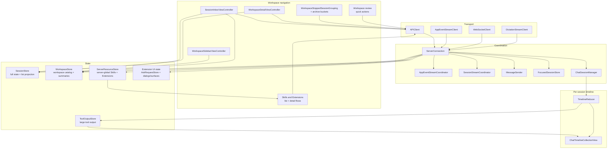

# Oppi client architecture

The Oppi Apple clients control and render server-owned and terminal-owned Pi sessions. They keep workspace navigation HTTP-first and reserve WebSockets for live streams. iOS paints the hot chat timeline with UIKit over authenticated HTTPS/WSS. Mac paints with AppKit and existing SwiftUI over the owner Unix socket.

## Audience and scope

Read this page before changing iOS or macOS client transport code, session and workspace stores, workspace navigation, chat timeline state, extension UI rendering, dictation, or media playback.

This page covers the Apple client structure. Server route, runtime, and storage details live in [Server architecture](architecture-server.md). For end-to-end LAN and paired HTTPS route selection, see [Networking and connection routing](networking.md).

## Detail map

This page keeps the rules that always apply. Read only the detail page for the area you are changing.

| Page | Covers |
| --- | --- |
| [Client blocks and shared core](architecture-client/blocks.md) | Client blocks; Shared Apple client core; Mac adapter path |
| [Transport and UI flows](architecture-client/flows.md) | Transport lanes; Workspace navigation flow; Focused session flow; Shared store updates; Extension UI on Apple |
| [Media, files, and sharing](architecture-client/media-files.md) | Media, files, and sharing |
| [Renderer change map and cleanup targets](architecture-client/change-map.md) | Renderer-addition change map; Client cleanup targets |
| [Where to look in code](architecture-client/code-map.md) | Where to look in code |

## Client responsibilities

The Apple client owns:

- paired-server credentials and endpoint selection,
- the global sessions inbox, workspace sidebar, server-global Skills and Extensions, workspace detail navigation, and focused-session navigation,
- focused session stream setup and recovery,
- app-event stream consumption and HTTP snapshot repair,
- per-session chat timeline state and rendering,
- extension UI sheets, ask cards, status rows, widgets, and native surfaces,
- voice input, audio playback, file previews, media playback, Quick Session intake, sharing, diagnostics, and settings.

The client does not execute Pi sessions or directly mutate server read models. It sends commands and renders the server projection.

## Client topology

The diagram below is the iOS HTTPS/WSS and UIKit composition. Mac uses the same `ChatSessionManager` and reducer core with owner-socket and AppKit/SwiftUI adapters; see [Mac adapter path](architecture-client/blocks.md#mac-adapter-path).

## UIKit and SwiftUI ownership

UIKit owns every iOS view and all app structure (decided 2026-10-15). The target is UIKit everywhere except the surfaces Apple requires in SwiftUI; the structure guard at the end of this section holds the ratchet.

### Rules (iOS, `clients/apple/Oppi`)

1. **New screens and views are UIKit.** Read `@Observable` stores in `updateProperties()` (iOS 26 observation tracking). Use `UICollectionView` list layout with content configurations for lists and settings, `navigationItem` bar items (set `visibilityPriority` and `axisBehavior` where the Duo's vertical bars matter), `UISheetPresentationController` for sheets, and `UIGlassEffect` for custom glass.
2. **Touched SwiftUI converts whole.** Work that changes a SwiftUI screen moves that whole screen to UIKit in the same work item, with behavior and accessibility-identifier parity, and the commit says so. Never put a UIKit view inside a SwiftUI screen. A SwiftUI leaf hosted inside a UIKit screen converts on its own, because that removes a seam. Untouched SwiftUI may wait for the next work that touches it.
3. **One router presents and pushes.** UIKit owns the window, split view, navigation stacks, and every sheet, full-screen cover, popover, and side panel, driven by `AppNavigation` through `Oppi/App/Router.swift` (`Oppi/App/HostFactory.swift` is its SwiftUI-facing half). UIKit screens use `Router.present` and `Router.push`, which take the theme from the presenter's app root, or a `RouterModalPresenter` slot whose request the screen sets in `updateProperties()`. `ModalPresentation` picks the style (`.sheet`, `.pageSheet`, `.fullScreen`, `.popover`, `.largeViewer(for:)`) and refines it (`.detents`, `.inNavigation`, `.arrowDirections`, `.keepsPopoverInCompactWidth`); `Router.selectSheetDetent` moves an open sheet. An iPad side panel is a `TrailingColumnController` column in regular width and a router sheet in compact width. A UIKit modal root that mirrors presenter state uses `RouterScreen.liveController(_:update:)`.
4. **Reuse the shared UIKit pieces** listed below before writing a new one.
5. **A list cell that changes its own layout must re-measure.** A collection view keeps the height it measured for a cell. The session lists set `selfSizingInvalidation = .enabledIncludingConstraints`, and a row that rearranges during layout invalidates its intrinsic size; otherwise its lines draw on top of each other.
6. **SwiftUI only where Apple requires it:** widgets, control widgets, Live Activities (`OppiControlWidget`, `OppiActivityExtension`), and App Intents UI.
7. **The structure guard enforces this** (below): no SwiftUI navigation or presentation constructs, no direct `UIHostingController`, and `import SwiftUI` counts only go down.

### Shared UIKit building blocks

- `IconChoiceUIView`: agent, workspace, and Pi icons (Quick Session, chat title, empty chat, sidebar).
- `IconPickerViewController`: the icon picker an Agent and a workspace share (`AgentIconPicker`, `WorkspaceIconPicker` are their adapters): an Emoji or Genmoji chooser over a searchable SF Symbol grid, presented with `ModalPresentation.iconPicker(for:)`. Its state is `IconPickerModel`; Save uploads a Genmoji, then commits.
- `InsetLabel`: pills and badges with insets and an optional capsule.
- `UIFont.scaled`, `UIFont.scaledMonospaced`, `UIImage.scaledSymbol`: the one Dynamic Type font and symbol helper.
- `WorkingSpinnerUIView`: the working spinner (timeline row, jump-to-bottom hint) for every spinner style.
- `PlainRowButton`, `ChangedFileRow`: a whole-row button and a changed-file row (context bar and Git panel, commit detail).
- `TerminalMirrorIndicatorUIView`: the pi-tui mirror mark (session rows, chat title).
- `HostSwitcherModel`: the single owner of the server list, connection retry, and switching.
- `ChangedRows` (`SettingsListStyle.swift`): reconfigure only the rows whose inputs changed, so an open menu survives a redraw.
- The settings kit (`Features/Settings`; rules in [Settings pages](#settings-pages)) and the catalog behind it (`OppiCore/Settings`: `SettingsCatalog`, `SettingValue`, `SettingsStore`): `SettingsListViewController` (the page base), `SettingsStyle`, `SettingsListStyle`, the declaration-driven rows (`SettingsDeclaredRows.swift`), and the row cells `SettingsIndexRowCell`, `SettingsMenuRowCell`, `SettingsActionRowCell`, `SettingsStateRowCell`, `SettingsSegmentedRowCell`, `SettingsSliderRowCell` (a stepped slider: title and percent over the slider, which is the one accessible element, whose frame is the whole row, and which VoiceOver moves one step at a time), and `SettingsEntryRowCell` (an entry you tap to edit: symbol, title, caption, no chevron; the page adds delete and reorder accessories). A disabled `SettingsIndexRowCell` row dims its title, drops the chevron, and says why in its value. `ScopedLockToggleRow.footer(for:)` is the one footer under a Server or Workspace Settings lock switch. `SettingsWorkPreviewCell` is the preview row under a caption (Chat's work strip and spinner, Text's sample fonts, Voice's mic). The App Settings root, Server Settings, General, Appearance, Text, Chat (and Top Bar and Quick Comments with its editor), Editor (and Keyboard Bar), Voice & Dictation, Dictation Dictionary, Privacy & Security, Experiments, Storage & About, Tailscale, Custom Themes, workspace Skills, Extensions, Details, Network Access and Sandbox MCP, the server's workspace list, MCP server detail, the Agent editor (Edit Agent and its tool, Skill, Extension, and workspace pages, and Pi's Tools page), and the Schedule editor (Edit Schedule and its time zone list) use the base; Workspace Settings and the SSH lists still carry their own list code and use the kit's cells and `SettingsListStyle`.
- `SettingsSelectionRowCell` (`Features/Settings`): the kit's row for picking things, a title with optional lines under it and a mark for chosen (a leading circle for a set, a trailing check for one choice), one overlay button as its accessibility element with the selected trait (the Agent editor's pages, the schedule time zone list). `ScheduleDateRowCell` and `ScheduleCronRowCell` are the schedule editor's date or time row and cron expression row. `SettingsTextViewRowCell` (`Features/Settings`) is the text row of a draft form (Edit Agent, Edit Schedule, the MCP add form): a growing editor, or with `singleLine` a name field that wraps at large text sizes, where a `UITextField` cannot and the accessibility audit flags it.
- `WorkspaceRowCell`, `detailToggleRow` (the kit switch row with a detail line), `WorkspaceTextEditorCell`, `WorkspaceIconRowCell`, `KeyboardContentInset` (`Features/Workspaces`): a workspace as one button row (its icon with the sandbox mark, name and lock, folder, optionally a description and the server's name: the Workspace Settings summary and the server's workspace list), a growing text editor row (Allowed Hosts, and Details' description and folder), the icon row that opens the icon picker, and the keyboard's bottom inset for a kit list that has text fields.
- `ThemeGalleryViewController`, `ThemeCardCell`: the theme gallery Appearance's Theme, Light Theme and Dark Theme rows push (`ThemeSlot` names which choice a row edits). Its own grid, not a list: one card per theme (`ThemeID.pickerThemes(matching:)`, Built-in then Imported), two columns in a wide container, drawn from `ThemeID.palette`, the palette the app paints with (built-ins are contrast-resolved by `ThemeContrast.resolve`; a custom theme keeps its JSON colors as written, and `CustomThemeStore.palette(name:)` does not adjust them). A card is one `SettingsRowButton` overlay (`settings.appearance.theme.<theme raw value>`) over decorative views, so a tap and VoiceOver activation choose the theme and the app re-themes with the gallery still open.
- `SessionListCollection`, `SessionListBottomBar`: both session lists' collection view, rows, swipes, menus, refresh, search, and bottom bar.
- `FloatingProgressPanel`: the floating progress panel (workspace list, review).
- `WorkspaceQuickActionLauncher`: start a session for a quick action and push its chat (context bar, commit detail, review file).
- `ServerCatalogServerRowCell`, `ServerCatalogServerMenu`: a server-global catalog list's selected-server row (passive, or one button that opens the server menu), the one menu builder (every paired server with the shown one checked, then Usage; a choice asks for the server's lock, then `switchToServerReady`, then runs the screen's own `onSwitched`). Extensions and MCP Servers use them; their loading, empty, and failed states are `SettingsStateRowCell`.
- `McpSignInPresenter`: presents the MCP sign-in sheet for `McpSignInOwner`'s attempt from whichever MCP screen is in the window (the list, or a server's detail that covers it), so one sheet is up and it closes with the owner.

### Remaining SwiftUI

- **Untouched for now:** Settings and admin screens (workspace settings' Dictionary page, and Server Settings' About This Server, Paired Devices, and Badge Icon pages, which the UIKit Server Settings page pushes through `ScreenNavigator.forUIKitScreen`), the thread detail, the full-screen reader's content router, debug and screenshot previews, and the session lists' Message capsule (`SessionInboxCompactComposeBar`, shared with the thread detail).
- **Framework-required:** the USDZ canvas (`USDZRealityCanvas`, the only SwiftUI in the USDZ preview), because RealityKit's `RealityView` is SwiftUI-only, and the Apple-required surfaces in rule 6. Its inputs are values (file URL, `USDZInspectPose`, a load-failure callback). `USDZSceneView` hosts it through `HostFactory.content` and owns the inspect gestures and accessibility; the inline card's chrome (`NativeMarkdownUSDZView`), the expanded scene (`FullScreenUSDZViewController`), and the file viewer's page are UIKit around it.

### HostFactory: the transitional seam

`OppiApp` publishes the app services as one `AppRootEnvironment` of stores, so a screen that captured it stays current. The scene sets it as a trait on its window; UIKit finds it with `HostFactory.root(near:)`, and a preview with its own fixture root uses `publishesAppRootToWindow`. `HostFactory` hosts the SwiftUI that remains: `HostFactory.screen` (a screen with the root, a `ScreenNavigator`, its `ScreenBars`, and the theme), and `HostFactory.content(_:root:)` (SwiftUI embedded in a UIKit view; pass the root). The App Lock cover is UIKit (`AppLockCoverViewController`, one per scene window from `AppLockCoverController`): it paints before the root exists, so it reads the theme from `ThemeRuntimeState` and the lock state from `AppLockService` alone. Never call `UIHostingController(` directly or hand-write an environment list. Presenter-local values go on the content explicitly (`withServerScopedEnvironment(connection)`, `presenterScope(connection:apiClient:navigation:)`). Hosted screens navigate through `@Environment(\.screenNavigator)` (`push`, `finish()`), present with `routerModal`, and search with `routerSearchable`. HostFactory shrinks as screens convert; no new work should need it.

### Gotchas while hosted SwiftUI remains

- **A missing required `@Environment(Type.self)` across a hosting seam crashes** (build 54 on the iOS app on Mac, `0ffdb2e5b`; the file viewer, `06d79f50c`). Host only through `HostFactory`.
- **SwiftUI navigation does nothing in a UIKit stack.** `NavigationLink` destinations lose the app environment, `navigationDestination` and value links do nothing, `.searchable` never reaches the UIKit bar, and `dismiss()` does nothing at a presented root. Use the navigator, `routerModal`, `routerSearchable`, and `finish()`.
- **Each hosted screen is its own SwiftUI graph.** A covered screen stops updating, so a `@Binding` into the presenter's `@State` goes stale. Share state through an `@Observable` model.
- **A covered presenter stops rendering**, so a modal that edits presenter state uses `.overFullScreen`, not `.fullScreen` (chat's Share in regular width, the expanded composer, composer pickers).
- **`routerModal` presents a run-loop turn late** (enforced in `RouterModalPresenter`) and only while the declaring view is in the window: declare it on a pushed page too. Pass a stored binding.
- **A router presentation ignores SwiftUI presentation modifiers.** Pass a `ModalPresentation` (`ModalPresentation.iconPicker`); `interactiveDismissDisabled` still reaches UIKit.
- **Search bars outlive their modal** unless ended: `Router.endSearch` runs on `finish()`, swipe-down, and trailing-column removal.
- **`ScreenNavigator.forUIKitScreen` is push-only.** `finish()` would pop the UIKit screen.
- **A preview nothing launches is deleted, not converted.** Previews use `RouterPreviewStack` or `RouterPreviewNavigation`; `scripts/screenshot-screen-guard.ts` fails when a test launches a screen no case serves.

### Chat composer

The composer is UIKit, including the action-row pills and their pickers, the Ask card, and the expanded composer (`ExpandedComposerViewController`); its bar is `ComposerBarController`, and the decisions it makes (what shows, the placeholder, the primary action, Ask paging) are `ComposerPolicy`. Every screen embeds it through `ChatComposerOwner` (`Oppi/Features/Chat/Composer/ChatComposerOwner.swift`), a child controller that owns `ComposerBarController`, the dictation-failure notice, the busy-mode tip, inline voice, focus and dictation requests, and the expanded composer, and reads the screen's draft and session state from a `ChatComposerSource` in its own `updateProperties()`; the owner measures the bar itself when its height changes (focus, the Ask slot, the busy-mode tip). The chat is one source. Quick Session (`QuickSessionViewController`, its state in `QuickSessionModel`) is the second `ChatComposerSource` on the same owner. The guided control-session composer (`GuidedControlComposerController`, its state and atomic launch in `GuidedControlComposerModel`) is another `ChatComposerSource` on the same owner: Agents, Schedules, and Custom Themes pin it above the keyboard, the detail pages of one thing pin it in its compact presentation, and the guided sheet (`GuidedControlSessionViewController`) holds it. The guided sheet is what Agents, Schedules, Custom Themes, the reviewable control Markdown screen (`ReviewableControlMarkdownViewController`, which passes its staged review comments), and the chat's Context panel (Edit with Oppi on an extension) present. No SwiftUI screen embeds the composer. The SSH terminal embeds `ComposerBarController` directly in a terminal configuration; one UIKit key-strip view serves the chat bar and the raw-keyboard accessory. The Ask card (`AskCardViewController`) sits in the composer's Ask slot at its natural height, capped; its rows scroll inside the card while Send / Ignore stay in its footer. The question's first plain paragraph is the title; the rest renders as Markdown through `AssistantMarkdownContentView` (the expanded sheet's renderer, `AskQuestionPreviewView`), clipped and faded to the height left under the cap so every option stays in view, whatever extension wrote the request. Its expanded sheet and the expanded composer are UIKit view controllers presented through the router; the extension editor dialog is the expanded composer in an editor configuration. Presentations from the composer go through the router or UIKit, never SwiftUI `.sheet`. Suggestion lists are a UIKit collection view fed by `FileSuggestionRanker` / `ComposerAutocomplete.slashSuggestions`; the view does not re-rank.

### Live Voice calls

A Live Voice call belongs to the app, not to a chat. `LiveVoiceCallCenter` (`Oppi/Features/LiveVoice/`, held as `AppRootEnvironment.liveVoiceCalls`) holds at most one `LiveVoiceCallController`, keyed by server id and session id. Every call starts through the center's `startCall` (the chat's Live Voice tap, and a Quick Session's pending call, which opens the chat and taps it). It places the call (`placeCall`) and marks it starting (`LiveVoiceCallController.isStarting`) before it returns, so from the tap the call holds the microphone and shows Connecting and a second tap is refused; then, in order, it checks microphone access, stops read-aloud and any dictation take (`prepareStart`; a denied permission or an End meanwhile stops here, with no system call), starts the system call, and opens the server call. A chat reads the call back (`call(serverId:sessionId:)`) to draw the composer's call surface, so leaving the chat (back to a list, another session, a stack/split swap, a lock cover) never detaches or ends the call, and the session's next chat shows the same call. Only End, the server ending it (a deleted session), or a dead link end a call. The call rides its own WebSocket (`ServerConnection.makeLiveVoiceWebSocketClient`), which the connection does not track, so focus changes and server switches leave it alone. A live or starting call owns the one microphone app-wide (`ownsMicrophone`): `VoiceInputManager` refuses to start dictation anywhere, the chat, expanded, and SSH terminal composers and the Ask card's full-screen view (the inline card has no mic) hide their mic (`ComposerShared.dictation`; the Ask card takes the chat composer's value and its full-screen view copies it when it opens, so one already open when the call starts keeps a mic, which refuses, and one opened during a call has none until it is reopened; the review-comment draft, HTML element picker, and the SwiftUI thread detail's Message capsule still show one, which refuses; the UIKit session lists drop their Message capsule's mic and the rail's Dictate, from `LiveVoiceCallCenter.ownsMicrophone` read in their bar pass), a call's start cancels a dictation take still running (`ComposerShared.stopDictationBeforeLiveVoice`, before the system call, because cancelling a take deactivates the audio session), and read-aloud stays quiet because the call holds the process-wide capture claim (`AudioPlayerService.beginProcessCaptureInterruption`). `callStart(serverId:sessionId:)` is the single policy for a new call, and a live or starting call counts: `.available` with none (a failed one is replaced), `.onThisCall` for the call's own session (no entry; its composer is the call), and `.endsCall(key)` while another session has it. The call stays bound to its session while the person chats elsewhere: another session's composer keeps typing and sending, and since its mic is gone, the mic slot itself becomes its Live Voice entry (`chat.liveVoice.start`), which asks "End the call in “A” and start one here?"; End & Call runs `replaceCall`, which ends the current call (a starting one too), waits for it, then goes through `startCall`, so the new call is a system call like any other; `placeCall` never takes over a live call. Quick Session, whose session does not exist yet, does not offer End & Call: it hides its Live Voice entry while a call is live, and a requested start (the Live Voice control, a Shortcut) says to end the call first. The controller's `connectedAt` is when the server first confirmed the call (kept through a reconnect, cleared on end or failure): the strip's duration counts from it. Removing a server ends its call first (`ConnectionCoordinator.removeServer` → `endCall(serverId:)`), and a call replaced while its End waits for the server's confirmation is kept until that end goes out. A chat that mounts while its session's call holds the composer sets its draft aside as the starting chat did (`ChatComposerDraftController.setAsideMessage`); the store keeps the pre-call draft untouched during the call, so no pre-call draft is lost, though unsent text typed during the call in a chat that is torn down is not kept. `currentCall` is what the call strip reads.

The call is also a CallKit call. `LiveVoiceSystemCall` (`Features/LiveVoice/LiveVoiceSystemCall.swift`, the center's `systemCall`, created in `OppiApp.init`) owns the app's one `CXProvider` (made on the first call; one audio-only call, generic handle, `includesCallsInRecents = false`, the app's display name as the provider name) behind the `LiveVoiceTelephony` seam. `startCall` goes through it once `prepareStart` passes: it requests a `CXStartCallAction`, then starts the controller's call unless the system ended the call or End was pressed during the request; the system shows it connecting when it performs the start and connected (`reportOutgoingCall(with:connectedAt:)`) once the controller's `callState?.lifecycle` is `.active`. The system UI's name is the session's title, or "Live Voice" while `ScopedLockService.hidesContentOutsideApp` covers the session (the same rule as notifications and Live Activities), re-read as the title or locks change; nothing else about the session goes to CallKit. When CallKit refuses the start (another call, a policy, the Simulator, which has no call service, so `CallKitLiveVoiceTelephony.make()` returns nil there), the call starts anyway without it, logged as `Call starts without CallKit`, and its audio activates and deactivates the session itself as before. Both sides drive each other: the system's End (`CXEndCallAction`) ends the app's call; the app's End (and the end a removed server or an End before confirmation makes) requests an end action, so a retiring controller leaves no system call; a call the server ended is reported as `.remoteEnded`, a failed or dropped one as `.failed`, and `providerDidReset` ends the app's call. Every `CXSetMutedCallAction` the system performs is the call's mute, whoever asked: its UI, a headset or AirPods gesture, or the app, whose mute requests the action only when it differs from the system's last mute, so the app's own request lands as a no-op and crossing requests settle on the last one performed, on both sides. Audio follows CallKit's rules: the category is set when the system performs the start action (and the provider's configuration is set again before each start, which hands callservicesd a current audio session ID), and for a system call the controller runs capture and playback only between `provider(_:didActivate:)` and `didDeactivate`, never calling `setActive` itself. If the system has not activated the session 5 seconds after it performed the start or unheld the call (a held call waits without a deadline; callservicesd holding a stale session ID; DTS says only an app restart clears it), the call fails with that reason on the call surface (kept there through a late server confirmation, until End), ends on the server, and is reported `.failed`, instead of staying live and silent. `CXSetHeldCallAction` (a phone call answered over the call) stops the mic and playback (`LiveVoiceAudioOwning.suspend`, which keeps the call's claim on the app's audio) and shows On Hold; the server call and its keepalive go on, and unhold with the session back resumes capture. `UIBackgroundModes` declares `voip` for the CallKit call, so the app keeps running while a held call has no audio.

Barge-in is local first. `LiveVoiceBargeInDetector` runs on every voice-processed 16 kHz mic buffer while a reply plays. Tap buffers are 64–100 ms, longer than a pause between syllables, so it judges each buffer in 20 ms windows. It compares each window's RMS level with the reply's level at the player (`LiveVoiceAudioMeter.playbackDBFS`). A window counts as the caller only when it is above an absolute floor and no more than an echo margin below the reply. The detector fires after sustained speech, never in the first moments of a reply, at most once per reply, and never while muted (in the app or through the system call) or on hold. Apple's voice-processing speech-activity listener reports speech only while the input is muted, so it cannot do this job. When the detector fires, the controller stops playback at once and sends `voice_call_barge_in` with a fresh `requestId`. It then drops inbound call audio until that request's `command_result` arrives. The server cancels the reply before it sends the result on the same socket, so in the server's send order every frame after the result is new speech. On the phone, binary frames reach `onInboundAudio` directly while the result goes through the JSON message stream, so a few frames sent right after the result can arrive while the gate is still closed and be dropped. In practice that loses nothing, because the next reply starts later. If the server refuses the barge-in (a stale lease, or a server without the message), the interrupted reply keeps streaming. The phone keeps dropping it until the stream has been quiet for `LiveVoicePlaybackScheduler.replyGap`, rather than resuming mid-sentence. A new socket, hold, or the call ending also clears the gate. A changed non-empty partial transcript also stops playback: the server sends one when its own speech detector or the transcript hears the caller first. All three paths, and how they avoid acting twice on the same speech, are described in [Barge-in](architecture-server.md#barge-in). The thresholds are named constants in the detector and are logged at each fire (`Barge-in`) and at call end (`Barge-in summary`) for tuning on devices.

The call strip (`LiveVoiceCallStripController` and `LiveVoiceCallStripView`, `Features/LiveVoice/`) is that surface: one strip under the status bar, owned once by `WorkspaceShellController`, which sets the strip's height as `additionalSafeAreaInsets.top` on the mounted layout and the server lock cover, so every screen under it (lists, Settings, Files, a terminal, another session's chat, a split's columns) moves down instead of being covered, and sheets present over it. `LiveVoiceCallStripContent.make` decides what it shows: nothing without a call, nothing while a chat on the call's session is on screen (`LiveVoiceCallCenter.shownChats`, which each `ChatViewController` updates as it appears and disappears, so a page pushed over the call's chat brings the strip back), else the session's title ("Live Voice" while a server, workspace, or session lock covers it), the call's `composerStatus` with "Muted" spelled out, the duration from `connectedAt`, and for a failed call its reason until End dismisses it. The strip body reopens the session through `AppOpener` (`.session`, in-app origin), so a server switch and a lock prompt work as for any open; Mute, the audio route (`AVRoutePickerView`), and End act on the call. VoiceOver reads the duration only from the open control's value when it lands there; the visible clock ticks once a second only while a connected call shows. A session list row whose session has the live call carries a call badge (`SessionRowCallBadge`, from `LiveVoiceCallCenter.rowBadge`): a green phone, or an orange crossed-out mic while muted, spoken with the row.

### Push discovery card

`PushDiscovery` (`Oppi/Core/Push`) holds one stage per server in `UserDefaults.standard`: due (`ready`) after the first session finishes or needs input (`ServerConnection.notePushDiscoveryMoment`, called where a running session settles, where an app event reports a background session settled, and where an ask or extension dialog arrives), and `closed` once the person dismissed the card or push registered. `SessionInboxViewController` shows `PushDiscoveryCardConfiguration` while the stage is `ready`, the server advertises a relay, this build can register (`PushDiscovery.isPushAvailable`), and push is off. Turn On runs `PushEnableFlow`: the Server Settings relay disclosure (`ServerNotificationsSection.Consent`) and `PushRegistration.enable`. The card's progress is kept with the server it belongs to, so switching servers never shows another server's turn-on.

### The shell

A UIKit scene (`SceneDelegate`, `Oppi/App/AppDelegate.swift`) owns the window; `OppiApp` holds the services, launch, and scene phases, and every open (scene URLs, notification responses, Siri and system controls, resource and file links) is one `AppOpenRequest` delivered to the window's `AppOpener`, which waits for App Lock, launch, a scoped lock, and the target server before it drives `AppNavigation`. `AppRootViewController` applies the theme to the window and shows the launch backdrop, onboarding, or the workspace shell, above the SwiftUI `AppRootLayer` (app-wide modals, workspace creation the shell starts). Quick Session is a UIKit controller (`QuickSessionViewController`) that `QuickSessionPresentation` mounts above the content while `AppNavigation.showQuickSession` is set: it hosts the Quick Session start `AppOpener` delivers once the shell is up, makes the content under it inert to touch and VoiceOver, and on dismissal opens the session a launch created and returns VoiceOver focus to the control that opened it. Its workspace and worktree pickers are UIKit popovers on their pills; the model picker is the shared UIKit `ModelPickerViewController` (the chat, Guided Control, and the Agent and Schedule editors present it too, with the presenter's server passed in; it owns its bar and `UISearchController`). `WorkspaceShellController` measures the window and mounts the compact stack with its workspace drawer or a `UISplitViewController`: a fold or resize first converts `AppNavigation`'s routes for the new layout, then mounts it from them, so the stacks rebuild where the user was. `AppNavigation` is the single source of truth for every stack. `ShellNavigationController` (`Oppi/App/ShellRouter.swift`) shows exactly the routes it is given, keeps the screens that stay, and reports the user's pops back (`popWorkspaceStack(toDepth:)`, `popSplitDetail(toDepth:)`). `ShellRouteScreens` (`Oppi/App/WorkspaceShellRoutes.swift`) makes each route's screen: All Sessions (`SessionInboxViewController`), the workspace sidebar (`WorkspaceSidebarViewController`, also the compact drawer), a workspace's sessions (`WorkspaceDetailViewController`), a session (`ChatRouteViewController`: its lock gate and server connection, then `ChatViewController`), Files (`FileBrowserViewController`: its lock gate and server connection, then a folder's list, or in regular width the folder tree beside the open file), a linked file (`WorkspaceLinkedFileViewController`: its lock gate and server connection, then the file viewer `FileViewerViewController`), Skills (`ServerSkillsViewController`) with a Skill's page (`ServerSkillDetailViewController`), its file browser (`ServerSkillBrowserViewController`), and a Skill file (`ServerSkillFileViewController`), Extensions (`ServerExtensionsViewController`) and an Extension's detail (`ServerExtensionDetailViewController`), SSH Terminal's host list (`SSHTerminalHostListViewController`), Schedules (`ScheduleListViewController`), Agents (`AgentListViewController`), MCP Servers (`McpServersViewController`), Server Metrics (`ServerMetricsViewController`: follows the visible server through the host switcher), Server Settings (`ServerSettingsRouteViewController`, below), and Workspace Settings (`WorkspaceSettingsViewController`: its lock gate and server connection, then the list) are UIKit controllers mounted directly, which take a refreshed route through `ShellRouteScreens.update` without being rebuilt; every other route is a `ShellRouteView` hosted with `HostFactory.screen`. The two session lists (All Sessions and a workspace's sessions) share their UIKit pieces (`SessionListCollection.swift`: the `SessionListCollection` that owns the collection view, its diffable snapshot, the cells and headers, and row taps, swipes, and the long-press menu; row values; the search bar binding; Stop, Resume, and Delete requests; alerts; bar items, the Message and Now Playing controls (`SessionListBottomBar`), and the server switcher) and draw each row as a UIKit cell (`SessionListEntryConfiguration`: `SessionRowView`, then the Thread strip or `In thread` link); the Session Rows settings page previews the same `SessionRowView`. The server switcher's rows and actions have one owner, `HostSwitcherModel`, which the UIKit screens' UIMenu (`SessionListServerSwitcher`: the session lists, Model Providers, Server Metrics, Server Settings) and the SwiftUI `HostSwitcherMenu` of Usage both draw. The lists' Message capsule is still the hosted SwiftUI `SessionInboxCompactComposeBar`, which the SwiftUI thread detail shares. Server Settings pins each page to one server: `ServerSettingsRouteViewController` resolves the visible server (`ServerSelection.resolveVisible`: the active server, else the one the route opened for) and embeds that server's `ServerSettingsViewController`, whose `SettingsStore`, `ServerSettingsModel`, Notifications controller, bar switcher, and every action closure belong to that server and never follow a switch. When the visible server changes (the page's own switcher, or the sidebar's on iPad), the route closes the pages that page pushed (About This Server, Paired Devices, Badge Icon, Workspaces, Dictation Dictionary: pinned to the old server too, tracked by the page) and replaces it, but never a routed screen above it, so Model Providers keeps a provider sign-in across a switch made from its own switcher; a response that arrives after the switch settles into the old page's model and nothing else. The route tracks the selection itself, because a page pushed above it hides its view and a hidden view's `updateProperties()` does not run. Remove Server removes the pinned server, and the route closes without giving the server the removal makes active a page. A screen opens a route by calling `AppNavigation` (`openWorkspace`, `openWorkspaceSession`, `openWorkspaceFileBrowser`, ...). A page that exists only above the screen that opened it (a fork, a quick-action chat, a host file, an agent's or schedule's detail, the SSH terminal) pushes with `ScreenNavigator.push` and stays above that screen until a route below it changes; a push asked for while a pop animates waits for it to finish. A pushed page whose presenter must react to it closing reports that itself: the SSH terminal clears `showsTerminal` when it leaves and pops itself when the session stops showing it, and Pi's Tools page saves through the observable model it edits when it closes. `finish()` at the split detail root shows the column's list. Every route is hosted directly in its UIKit stack, with the UIKit bar and back swipe.

**Mac (`clients/apple/OppiMac`)**

New Mac views are AppKit by default. Existing SwiftUI Mac code stays until a separate migration decision. The AGENTS.md rule still holds: a feature does not touch the Mac app unless the request names Mac, macOS, desktop, or OppiMac.

**OppiCore** stays UI-framework-free.

**Structure guard.** `scripts/uikit-structure-guard.ts` scans `clients/apple/Oppi/**/*.swift` and the Debug-only `clients/apple/OppiDebugHarness/**/*.swift` (harnesses and screenshot previews; see `dev/testing/apple.md`, "Debug harnesses") after stripping comments and string literals. `NavigationStack`, `NavigationSplitView`, `NavigationLink`, `.navigationDestination(`, `.sheet(`, `.fullScreenCover(`, `.popover(`, `.inspector(`, `UIHostingController(`, and `UIHostingController<` (a subclass or stored type) are disallowed in every file, previews and harnesses included; the only exception is `HostFactory.swift`'s two hosting controllers (`HostedScreenController`, `HostedContentController`), a commented entry in the guard's `allowed` list, and another would need Chen's approval. `import SwiftUI` is a ratchet: a file fails when its count exceeds `scripts/uikit-structure-baseline.json`; new files have baseline 0 and decreases pass. Lowering the baseline after a migration is expected: run `bun scripts/uikit-structure-guard.ts --update` and commit the reduced baseline with the migration. Renaming or moving a file keeps its count, so `--update` after a rename is fine when the baseline diff only moves entries. Ordinary runs never write the baseline.

### The chat bar and the SSH terminal

`ChatBarItems` (`Oppi/Features/Chat/ChatViewController+Bars.swift`) owns the chat's bar in both shapes: Back leading; the chosen buttons and a … menu trailing on a horizontal bar, the same controls one per position on the Duo's vertical rail. The buttons and their order come from `AppPreferences.ChatTopBar` as a `ChatTopBarLayout` (`Support/ChatTopBarActions.swift`): every one of Files, Git, Outline, Context, and Terminal has a place in `order`, and the ones in `shown` are drawn in the bar while the rest are offered in the … menu, also in that order; the default (no stored layout; only the Top Bar page's switches and drags write one, so a stored layout is always a person's choice and is kept as saved) shows only Context, with Files, Git, Outline, and Terminal in the overflow menu, and a chat on the default bar with a workspace shows the one-time `FeatureEducationTips.topBarMoreTools` hint under the bar (`ChatViewController.updateTopBarTip`; opening the overflow menu or the Top Bar page completes it). A stored layout missing an action (one saved before Git) gets it appended to `order` and not shown, so it keeps its bar and offers the newcomer in the … menu. Git opens the chat's Git panel (`GitPanelViewController`), a side panel like Outline and Context: it hosts `WorkspaceContextBarView` (the panel's whole content: a summary header over a table of files and the commit graph, no card or outer padding) with `Options.pushChat`, so a session started from it closes the panel and pushes onto the chat's stack, and there is no Git strip over the timeline. `ContextBarScoping` decides what the bar lists: a session in its own worktree (`worktreeId` set and not `WorkspaceWorktree.mainId`) lists the whole Git status; a main-checkout session lists its `changeStats.changedFiles` (This session) with a switch to the whole status (All changes), panel state only. The Git bar button's accessibility value and count badge (bar only, not the rail) come from the same scoping with This session, and every Git read in the chat (availability, badge, value, menu glance, panel) goes through `ChatViewController.loadedGitStatus`, which asks `GitStatusStore.status(workspaceId:worktreeId:)` so another checkout's status in the shared store never shows. The horizontal bar's Git button is `GitBarButton` (`Support/GitBarButton.swift`), shared with the workspace screen. Every trailing control in the chat bar, the ring included, takes one 38 pt wide, 44 pt tall slot with no spacing between slots, so the icons sit on one even pitch however many are shown (wider slots squeeze the session title out of an iPhone bar with four buttons); the Git logo and its count (at most "99+", tucked into the diamond's empty corner) are centered in the slot together, and only an accessibility text size widens it. The selected platter is a 36 pt circle in the slot. The workspace screen (`WorkspaceDetailViewController+Chrome.swift`) has no Git strip over its list either: its bar puts a Git button (`workspace.git.open`) before Terminal and Config in both shapes, offered by the same `ChatBarItems.mayOfferGit`, counting the selected worktree's changed files from `GitStatusStore.status(workspaceId:worktreeId:)`, and opening the same `GitPanelViewController` as a sheet whose New Session closes it and pushes onto the workspace stack. While a panel is open in the trailing column its button shows as selected: the bar's glass draws control content in one color, so a tint alone is invisible; the selected state is a platter behind the icon (and `ContextUsageRingButton.isSelected`), the selected accessibility trait, and on the rail the item's `isSelected`. The context ring is not a fixed control: `.context` is a bar position like the others, drawn by `ContextUsageRingButton` in the bar and by its rail item on the Duo, and its … menu item carries the usage percent on its label's line. Every hidden action's menu item does the same with its button's glance (`ChatBarItems.menuTitle`; Git: lines added and removed, or the changed-file count when there are no line counts, and commits ahead of and behind upstream, kept short so an iPhone menu does not wrap it), not as a subtitle, so the icon stays beside the label. `ChatBarItems.runTopBarAction` is the one owner of what a button does, so a bar button, a rail item, a menu item, and accessibility activation are the same path. Availability is a set, not a decision inside the bar: a chat with no workspace offers no Files, Git, or Terminal, Git also needs a workspace that may be a repository (`ChatBarItems.mayOfferGit`: not with Git status off or a loaded status that says it is none; kept while unknown), an empty timeline offers no Outline, and Terminal needs a workspace folder a shell can start in (`SSHTerminalFolderTarget.workspace(_:)`: not a sandbox workspace, not a relative mount). `ChatTopBarLayout.bar(available:)` and `menu(available:)` drop what cannot be offered instead of borrowing another button's place, so a button the user showed never leaves the bar looking like a different one. While a folder lookup runs, the Terminal control is disabled and says Opening…, so one tap cannot push two screens. Settings → Chat is `SettingsChatViewController`, a UIKit collection-view page (its previews are the real timeline views, in `SettingsWorkPreviewCell`) whose Top Bar row pushes `SettingsChatTopBarViewController`, a UIKit list with one switch per button and reorder handles, in editing mode so the handles are always there; A switch and a drag both write through `AppPreferences.ChatTopBar.setLayout`, and the chats read the change through `AppPreferences.ChatTopBar.didChangeNotification`; the Chat page's Top Bar row observes the same notification, so its summary follows an edit made on the pushed page. The … menu is built once and resolves its hidden actions through `UIDeferredMenuElement.uncached`, so a pass that changes the bar never re-attaches the menu its owner is holding.

A workspace's bar has its own Terminal item (`workspace.terminal.open`, beside Config in both shapes) and both entry points end at `SSHTerminalFolderEntry.open`, which needs the paired server's host and a folder it can resolve (an absolute path, or the server's `~` form, expanded on the host). It matches saved hosts with `SSHTerminalHostMatch` (case-insensitive, trailing dot ignored) and takes them in this order: an exact host name, then a bare short name matched against its FQDN; within one kind, a host whose Run on Connect command starts a multiplexer comes before one with no command, then one running anything else, then the first saved. It pushes `SSHTerminalFolderViewController` to connect, or pushes the Add Host form prefilled with the server's host and nothing invented for the username, which continues into the folder terminal once saved. Where the folder opens is the host's Run on Connect command's first word, matched by name (`SSHTerminalMultiplexerKind.detected(in:)`: `herdr`, `/Users/me/.local/bin/herdr`, `herdr --attach` are Herdr; `tmux`, `tmux new -A -s main` are tmux; anything else or nothing is no multiplexer, and the folder terminal is the plain login shell it always was). Two placements cover both, so a new multiplexer is one more case in the kind and one more type conforming to `SSHTerminalMultiplexer`, never a second copy of the flow: `.hostTerminal` reuses the host's own terminal — the one its Run on Connect command opened — and drives the multiplexer over that terminal's side exec channel (`HerdrMultiplexer`: read the host's `$HOME` and the folder's physical path (`pwd -P`) and `herdr api snapshot` in one side command, focus the workspace that already has a pane whose cwd is the folder in either spelling, else `herdr workspace create --cwd … --label … --focus`, or `herdr worktree open --path … --label … --focus` for a chat's git worktree); `.folderTerminal` starts a terminal of its own for the folder, whose command is the multiplexer's attach command (`TmuxMultiplexer`: `tmux new -A -s <session> -c <folder>`, the session named after the workspace and worktree plus a stable folder hash, with `.` and `:` — tmux target syntax — replaced by `-` and `#` doubled so tmux keeps it literal; the command enters the folder itself instead of passing `-c`, because tmux expands formats in its arguments and starts in the home folder when it cannot enter the one it was given). `SSHTerminalFolderEntry.prepare(session:profile:target:)` is the one place that turns a target and a profile into those three cases, and both the folder screen and the Add Host form go through it. Nothing is typed into a running program: a `.hostTerminal` open runs only CLI calls, and its refusal shows as a terminal notice while the person stays in the host's terminal. A Herdr focus moves the Herdr session's focus, so other clients attached to that session follow it. `SSHTerminalRegistry` keys terminals by `SSHTerminalIdentity` — `(profileID, folder)` — so a tmux folder terminal and the host's own terminal (login shell or Run on Connect) coexist, and editing or deleting the host still ends every terminal of that host, and so does the background grace. A `.hostTerminal` folder therefore lands in the host's existing terminal rather than a second one. `SSHTerminalConnectSession.folder` makes the remote command `SSHTerminalFolderCommand.command(folder:)`, or `folderTerminalCommand` when the multiplexer supplies one: `sh -c` with the script as one quoted word, which changes directory, reports a missing folder and exits non-zero instead of opening a shell elsewhere, then `exec`s the remote login shell so fish, zsh, and bash all work. The folder is never shell code: the *remote login shell* parses that word first, and fish reads `\'` inside single quotes as an escaped quote, so the word contains no `'`, `\'`, or `\\`. `SSHTerminalRemoteShell` owns that rule for every command the folder flow generates — the plain shell, the tmux attach, and Herdr's create and worktree calls: `octalEncoded` turns every byte of a value into `\NNN` and the inner `sh` rebuilds it with `printf` into a variable; surrounding whitespace is trimmed the way the server resolves a mount, so a folder ending in a newline opens the trimmed folder, and a sentinel byte plus `${p%x}` keeps command substitution from eating a trailing newline a caller might pass. The `~` form becomes `"$HOME"/"$(printf …)"`, and Herdr, whose CLI takes a path, gets the absolute path built from that same `$HOME`.

Terminal colors come from the host's Ghostty config. `SSHTerminalColorLoader` (`Features/SSHTerminal/SSHTerminalColors.swift`) runs three bounded side commands from `SSHTerminalGhosttyRemote` (config files with one level of `config-file`, one theme file by name or path, the theme list), each one `SSHTerminalRemoteShell.word` with the theme name octal-encoded; `SSHTerminalGhosttyConfig` parses only the color keys on the device, with byte, line, and line-length caps, and the config's explicit values overlay the theme file's. The per-host choice (host theme, Oppi theme, or a named theme) and the last read live in `SSHTerminalColorStore` (`Core/Networking`), keyed by host id and kept out of `SSHTerminalProfile` so a color change never reconciles or closes an open terminal. The terminal view controller reads the choice from the store, seeds the loader from the cache so the first frame is already colored, and refreshes over the side channel on each connect and when the app's light/dark appearance changes; `SSHTerminalGridView.applyTheme(_:colors:)` (`Features/SSHTerminal/SSHTerminalSurface.swift`) hands the palette, default colors, and cursor to libghostty (`SSHTerminalEngine.setColors`) and the selection color to the selection overlay, so programs' OSC 4/10/11 changes still land on top.

## Settings pages

A UIKit settings page is built from the settings kit in `clients/apple/Oppi/Features/Settings`. The kit standardizes the look, the row kinds, the states, and where a setting is saved. A setting that is declared in the catalog ([below](#the-catalog-and-the-store)) is read and written by `SettingsStore` through rows drawn from its declaration; a page keeps its own data only for what the catalog does not declare yet, reads it in `sections()`, and saves it itself. `scripts/uikit-structure-guard.ts` counts `SettingsListStyle.pin(`, `SettingsListStyle.applyTheme(`, and a hand-built `UICollectionLayoutListConfiguration(appearance: .insetGrouped)` (in a file that also paints the theme's background itself or calls `SettingsListStyle`) as a ratchet (`scripts/uikit-structure-baseline.json`): a settings list that pins, themes, or lays itself out is a page that should subclass the base, and the count only goes down. The base, `SettingsListStyle.swift`, and the screens in the guard's `settingsThemingExceptions` (each with a reason: onboarding's manual entry, the share-redaction sheet, the theme gallery's grid, the icon picker's symbol grid, four chat panels, and two SSH terminal screens) are exempt. The layout check does not see a list built another way. A new settings page subclasses `SettingsListViewController` and uses none of them. A page that edits text in place passes `endsAtKeyboard: true` to the base (or to `SettingsListStyle.pin`), so its list ends at the keyboard and the field scrolls above it.

### The pieces

- **`SettingsListViewController<Section, Item>`** (the page base): a themed inset-grouped list whose own background is clear, so the theme's `bg` shows behind the cards. It pins the list at the readable form width, repaints on a theme change, redraws only the rows whose `inputs(of:)` changed, refreshes when the page comes back on screen, and redraws section headers and footers in place. A page gives `title`, `listIdentifier` (`settings.<page>.list`), and `scope`, and overrides `sections()` (it runs inside `updateProperties()`, so every `@Observable` store it reads re-runs the page), `inputs(of:)`, `configure(_:item:)` or `dequeue(_:at:)`, `isSelectable(_:)`/`select(_:)`, and where needed `copyText(of:)`, `trailingSwipeActions(for:)`, and `decorate(header:section:)`/`decorate(footer:section:)`. Editing pages (reorder handles) set `collectionView.isEditing` and the data source's `reorderingHandlers` in `viewDidLoad()`; a drag stays inside its section.
- **`SettingsStyle`** (`SettingsListStyle.swift`): the tokens a page draws with. Title is the theme `fg`, value is `comment`, accent is `blue`, destructive is `red`, warning is `orange`, and page is `bg`. The card is the theme's `bgHighlight` in a dark theme, so a card reads as a surface on that theme's page (the system card sat at a 1.01 contrast ratio on Dark); a light theme keeps the system white card, and so does a dark theme whose `bgHighlight` is under a 1.08 contrast ratio against its `bg`. Every settings list paints its cards in one place: build the data source with `SettingsListStyle.cardProvider` (the base does; so do the SSH lists, Preflight, and Workspace Settings), which gives each cell `SettingsStyle.cardBackground(for:)`, the system list-cell background with only the resting color replaced, so the pressed look survives. A cell that already has its own background handler keeps it. `content(_:)` on the base (and `SettingsStyle.content(_:)`) returns a prefilled `UIListContentConfiguration`: `.plain`, `.info`, or `.subtitle`.
- **`SettingsScope`** (`OppiCore/Settings`) and `SettingsSectionModel.scope` (below).
- **Declared rows** (`SettingsDeclaredRows.swift`, an extension of the base): `settingToggleRow` and `settingChoiceRow` draw a declaration's row from the page's `settings` store; `settingRows`, `settingInputs`, and `dequeueSettingFailure` put the row, its redraw inputs, and its failure line in the page's `sections()`, `inputs(of:)`, and `dequeue(_:at:)`.
- **`SettingsListStyle`**: `pin` and `applyTheme` (the base calls them; a list that is not on the base still does), `layoutConfiguration(headers:footers:)` (a clear-background list layout), the `settingsToggle` and `settingsPopUpMenu` cell accessories, and `ChangedRows`.

### Row kinds

Pick the row kind by what the row does, not by how it looks.

| Kind | Use it for | Built with |
|---|---|---|
| Navigate | Opens another page. Title, optional accent symbol, optional value, chevron. The value sits beside the title when both fit on a line, and under it when they do not (a long summary, or a large text size). | `SettingsIndexRowCell` |
| Choice | Picks one of a few values. The whole row is a menu button showing the current choice. A disabled row shows its choice and cannot open. | A declared setting: `settingChoiceRow` (a `SettingsMenuRowCell` filled from the declaration and the store). Any other choice: `SettingsMenuRowCell` directly. |
| Toggle | An on/off setting. | A declared setting: `settingToggleRow(_:_:)` on the base. Any other switch (a draft's field, a reorder list's visibility): `toggleRow(_:title:isOn:identifier:onChange:)` (a plain cell plus `.settingsToggle`), which the settings-write guard counts. |
| Action | Does something now: connect, copy, save, remove, delete. Accent or destructive tint, optional symbol, optional spinner while it runs, optional confirmation (an alert, or an action sheet that anchors to the row as a popover on iPad). | `SettingsActionRowCell` |
| State | A list that is loading, empty, or failed: `.loading(text)`, `.message(text)`, `.failure(text, retry:)`. One style; "Retry" is the one retry label. | `SettingsStateRowCell` |
| Info | A read-only fact. Long press copies its value through `copyText(of:)`. | `content(.info)` in a plain cell |

`SettingsSegmentedRowCell` is the exception for a choice: use it only where the choice reshapes a live preview on the same page (Chat's Style and Work Strip). Every other choice is a menu row, whatever the number of options.

The row cells that carry one control (index, menu, action, state) share one pattern: their own labels paint the row, an overlay `SettingsRowButton` is the row's only accessibility element and carries the identifier, and `setTapAction` sets its action. VoiceOver activates that button, so the cell has no activation override of its own. A `contentConfiguration` cell cannot do this: XCUITest types it as a Cell, so `app.buttons[id]` would not find it. Peer and step rows of the Tailscale and SSH setup lists (`SetupRowCell`) keep their own vocabulary: several lines, a badge or a spinner, and an inline button.

### One title colour

A row title is the theme `fg`. A page never picks `.label`, `secondaryLabel`, or a one-off color for a title; use `content(_:)`, the kit cells (they read `SettingsStyle`), or `SettingsStyle.current.title`. A value is `comment`, an action is `blue` (or `red` when destructive), and a problem the person can still fix is `orange`.

### Scope sentences

`SettingsScope` says where a setting is kept:

| Scope | Sentence a differing section shows |
|---|---|
| `device` | "Saved on this device." |
| `server(name)` | "Applies to every device on <server>." |
| `workspace(name)` | "Applies to this workspace." |
| `deviceOnServer(name)` | "For this device, kept on <server>." |

Every page declares its default scope in `init` (a page of declared settings takes it from their `SettingStorage`). A section whose `scope:` differs from the page's gets that one sentence in front of its footer (`SettingsScope.footer(_:scope:pageScope:)`); a section with no `scope:`, or the page's own, shows only its footer. No badges or icons. Say a scope only where a page really mixes scopes; do not tag every section. A page that does needs `footers: true`. The sentence always says "this device", never "this iPhone" or "this iPad".

### Saving

- **A single control saves immediately.** A switch, a menu, or a segmented control writes its value when it changes; the page asks for a redraw (`setNeedsUpdateProperties()`) if the store is not observable.
- **Save/Cancel drafts** only for fields that validate together (a host form, a workspace's details) or for heavy, visible saves. A draft page validates before it saves and shows why a save was refused.
- **A server save** shows the new value disabled while it is in flight, reverts to the previous value with the reason if it fails, and reloads the server's value on a 409 conflict. A declared setting gets all of it from `SettingsStore`; a page that has not moved onto the catalog does it by hand to the same rules.

### The catalog and the store

Chen's rule: one place declares a setting, so the client and the server apply it the same way. Anything shared by more than one page or one device is declared in `OppiCore/Settings/SettingsCatalog.swift` and nowhere else.

- **`SettingDeclaration<Value>`**: the kit `id` (the row's accessibility identifier), the storage `key`, `storage`, `default`, `validate`, `save` (`.immediate` or `.draft(form:)`), and `copy` (title, footer, consent). `SettingsCatalog.all` lists them type-erased, and `SettingsCatalogTests` keeps ids and storage places unique.
- **`SettingStorage`** decides the adapter and the scope: `.device(perServer:)` (`UserDefaults`), `.server(endpoint, revisioned:)` (one field of a server route's JSON), `.workspace(field:)`, `.deviceOnServer(endpoint, field:)`, and `.piOwned(endpoint, level:)`. Only the first two have adapters; a declaration with another storage reads as unavailable until its slice adds one. `SettingStorage.scope(serverName:workspaceName:)` derives the `SettingsScope`, so a page of declared settings takes its scope from `declaration.storage.scope(serverName:workspaceName:)` and never builds one by hand. A page that mixes scopes, with a section per scope, is not built yet: add the per-section scope (from the section's declarations) when the first one needs it.
- **A device setting uses the existing preference key.** The declaration's `key` and `default` are the `AppPreferenceStore` ones (`hapticFeedbackEnabledKey`/`hapticFeedbackEnabledDefault`, `timeoutPresetKey`/`timeoutPresetDefault`, `linkOpeningModeKey`/`linkOpeningModeDefault`), and `DeviceAdapter` stores the same scalar the preference's setter does, so `AppPreferences.*` and the store read one value. No second key and no second default.
- **`SettingValue<Value>`**: `loading`, `value(_, revision:)`, `saving(shown:previous:)`, `failed(last:reason:)`, and `unavailable(reason:)`, with the transitions as methods. An unreachable server is `failed` (it can be retried); `unavailable` is for no server or storage with no adapter yet.
- **`SettingsStore`** (`@Observable`) is the only code that validates, saves, rolls back, and reloads a setting. A store has one context for its whole life, set when it is made, and never changes it: the **device store** (`serverId == nil`, `ConnectionCoordinator.deviceSettings`, which `AppRootEnvironment.settings` publishes) holds device-scoped declarations, and a **server store** (`ConnectionCoordinator.settings(for: serverId)`) holds one paired server's. The coordinator makes a server's store on first use, hands out the same one afterwards, and drops it when the server is removed, so two screens on different servers (an iPad split, a host-following page) never share state, and a result can only land in the store of the server that produced it. A device declaration goes through the device store and a server one through its server's store; the wrong store is a bug (`assertionFailure` in Debug) and reads as unavailable. The API: `read(_:)`, `reload(_:)` (fetches the route's document again, after any save in flight, for a button that is about to write and must not trust a document held since an earlier read), `set(_:_:)`, `retry(id:)`. `set` and `reload` return the settled `SettingValue` of that call: a caller uses it instead of reading the store again after an `await`, and a caller with a side effect of its own applies it for its own server from that result. A setting's other side effect lives in the store's `afterWrite` hook (`SettingsStore.liveDevice`: the idle timer follows Keep Awake After Activity; `SettingsStore.live`: the Server Metrics pill cache), never in a page. A server setting loads on its first read; a write shows `saving`, then the stored value, or `failed` with the reason and a retry; a `revision_conflict` reloads the document and the row says once, with no Retry, that it changed on another device; a document older than the one held is ignored; a setting first read after its route loaded reads that document instead of asking again; a response with no `revision` is an unrevisioned route with no conflict path; and writes to one route run in order. Server Metrics' enable is written only through its server's store, from the Metrics page (`coordinator.settings(for: loadedServerId)`) and from Server Settings' switch (`settingToggleRow` on the page's own server store) alike, so neither saves against a document the other has already moved on from. The store's `afterWrite` (`SettingsStore.liveServerAfterWrite`) keeps the connection's cached Server Metrics flag, which the host pill and the Metrics page read, in step with what the server stored, whichever screen saved it. Tests replace `deviceSettings` and `makeServerSettings` on the coordinator to point a store at a suite of its own or a fake route.
- **Adapters** are small types of their own (`DeviceAdapter`, `ServerAdapter`). The server adapter reaches a route through `SettingsServerTransport`, which `APIClient` implements per `SettingEndpoint` in `APIClient+SettingsTransport.swift`: only the changed field is sent, with `baseRevision` when the route revisions its document. A page never calls an `APIClient` settings route or writes a settings key. The first users: General's three device settings (`SettingsGeneralViewController`) and Server Metrics' enable (`ServerMetricsViewController.setSampling`, whose server route is `SettingEndpoint.serverMetrics`).
- **A new setting**: declare it in the catalog (a server-backed one must match a row of `protocol/settings.json`: `SettingsCatalogContractTests` holds its scope, its field, and its `revisioned` flag to the server's), and show it with `settingToggleRow` or `settingChoiceRow` (or, for a button, `reload` then `set`). Route every write of it through the store, including any older model that saved it directly.

### The settings-write guard

`scripts/uikit-structure-guard.ts` also counts, in `clients/apple/Oppi/Features/**`, the places a setting is written outside the store: `AppPreferences.*.set…(`, `UserDefaults.standard.set(`, `FontPreferences.set…(`, the `APIClient` calls that write a setting (its `settingsApiWrites` list), and the plain switch rows a declared setting replaces with `settingToggleRow`: `toggleRow(` and a direct `.settingsToggle(` accessory. Counts are per file in `scripts/uikit-structure-baseline.json` and only go down: a page that moves its settings onto the catalog runs `bun scripts/uikit-structure-guard.ts --update` and the baseline drops. The iOS architecture check and the build's boundary phase run it.

The guard sees a call by name. It does not see a write through a wrapper (a helper or model method such as `ServerSettingsModel` or `WorkspaceSettingsModel` that calls the preference or the API), a stored closure, `UserDefaults` held in a variable, or an `APIClient` write missing from the list. A wrapper is counted only where it makes the call itself, so moving a call into a new wrapper lowers a page's count without moving the setting onto the store: review a new wrapper as a write, and add a new settings route's `APIClient` method to `settingsApiWrites`.

A switch accessory (`.settingsToggle(`) keeps one `UISwitch` for the cell's life and sets it on every redraw (`reusing:` is required), so a switch redrawn after a rollback never leaves the replaced one on screen at the old position.

### Identifiers

Identifiers that exist stay as they are (`settings.chatStyle` and `settings.row.*` are pinned in UI tests). A new row's identifier is `settings.<page>.<row>`, `server.<page>.<row>`, or `workspace.<page>.<row>`. The identifier goes on the row's button (index, menu, action, state) or on the control (a switch, a segmented control), not on the cell.

### Words

One glossary for every settings string.

| Thing | Use | Stop using |
|---|---|---|
| Paired Oppi server | server | "host", and "computer" outside setup |
| Machine before pairing | computer (Set Up a Computer only) | |
| SSH saved target | host (SSH only) | |
| Network allow-list | Allowed Hosts | "host pattern" |
| Oppi folder thing | workspace | "project" (except Pi project settings and Project Trust) |
| This phone or iPad | this device | "this iPhone" |
| Pi | only when naming Pi's own files, versions, or settings | Pi as a synonym for session or agent |
| Model actor, run | agent, session | |
| Skills, Extensions, MCP Servers | those names | "Tools list" |
| Dictation phrases | Dictation Dictionary | bare "Dictionary" |
| Terminal feature | SSH Terminal | "SSH Hosts" |
| Device key | This Device's Key | "This Device's SSH Identity" |
| Verbs | Remove = unpair from this device; Delete = destroy; Revoke = end a device's access; Forget = drop local trust only | "Forget This Workspace" for a server delete |

## Terminal tool output

Timeline rows paint terminal-kind tool output from `ToolOutputStore`. The server sends stripped text: a suffix under 8 KiB, or a throttled 16 KiB / 80-line tail replace after that. Opening the full log still uses the sidecar. SSH terminal sessions are a separate surface.

## Full-screen readers from the timeline

A row opens its reader through `ChatTimelineConfiguration.onOpenChatReader` (`ChatViewController+Timeline.openTimelineReader`), which pushes a `.chatReader` route, so the chat leaves the window while the reader is up. The timeline's own apply keeps running (the session runtime stays bound for a covered chat), but UIKit configures no cell for a row outside the viewport, and the thinking row or expanded tool row a reader follows usually sits just above the streaming tail. Live readers are therefore owned by `ChatTimelineReaderTraces` (`Features/Chat/Timeline/Collection/ChatTimelineReaderTraces.swift`): one trace per open reader keyed by item id, fed by every apply from the rows themselves. A thinking item's text follows `TimelineReducer.liveRowIDs` and `ThinkingTimelineRowConfiguration.traceIsComplete`, its one rule for what "finished" means; a running call's output and source come from `ToolTimelineRowFullScreenSupport` and are fed through the call's done apply, then left alone. Rows own no streams: a row outside a timeline (a preview, a harness) opens a finished reader. An entry holds its traces weakly: the payload it was opened from (`ChatReaderPayloadStore`) and the mounted reader own them, so a reader rebuilt after a split or stack swap observes the same trace, and an entry whose trace nobody holds is dropped at the next apply. A row that leaves the timeline settles its reader instead of leaving it live. Work per apply is bounded by the open readers: with none, the feed is one emptiness check.

Opening a busy session replays the server event ring over the freshly loaded trace. The replayed `agent_start` closes the running tool as inferred-interrupted; the replayed `tool_start` then revives it, because a start is authoritative evidence the call is executing. Canonically finished calls stay finished. The expanded row and full-screen reader use the stored text, and an explicit open loads the sidecar. They do not wait on a byte-log resync.

## Client boundary rules current code

These rules are enforced by `server/scripts/check-architecture-boundaries.ts` during server checks (`--scope all`), the iOS build phase (`--scope ios`), and the Mac pre-push gate (`--scope mac`):

- `clients/apple/OppiCore/Runtime/TimelineReducer.swift` and `DeltaCoalescer.swift` must stay platform-neutral under the shared-core import rule.
- `clients/apple/OppiCore/**` files must not import UIKit, AppKit, SwiftUI, ActivityKit, UserNotifications, Speech, AVFoundation, WebKit, or MetricKit. Put platform-specific code in the iOS or macOS app target.
- `clients/apple/OppiMac/**` files must not import UIKit. New Mac views are AppKit by default; existing SwiftUI Mac code stays until a separate migration decision.
- `project.yml` is the Mac target membership authority. OppiMac may compile `OppiMac/**`, `OppiCore/**`, `Shared/**`, and only the established `Oppi/**` adapter files listed there; do not add arbitrary iOS production files to the Mac target.
- `clients/apple/Oppi/Core/Views/**` and `clients/apple/Oppi/Features/Chat/Timeline/**` must not reference `APIClient` or `WebSocketClient` directly.
- `clients/apple/Oppi/Core/Views/**` and `clients/apple/Oppi/Features/Chat/Timeline/**` must not reference `ServerConnection`, `ConnectionCoordinator`, `apiClient` (member, environment key path, or binding), `wsClient`, or `SessionStore`/`WorkspaceStore` (`view-layer-connection-boundary`). They receive explicit values (`SessionContentAccess`, icon cache) and typed actions from chat composition.
- `clients/apple/Oppi/App/**`, `clients/apple/Oppi/Features/**`, and `clients/apple/OppiDebugHarness/**` must not call `.stopRecording(` or `.cancelRecording(`; only `ComposerShared.swift` does (`ios-voice-lifecycle-owner`). Everything else goes through `ComposerShared`, which owns keyboard restore, draft rollback, and capture ownership.
- `TimelineReducer.swift` may carry at most one `cyclomatic_complexity` lint disable, and `ToolPresentationBuilder.swift` and `ToolTimelineRowContent.swift` none (`ios-cyclomatic-disable-budget`). Split the function instead of disabling the lint.
- In `AppleOnDeviceVoiceProvider.swift`, the session's `start()` must call `setContext(` before `start(inputSequence:`, because `SpeechAnalyzer` ignores hint phrases set after analysis starts (`ios-speech-context-before-start`).
- iOS test targets (`OppiTests`, `OppiUITests`, `OppiE2ETests`, `OppiPerfTests`) never open files through `#filePath`/`#file`: sim-pool builds use a prefix-mapped compilation cache that compiles them to `/^src/...`. Bundle the file as a test-target resource, or read `OPPI_SOURCE_ROOT` (sim-pool sets it) for checkout-only artifacts (`ios-test-no-source-paths`).
- Workspace and quick-session list views must read `SessionStore.listProjectionSessions` or `listProjectionSessions(workspaceId:)`, not full `SessionStore.sessions`.
- `SessionStore`, `WorkspaceStore`, `ServerResourceStore`, and shared stores under `clients/apple/OppiCore/Stores/**` must not depend on each other. Cross-store workflows belong in `ServerConnection` or a small service.
- iOS opens go through `AppOpener` (`Oppi/App/AppOpener.swift`). Every entry point (scene URLs, notification responses, App Intents and controls, timeline and extension links, SwiftUI `openURL`) delivers one `AppOpenRequest` to the window's opener (`HostFactory.root(near:).opener`, or the root's `openURL` action); there is no NotificationCenter open bus. Only the opener waits for App Lock (`performWhenUnlocked`), launch, and the target server; applies the browser preference; and system-opens URLs. Only the opener and Tailnet authentication may present `InAppBrowserPresenter` directly. Timeline `UITextViewDelegate` conformances must implement `primaryActionFor` in the same file.
- Generic extension UI rendering and routing must not branch on concrete tool names, extension names, status keys, widget keys, or display names. Add semantic protocol metadata at the producer boundary instead. This includes `ExtensionSurfacePanel.swift` and `MacExtensionSurfacePanel.swift`.
- SwiftUI foreground, fill, and stroke styling must use the environment-resolved `.theme*` `ShapeStyle` shorthand. `Color.theme*` is a runtime snapshot for APIs that require a concrete `Color` or a UIKit/AppKit bridge. Persistent list and panel modifiers must read `theme` or `themeID` from the environment so mounted content repaints after a theme switch. `scripts/theme-surface-guard.ts` enforces the shorthand boundary during the iOS architecture check.
- iOS SwiftUI navigation and presentation constructs (`NavigationStack`, `NavigationSplitView`, `NavigationLink`, `.navigationDestination(`, `.sheet(`, `.fullScreenCover(`, `.popover(`, `.inspector(`, `UIHostingController(`, `UIHostingController<`) are disallowed under `clients/apple/Oppi`, and `import SwiftUI` may not exceed the per-file counts in `scripts/uikit-structure-baseline.json` (new files start at 0). `scripts/uikit-structure-guard.ts` enforces both during the iOS architecture check, and `scripts/screenshot-screen-guard.ts` checks that every `SCREENSHOT_SCREEN` a UI or E2E test launches has a preview case; see [UIKit and SwiftUI ownership](#uikit-and-swiftui-ownership).
