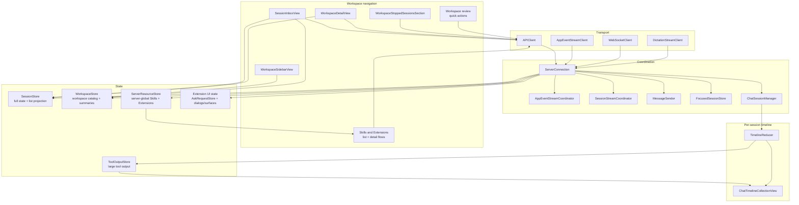

# Oppi client architecture

The Oppi Apple clients control and render server-owned and terminal-owned Pi sessions. They keep workspace navigation HTTP-first and reserve WebSockets for live streams. iOS paints the hot chat timeline with UIKit over authenticated HTTPS/WSS. Mac paints with AppKit and existing SwiftUI over the owner Unix socket.

## Audience and scope

Read this page before changing iOS or macOS client transport code, session and workspace stores, workspace navigation, chat timeline state, extension UI rendering, dictation, or media playback.

This page covers the Apple client structure. Server route, runtime, and storage details live in [Server architecture](architecture-server.md). For end-to-end LAN and paired HTTPS route selection, see [Networking and connection routing](networking.md).

## Detail map

This page keeps the rules that always apply. Read only the detail page for the area you are changing.

| Page | Covers |
| --- | --- |
| [Client blocks and shared core](architecture-client/blocks.md) | Client blocks; Shared Apple client core; Mac adapter path |
| [Transport and UI flows](architecture-client/flows.md) | Transport lanes; Workspace navigation flow; Focused session flow; Shared store updates; Extension UI on Apple |
| [Media, files, and sharing](architecture-client/media-files.md) | Media, files, and sharing |
| [Renderer change map and cleanup targets](architecture-client/change-map.md) | Renderer-addition change map; Client cleanup targets |
| [Where to look in code](architecture-client/code-map.md) | Where to look in code |

## Client responsibilities

The Apple client owns:

- paired-server credentials and endpoint selection,
- the global sessions inbox, workspace sidebar, server-global Skills and Extensions, workspace detail navigation, and focused-session navigation,
- focused session stream setup and recovery,
- app-event stream consumption and HTTP snapshot repair,
- per-session chat timeline state and rendering,
- extension UI sheets, ask cards, status rows, widgets, and native surfaces,
- voice input, audio playback, file previews, media playback, Quick Session intake, sharing, diagnostics, and settings.

The client does not execute Pi sessions or directly mutate server read models. It sends commands and renders the server projection.

## Client topology

The diagram below is the iOS HTTPS/WSS and UIKit composition. Mac uses the same `ChatSessionManager` and reducer core with owner-socket and AppKit/SwiftUI adapters; see [Mac adapter path](architecture-client/blocks.md#mac-adapter-path).

## UIKit and SwiftUI ownership

UIKit owns iOS structure. Decided 2026-10-15; the ratchet guard below enforces it.

**iOS (`clients/apple/Oppi`)**

1. **UIKit owns app structure and every modal.** Window root, split view, navigation stacks, and every presentation (sheet, full-screen cover, popover, inspector) belong to UIKit, through one router driven by `AppNavigation`. The router is `Oppi/App/Router.swift` for UIKit and `Oppi/App/HostFactory.swift` for the SwiftUI-facing API; the shell below uses both. A SwiftUI screen presents with `routerModal(item:presentation:onDismiss:content:)` or `routerModal(isPresented:...)` instead of `.sheet`, `.fullScreenCover`, or `.popover`. `ModalPresentation` picks the style: `.sheet` (SwiftUI `.sheet`), `.pageSheet`, `.fullScreen`, `.popover` (anchored to the declaring view), or `.largeViewer(for:)` for documents, refined with `.detents(_:grabber:selected:cornerRadius:)`, `.inNavigation(_:)`, `.arrowDirections(_:)`, and `.keepsPopoverInCompactWidth()` (SwiftUI's presentation modifiers do nothing on a UIKit-presented screen). Popovers paint the theme's popover surface. A screen moves its own sheet with `ScreenNavigator.selectSheetDetent(_:)`, the selection half of `presentationDetents(_:selection:)`. A side panel that was an `.inspector` is a `routerTrailingColumn(item:minWidth:idealWidth:content:)` (`Oppi/Features/Review/TrailingSidePanelPolicy.swift`): a UIKit-hosted screen in its own navigation controller in a full-height trailing column with a hairline divider, its bar level with the screen's and its content laid out compact, like an iPadOS inspector. It sits on the navigation controller that holds the screen while the screen is on screen, and that controller's safe area makes room for it, so the screen's bar items and content stay beside it; at compact width the caller presents the same panel with `routerModal`. The column's panel must not bring its own SwiftUI `NavigationStack`: hosted in a child controller, such a stack reset an enclosing SwiftUI `NavigationStack` to its root. Chat's side panels (Outline, Files, Context) take the column in regular width (iPad, the Duo's open display) and are router sheets in compact width; in both places they sit at the root of a router navigation controller and push their pages through its navigator. A covered presenter stops rendering, so a modal over a screen whose state it edits through bindings uses `.overFullScreen` rather than `.fullScreen` (chat's Share sheet in regular width, the expanded composer, and the composer pickers). The contract matches SwiftUI `.sheet`: the binding presents and dismisses, a new id replaces the open modal, and `onDismiss` runs after every dismissal, including swipe-down and the screen's own `finish()`. A presentation can follow size classes: when its style or navigation wrapper changes while the modal is up, the router presents the same item again without clearing the binding or running `onDismiss`, and sheet detents change in place. UIKit code presents a SwiftUI screen with `Router.present(presentation:from:content:)`. SwiftUI alerts, confirmation dialogs, and menus inside an existing SwiftUI screen may stay until that screen moves.
2. **New screens and views are UIKit.** Write view controllers and views. Read `@Observable` stores in `updateProperties()` (iOS 26 automatic observation tracking). Use `UICollectionView` list layout with content configurations for lists and settings, `navigationItem` bar items (set `visibilityPriority` and `axisBehavior` where Duo vertical bars matter), `UISheetPresentationController` for sheets, and `UIGlassEffect` for custom glass.
3. **Existing SwiftUI screens stay until a trigger moves them.** The triggers are a crash or bug in the screen, a substantive rewrite, or the router migration reaching it. The commit names the trigger. No tidy-up conversions: a conversion with no trigger adds risk and no behavior.
4. **SwiftUI shown from UIKit goes through `HostFactory`.** `OppiApp` publishes the app-scoped services (`ConnectionCoordinator`, `AppNavigation`, `ServerStore`, theme, the active server's scoped stores, the saved row appearance) as one `AppRootEnvironment` (`Oppi/App/AppRootEnvironment.swift`). Every member is a store, so the root never changes and a screen that captured it when pushed stays current; a value member (the row appearance once was) went stale in pushed screens. The scene sets it as a UIKit trait on its window, so UIKit code anywhere in the window, presented controllers included, finds it with `HostFactory.root(near:)`; a preview with its own fixture root publishes that one with `publishesAppRootToWindow`. The SwiftUI value is a plain environment value; a trait-bridged value read nil inside `NavigationStack` destinations. `HostFactory.screen` hosts a screen with that root applied through `appRootEnvironment(_:)`, a `ScreenNavigator`, its `ScreenBars` (a large title, inline on the Duo's vertical rail where a large one showed nothing; the toolbar while the screen has `.bottomBar` items), and the theme's color scheme (`overrideUserInterfaceStyle`) and page background, behind content that leaves it bare. `HostFactory.content(_:root:)` hosts SwiftUI embedded in a UIKit view and requires the root, passed explicitly from the embedding representable's environment or found with `root(near:)` once the view is in a window; embedded hosts are often not child controllers, so they cannot count on inheriting it. Only the App Lock cover, which paints before the root exists, uses `HostFactory.appLockCover`. Debug harnesses and screenshot previews get the app root at the window. Never call `UIHostingController(` directly or hand-write an environment list at a hosting seam. Presenter-local values go on the content explicitly and override the root's, for example `withServerScopedEnvironment(connection)` for a chat's own server. Required `@Environment(Type.self)` lookups that were missing across a UIKit↔SwiftUI seam caused two crashes: build 54 on the iOS app on Mac, where SwiftUI's sheet environment bridge dropped `ConnectionCoordinator` (`0ffdb2e5b`), and the file viewer (`06d79f50c`). A sheet that reads those services uses `routerModal`, not SwiftUI `.sheet`, with the presenter-local values passed explicitly: chat puts its server scope, reducer stores, and navigation on every modal and side panel (`ChatView.chatModalScope`), and review screens forward theirs to what they push or present (`presenterScope(connection:apiClient:navigation:)`).

   **Hosted screens never navigate or present by themselves.** In a UIKit stack, a page pushed by `NavigationLink { destination }` loses the app environment and crashes on its first required service read, value links and `navigationDestination` do nothing, `.searchable` never reaches the UIKit bar, and `dismiss()` does nothing at the root of a presented navigation controller. A hosted screen reads `@Environment(\.screenNavigator)` and calls `present(_:onDismiss:content:)`, `push(bars:content:)`, or `finish()`, declares `routerModal`, and searches with `routerSearchable(text:prompt:)` (the host owns a `UISearchController` bound to the text both ways; the screen needs a navigation controller). Outcomes are the screen's own typed closures; after reporting one the screen calls `finish()`, which pops a pushed screen or dismisses the modal it is the root of. A modal dismissed under an active search left its bar on screen, still taking taps, so the router ends the search first: in `finish()` and on swipe-down. Presenter-local values a modal needs go on its content explicitly; the model pickers in Edit Agent and Edit Schedule get the editor's `apiClient` and `chatState`, and the chat commit viewer gets its own `AppNavigation` so a chat opened inside it cannot take the app's pending quick-session message. Shared modal content that some callers still present with SwiftUI `.sheet` keeps its own `NavigationStack` and `dismiss()` until every caller presents through the router (the model picker, the expanded composer, the review comment stash). Two `routerSearchable` views that swap inside one screen (the Files panel's tabs) share its bar: the newest drives it and the bar stays until the last one leaves, since SwiftUI can still update the old view after it adds the new one.

   **Every hosted screen is its own SwiftUI graph.** SwiftUI stops updating a screen whose view left the window: covered by a push or by a `.fullScreen` modal. So a `@Binding` into the presenter's `@State` does not refresh a pushed screen, and clearing a presenter binding while the presenter is covered does nothing. `push` and `present` take a content closure that runs in the new screen's graph, so `@Observable` reads in it stay live. State that two screens edit belongs in an `@Observable` model (see `AgentNativeEditSelections`). `routerModal` content also refreshes when the presenter re-renders, which happens while the presenter stays in the window (sheets, popovers, `.overFullScreen`). A `routerModal` presents on the next main-queue turn, after the presenter's SwiftUI update: a hosting controller created inside a SwiftUI `NavigationStack`'s update joined that graph: the modal's title and bar items showed in the stack's bar while its own bar stayed empty, and a modal with its own `NavigationStack` opened from a SwiftUI stack's destination reset that stack to its root. A `routerModal` presents only while the view that declares it is in the window, so a modal a pushed page can trigger is declared on that page too: MCP sign-in starts on a server's detail page, which covers the list, and both declare `mcpSignInModal`. A modifier applied outside the view that carries `appRootEnvironment` passes the root itself (`PairingApprovalPromptHost(root:)`). A router presentation ignores the content's SwiftUI presentation modifiers (`presentationDetents`, `presentationCompactAdaptation`); content that both kinds of presenter show puts its router presentation next to those modifiers, as `ModalPresentation.iconPicker(horizontalSizeClass:verticalSizeClass:)` does for `UnifiedIconPickerView`. `interactiveDismissDisabled` already reaches UIKit, including through the router's navigation container.

   Migration order: a modal whose content keeps its own `NavigationStack` and `dismiss()` moves to `routerModal` without `.inNavigation()`. It is then the presented controller, where `dismiss()` works. Dropping that stack means `.inNavigation()`, `finish()` for `dismiss()`, and `navigator.push` for every link inside (a `SettingsIndexActionRow` keeps the disclosure chevron), in the same change.
   **The shell.** A UIKit scene (`SceneDelegate`, `Oppi/App/AppDelegate.swift`) owns the window; `OppiApp` holds the services and the app-wide handlers (URLs, notification and Siri opens, resource and file links, scene phases, launch). `AppRootViewController` applies the theme to the window and shows the launch backdrop, onboarding, or the workspace shell, above the SwiftUI `AppRootLayer` (app-wide modals, workspace creation the shell starts, the Quick Session overlay, which brings the layer to the front). `WorkspaceShellController` measures the window and mounts the compact stack with its workspace drawer or a `UISplitViewController`: a fold or resize first converts `AppNavigation`'s routes for the new layout, then mounts it from them, so the stacks rebuild where the user was. `AppNavigation` is the single source of truth for every stack. `ShellNavigationController` (`Oppi/App/ShellRouter.swift`) shows exactly the routes it is given, keeps the screens that stay, and reports the user's pops back (`popWorkspaceStack(toDepth:)`, `popSplitDetail(toDepth:)`); each route's content is `ShellRouteView` (`Oppi/App/WorkspaceShellRoutes.swift`). A screen opens a route by calling `AppNavigation` (`openWorkspace`, `openWorkspaceSession`, `openWorkspaceFileBrowser`, ...). A page that exists only above the screen that opened it (a fork, a quick-action chat, a host file, an agent's or schedule's detail, the SSH terminal) pushes with `ScreenNavigator.push` and stays above that screen until a route below it changes; a push asked for while a pop animates waits for it to finish. A pushed page whose presenter must react to it closing reports that itself: the SSH terminal clears `showsTerminal` when it leaves and pops itself when the session stops showing it, and Pi's Tools page saves through the observable model it edits when it closes. `finish()` at the split detail root shows the column's list. Every route is hosted directly in its UIKit stack, with the UIKit bar and back swipe.

5. **SwiftUI only where Apple requires it.** That means widgets, control widgets, and Live Activities (`OppiControlWidget`, `OppiActivityExtension`).

**Mac (`clients/apple/OppiMac`)**

New Mac views are AppKit by default. Existing SwiftUI Mac code stays until a separate migration decision. The AGENTS.md rule still holds: a feature does not touch the Mac app unless the request names Mac, macOS, desktop, or OppiMac.

**OppiCore** stays UI-framework-free.

**Ratchet guard.** `scripts/uikit-structure-guard.ts` counts these SwiftUI constructs per file under `clients/apple/Oppi/**/*.swift` after stripping comments and string literals: `NavigationStack`, `NavigationSplitView`, `NavigationLink`, `.navigationDestination(`, `.sheet(`, `.fullScreenCover(`, `.popover(`, `.inspector(`, `UIHostingController(`, and `import SwiftUI`. A file fails when a count exceeds `scripts/uikit-structure-baseline.json`; new files have baseline 0, and decreases pass. Raising a baseline needs Chen's approval. Lowering it after a migration is expected: run `bun scripts/uikit-structure-guard.ts --update` and commit the reduced baseline with the migration. Renaming or moving a file keeps its counts, so `--update` after a rename is fine when the baseline diff only moves entries. Ordinary runs never write the baseline.

## Terminal tool output

Timeline rows paint terminal-kind tool output from `ToolOutputStore`. The server sends stripped text: a suffix under 8 KiB, or a throttled 16 KiB / 80-line tail replace after that. Opening the full log still uses the sidecar. SSH terminal sessions are a separate surface.

Opening a busy session replays the server event ring over the freshly loaded trace. The replayed `agent_start` closes the running tool as inferred-interrupted; the replayed `tool_start` then revives it, because a start is authoritative evidence the call is executing. Canonically finished calls stay finished. The expanded row and full-screen reader use the stored text, and an explicit open loads the sidecar. They do not wait on a byte-log resync.

## Client boundary rules current code

These rules are enforced by `server/scripts/check-architecture-boundaries.ts` during server checks (`--scope all`), the iOS build phase (`--scope ios`), and the Mac pre-push gate (`--scope mac`):

- `clients/apple/OppiCore/Runtime/TimelineReducer.swift` and `DeltaCoalescer.swift` must stay platform-neutral under the shared-core import rule.
- `clients/apple/OppiCore/**` files must not import UIKit, AppKit, SwiftUI, ActivityKit, UserNotifications, Speech, AVFoundation, WebKit, or MetricKit. Put platform-specific code in the iOS or macOS app target.
- `clients/apple/OppiMac/**` files must not import UIKit. New Mac views are AppKit by default; existing SwiftUI Mac code stays until a separate migration decision.
- `project.yml` is the Mac target membership authority. OppiMac may compile `OppiMac/**`, `OppiCore/**`, `Shared/**`, and only the established `Oppi/**` adapter files listed there; do not add arbitrary iOS production files to the Mac target.
- `clients/apple/Oppi/Core/Views/**` and `clients/apple/Oppi/Features/Chat/Timeline/**` must not reference `APIClient` or `WebSocketClient` directly.
- `clients/apple/Oppi/Core/Views/**` and `clients/apple/Oppi/Features/Chat/Timeline/**` must not reference `ServerConnection`, `ConnectionCoordinator`, `apiClient` (member, environment key path, or binding), `wsClient`, or `SessionStore`/`WorkspaceStore` (`view-layer-connection-boundary`). They receive explicit values (`SessionContentAccess`, icon cache) and typed actions from chat composition.
- Workspace and quick-session list views must read `SessionStore.listProjectionSessions` or `listProjectionSessions(workspaceId:)`, not full `SessionStore.sessions`.
- `SessionStore`, `WorkspaceStore`, `ServerResourceStore`, and shared stores under `clients/apple/OppiCore/Stores/**` must not depend on each other. Cross-store workflows belong in `ServerConnection` or a small service.
- iOS content web links use `MarkdownLinkInteractionSupport` or `.webLinkTapped`; `OppiApp` applies the browser preference. Direct system opens are limited to that owner and allowlisted non-HTTP fallbacks. Only that owner and Tailnet authentication may present `InAppBrowserPresenter` directly. Timeline `UITextViewDelegate` conformances must implement `primaryActionFor` in the same file.
- Generic extension UI rendering and routing must not branch on concrete tool names, extension names, status keys, widget keys, or display names. Add semantic protocol metadata at the producer boundary instead. This includes `ExtensionSurfacePanel.swift` and `MacExtensionSurfacePanel.swift`.
- SwiftUI foreground, fill, and stroke styling must use the environment-resolved `.theme*` `ShapeStyle` shorthand. `Color.theme*` is a runtime snapshot for APIs that require a concrete `Color` or a UIKit/AppKit bridge. Persistent list and panel modifiers must read `theme` or `themeID` from the environment so mounted content repaints after a theme switch. `scripts/theme-surface-guard.ts` enforces the shorthand boundary during the iOS architecture check.
- iOS SwiftUI structure constructs (`NavigationStack`, `NavigationSplitView`, `NavigationLink`, `.navigationDestination(`, `.sheet(`, `.fullScreenCover(`, `.popover(`, `.inspector(`, `UIHostingController(`, `import SwiftUI`) may not exceed the per-file counts in `scripts/uikit-structure-baseline.json`. New files start at 0. `scripts/uikit-structure-guard.ts` enforces the ratchet during the iOS architecture check; see [UIKit and SwiftUI ownership](#uikit-and-swiftui-ownership).
