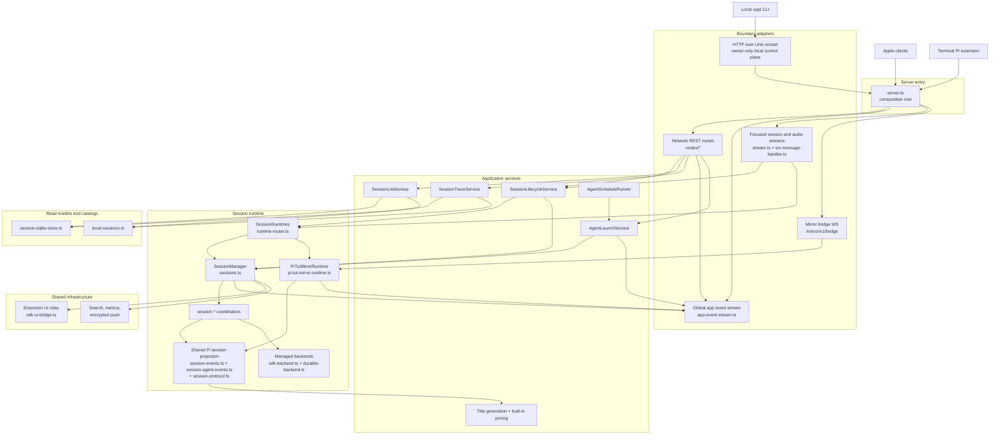

# Oppi server architecture

The Oppi server owns sessions, workspace access, runtime configuration, and the mobile-facing projection of Pi session state. It exposes authenticated HTTP plus the bearer-free Oppi Mirror bridge over an owner-only Unix socket. iPhone and iPad clients, dictation, and app events use authenticated HTTPS/WSS listeners. The co-located Mac app uses that same owner Unix socket for authenticated local HTTP and live WebSocket upgrades whether it attaches to a healthy runtime, waits for LaunchAgent, or spawns a child process, and must not send `sk_` over HTTPS or WSS.

## Audience and scope

Read this page when changing server routes, WebSocket transports, session lifecycle code, runtime ownership, the Pi SDK adapter, terminal mirror behavior, storage projections, or protocol contracts.

This page covers production server structure. For Apple UI composition, see [Client architecture](architecture-client.md). For supported HTTPS/WSS routing, see [Networking and connection routing](networking.md).

## Detail map

This page keeps the rules that always apply. Read only the detail page for the area you are changing.

| Page | Covers |
| --- | --- |
| [Server blocks and HTTP/WebSocket boundaries](architecture-server/blocks-and-boundaries.md) | Main server blocks; HTTP and WebSocket boundaries |
| [Session runtime](architecture-server/runtime.md) | Session runtime ownership; Managed SDK runtime; Server durable; Saved Agents and schedules; Terminal mirror runtime |
| [Read models and event stream](architecture-server/read-models.md) | Session list and history read models; App event stream |
| [Tool inspection](architecture-server/tool-inspection.md) | Producer facts; mobile-renderer registry; full tool-output ownership |
| [Durable conversation stream](architecture-server/durable-conversation-stream.md) | Experimental `attach` / `snapshot` / `update` replica of a durable conversation on the focused socket |
| [Cleanup targets and code map](architecture-server/code-map.md) | Server cleanup targets; Where to look in code |

## Server responsibilities

The server owns:

- authenticated HTTP and WebSocket boundaries,
- workspace CRUD, workspace file access, review comments, quick actions, and provider auth,
- managed Pi SDK session lifecycle,
- saved Agent definitions and schedule-runner state,
- terminal Pi TUI mirror registration and command proxying,
- session event projection into durable sequence numbers, summaries, media, search, and SQLite read models,
- extension UI relay and attention state,
- telemetry, end-to-end-encrypted push through a relay, package version via getPackageInfo(), and diagnostics.

The server does not render the chat timeline. It sends protocol messages and HTTP snapshots for the Apple client to render.

### Program status

`Session.programStatus` / `SessionSummary.programStatus` is the one status vocabulary for every session (OSC 7501: `idle`, `working`, `done`, `blocked` with a `kind`, `error`). `server/src/program-status.ts` is its single owner: `trackProgramRunEvent` folds Pi events (the same rules as Pi 1.1.0's terminal reporter, including `agent_settled.aborted`), `deriveProgramStatus` is the table over lifecycle status, run tracker, and pending user-reply dialogs, and `syncProgramStatus` stores the result. Sync runs after each Pi event (`SessionEventProcessor`), on lifecycle and dialog messages and before persistence (`SessionBroadcaster`), and in the mirror's bridge-state path, so managed and mirrored sessions share one function. `Storage.saveSession` also normalizes every `stopped` and `error` row (a fresh, host-less derive from the stored outcome) and writes `programStatus` back onto the caller's object, which is why a stop of a disconnected mirror never leaves `working`/`blocked` behind; `starting` rows are deliberately excluded so a stop mid-start keeps the last outcome. The value persists with the session (`program_status_json`), which is how a stopped session keeps done/error across a restart; startup marks crash orphans stopped and backfills sessions that predate it. Lifecycle `Session.status` stays for controls. Consumers read program status: list and app-event summaries, `blocked`/`error` pushes (`SessionPushNotifier`; see [Push](#push)), and `oppi session wait` (`--program-status` also writes it to the terminal as OSC 7501 via `cli/program-status-osc.ts`). The `message` is the session name, the first line of a dialog title (extensions put commands, diffs, and tool input on later lines), the first question of an `ask`, or the first line of an error (a typed launch failure has none); never a prompt. A `blocked` push body carries it. `editor` dialogs count as blocking user replies everywhere `isPendingUserReplyRequest` is used.

## Server topology

## Push

Push is relay-only and end to end encrypted ([protocol/push/spec.md](../protocol/push/spec.md)); the server holds no APNs key and opens no connection to Apple. `push.mode` is `relay` through Oppi's relay by default; nothing is sent until a phone registers. `server/src/push/` owns it:

- `envelope.ts`: the only way to make a `SealedPushEnvelope` (HPKE to the device's X25519 push key, Ed25519 signature by the server identity key, fixed 512-byte padded plaintext).
- `hpke.ts`: RFC 9180 base mode, single shot, for DHKEM(X25519, HKDF-SHA256) / HKDF-SHA256 / ChaCha20-Poly1305, composed from `node:crypto` primitives only; checked against RFC 9180 Appendix A.2.1. Push uses no third-party crypto package.
- `relay-client.ts`: relay API v1 server calls. Alerts accept only a `SealedPushEnvelope`; Live Activity pushes are built field by field from the fixed schema (event and two counts; the relay stamps the time). It tries `[primary, standby]` and prunes only on a primary `410`.
- `push-sender.ts`: per-device sealing with a timestamp, collapse IDs, and best-effort permission release, plus `sendLiveActivity` with its own per-device budget. It keeps no per-push state and never writes config to send; the phone deduplicates on the envelope's HPKE `enc`.
- `registration.ts`: `PUT /me/push-registration` checks; the device's enrolled P-256 key signs the push key and send token.
- `relay-origin.ts`: parses and validates the `push.relays` origins (HTTPS, or HTTP on loopback; no path or credentials).

`server/src/session-push-notifier.ts` (`SessionPushNotifier`) is the one owner of session alerts; pairing alerts stay in `device-pairing.ts`. From program status it pushes `blocked` (Needs you, any session, skipping each device that holds an app-event or focused stream) and `error` (a top-level run failed, to every device); it also decides who is offered the agent `notify` tool (`SessionNotifyPort`: top-level sessions while some device holds a push registration) and sends its calls as `notify` pushes to every device. Each alert sends at most once a minute per session; a `blocked` body is the status message (a dialog title's first line or the first `ask` question), `error` text is fixed, and `notify` carries the agent's words. `PushSender` sends a device only the events its registration lists. The tool's words and limits live in `extensions/durable/notify/contract.ts`, shared by both engines: classic sessions get it as an inline Pi extension (`session-notify-extension.ts`) registered on each resource load while offered, and durable sessions select the bundled `oppi.notify` built-in like `oppi.sessions`, added when offered and removed otherwise on every attach, reaching the server through `oppiHost().notify(env)`.

`server/src/live-activity-notifier.ts` drives the counts-only Live Activity (spec section 3.6) for away devices whose registration says `liveActivity: true`: it recounts top-level `working`/`blocked` sessions on every program-status change, tracks per device whether a card exists, coalesces to one send a minute, starts a card only when it knows there is none, and restarts a card by Apple's 8 hours, counted from the earliest it can have started. `server.ts` feeds it program-status changes and presence (a device's first stream opening, its last closing).

`PushRegistration` records live on `ServerConfig.pushRegistrations`, one per paired device; revoking the device or rotating the owner token removes them in the same write. The standalone relay is `relay/` (core, Node and Cloudflare adapters); it imports nothing from `server/` or `clients/` and no HPKE or KEM package, which `check-architecture-boundaries.ts --scope relay` enforces. Test vectors in `protocol/push/vectors/` change only through `protocol/push/scripts/generate-vectors.sh` and `npm run push:canary -- --write-capture`.

## Live Voice

A Live Voice call belongs to one ordinary session. The phone opens a second stream to that session (`/workspaces/{id}/sessions/{id}/stream`, or the control path) and sends `voice_call_*` frames plus binary 16 kHz PCM; the server sends call state and binary 24 kHz PCM back on the same socket. Playback PCM is sent with `compress: false`, so the socket's permessage-deflate compresses only its JSON; speech PCM deflates only to about 89% and each compressed frame costs a zlib pass on both ends. `URLSessionWebSocketTask` negotiates deflate and compresses most mic frames on its own, which the server inflates; that inbound cost is small and stays. Owners: `VoiceCallController` (`continuous-voice-call.ts`) holds call identity, controller lease, and the per-utterance status the phone shows; `VoiceCallMediaCoordinator` (`continuous-voice-media.ts`) runs one media adapter per attached connection (local ASR + read-aloud TTS, or Grok Voice); `LiveVoiceSessionLink` and `LiveVoiceSpeech` (`live-voice-speech.ts`) join the two to the session. What the caller says reaches the session through `sendPrompt` with steering, like a typed message. Classic sessions register a built-in `speak` tool on every resource load, inactive until the session has call media attached; the agent answers out loud with it. Every run that starts during a call turns `speak` on for that run. The agent learns the call mode from two hidden `display: false` custom messages in the session: one when the call attaches (speech is transcribed and may be misrecognized; speak first, acknowledge, work, speak the outcome) and one when it detaches (typed written chat again). They are sent with `triggerTurn: false`, so an idle session saves them without a turn and a busy run holds them until the current turn's tool results are in, which puts them before its next model call, steered messages included. Each records `details.active`. The extension compares the call with the last such message in the model's context (`buildContextEntries()` for the current leaf, so compaction and tree position count) on `session_start`, `session_compact`, and `session_tree`, and sends a message only when they differ. After a server restart, a reopened session that still ends on a start message gets an end message, since calls do not survive a restart; after a compaction that summarized the start away, or a tree jump to before it, a live call gets its start message again. A compaction that triggers mid-run saves the new message at the end of the next turn, one model call later. A run that ends without `speak` has the opening of its final reply read, and a failed run says so. Durable sessions get the same `speak` from the bundled `oppi.live-voice` built-in (words and limits in `extensions/durable/live-voice/contract.ts`, shared with the classic extension). No default selection carries it: each `DurableBackend` attachment registers with `LiveVoiceSpeech.attachRuntime` (through `DurableHarness.bindLiveVoice`) and commits it, with `speak`, into the conversation's `pi.agent` selection while a call is attached and out when it ends. pi-durable re-plans tools and prompt sections before every model request, so a run in progress gets `speak` at its next model call. Its `live-voice` prompt section carries the call-started guidance in place of the hidden messages; when the call ends, the section and the tool leave the prompt. An attach's `{ add }` edit drops the extension, so a restart mid-call re-adds it only while the call is live, and a child spawned during a call never inherits it. The durable `agent_end` carries the run's final assistant message, which the read-aloud fallback needs. Terminal mirrors refuse calls. A paired device is the only voice principal; owner tokens never control a call. A call socket kept past its access token carries only that call: other commands are refused and session traffic is not sent. The local route (`YuwpVoiceMediaAdapter`) logs privacy-safe debug telemetry to `server.log` under component `voice_media`, mirroring Grok's `grok_voice.call_summary`: `voice_media.turn_committed` (end reason, trailing silence, sentence end, unit count, turn duration, ASR restart), `voice_media.barge_in` (`source`, see Barge-in below), `voice_media.tts_item` (chars, time to first audio, outcome), `voice_media.turn_to_voice` (turn commit to first assistant audio on the phone), and `voice_media.call_summary` at call end. Only counts, durations, reasons, and ids; never transcript or spoken text, and nothing per audio frame.

### Barge-in

The caller talking over the agent's reply stops it. Three paths can notice, fastest first. Each counts only while the reply is audible or about to be: speech is queued or generating, or the phone may still be playing what was sent (`playbackEndsAt`; TTS outruns playback, so most barge-ins land after the queue drained).

1. **Phone** (`source: local`). The phone's `LiveVoiceBargeInDetector` hears sustained speech that is not the reply's echo. It stops playback at once and sends `voice_call_barge_in` (callId, controller lease, required `requestId`). The handler checks the lease, and `VoiceCallMediaCoordinator.bargeIn` calls the adapter's `bargeIn()` before the `command_result` goes out, so in the server's send order every audio frame after the result is new speech. The phone drops call audio until that result arrives. A repeated `requestId` is a no-op. Detector and gate details are in [Live Voice calls](architecture-client.md#live-voice-calls).
2. **Server speech detector** (`source: vad`, local route only). After `BARGE_IN_SPEAKING_REPORTS` consecutive Yuwp speaking reports, the adapter cancels and sends a `"…"` partial transcript. A changed non-empty partial is the phone's signal to drop buffered audio. A cough or click does not interrupt.
3. **Transcript** (`source: transcript`). The first new words of a user turn cancel, and their partial flushes the phone. This is the fallback when neither of the above fired.

All local-route paths go through `cancelAssistantSpeech()`, which bumps the speech generation, empties the queue, aborts TTS, and sets `playbackEndsAt` to now. Whichever path comes second for the same speech finds nothing audible: it logs nothing, cancels nothing new, and sends no placeholder. A phone barge-in after a server one answers `cancelled: false`. The `"…"` placeholder and the phone's gate do not interact: the partial only stops local playback, and the gate only waits for its own request's result. None of these paths changes ASR or turn-taking. On Grok Voice, xAI's server VAD hears the same mic and interrupts on its own ("In VAD mode, interruptions are automatic"). A phone barge-in sends nothing to xAI; it only withholds the rest of the current response's audio until the next `response.created`.

## Protocol boundary

Server protocol types live in `server/src/types/protocol.ts` and are re-exported from `server/src/types.ts`. `types.ts` is a stable barrel for the historical `./types.js` import path; it should only re-export type modules.

When changing protocol messages:

1. Update server protocol types.
2. Update Apple models: `ClientMessage.swift`, `ServerMessage.swift`, `AppEventMessage.swift`, and stream wrappers.
3. Update protocol snapshots in `protocol/*.json` when the wire shape changes. Ordinary protocol tests compare deterministic canonical bytes with the committed fixtures without writing tracked files. Deliberate fixture changes use `cd server && npm run protocol:fixtures:update`.
4. Run server protocol tests, followed by Apple Codable tests.

The experimental durable conversation stream (`ConversationStreamServerMessage`, `ConversationStreamAttach`, `ConversationStreamOlder`) is outside the server's `ServerMessage`/`ClientMessage` unions. Its fixtures are `protocol/conversation-stream.json` and the golden `protocol/conversation-stream-golden.json`; its Apple models are `OppiCore/Models/ConversationStream.swift`, applied by `ConversationReplica`. The Apple client carries the frames as `ServerMessage.conversationStream` and the requests as `ClientMessage.conversationAttach`/`.conversationOlder`, so they share the focused socket's decoding and send path. See [Durable conversation stream](architecture-server/durable-conversation-stream.md).

Tool presentation facts and full-output lifetime are documented in [Tool inspection](architecture-server/tool-inspection.md).

## Server boundary rules current code

These rules are enforced by `server/scripts/check-architecture-boundaries.ts` and ESLint local rules:

- Server tests live under `server/tests/**`, not `server/src/**`.
- `server/src/server.ts` is the single composition root. Lower layers must not import it.
- Core modules must not import `server/src/routes/**`; shared logic belongs in non-route modules.
- Concrete route modules must not import each other. Compose route dispatch in `server/src/routes/index.ts`, and keep shared route helpers limited to the approved route helper modules.
- `server/src/types.ts` may only re-export modules under `server/src/types/`.
- `session-*` modules must not import the `sessions.ts` facade.
- `server/src/storage/**` modules are infrastructure leaves. They must not import routes, stream code, or session runtime modules.
- `@earendil-works/pi-ai/compat` imports are forbidden. Configured model/auth requests use `ModelRuntime`; static built-in pricing reads use `@earendil-works/pi-ai/providers/all`.
- Direct `mirror-session-resume.ts` imports live only in `server/src/session-lifecycle-service.ts`; routes and streams call lifecycle service methods for mirror open/resume behavior.
- `runtime == "pi-tui"` ownership checks live only in runtime, lifecycle, mirror-resume, and current input-command boundary modules. Other modules consume typed service results or semantic capabilities instead of branching on runtime ownership.
- Generic extension UI relay/rendering code must not branch on concrete tool names, extension names, status keys, widget keys, or display names. Add semantic protocol metadata at the producer boundary instead.
