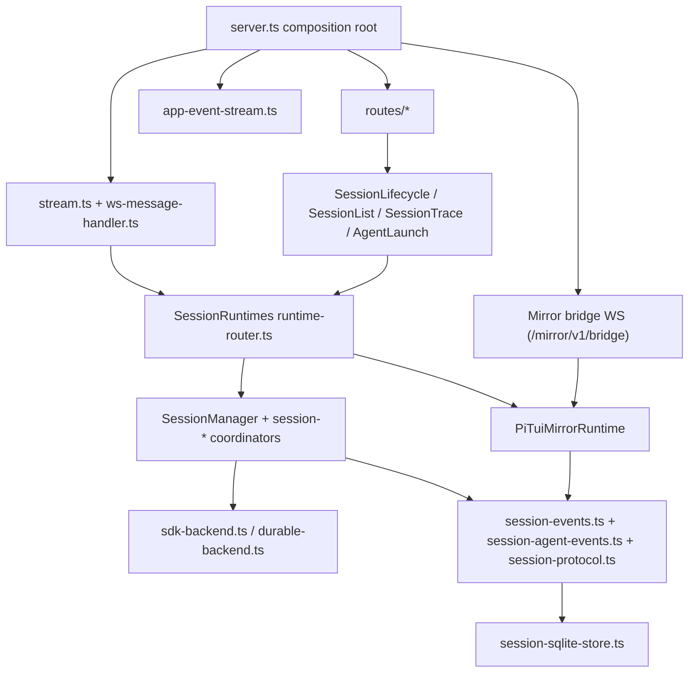

# Oppi server architecture

The server owns sessions, workspace access, runtime configuration, and the mobile projection of Pi session state; it never renders the timeline. It serves authenticated HTTP and the bearer-free mirror bridge on an owner-only Unix socket, and authenticated HTTPS/WSS to iPhone and iPad ([Listeners](architecture-server/blocks-and-boundaries.md#listeners)).

## Detail map

| Page | Covers |
| --- | --- |
| [Blocks and HTTP/WebSocket boundaries](architecture-server/blocks-and-boundaries.md) | Block owners, listeners, routes, file writes, upgrade paths |
| [Session runtime](architecture-server/runtime.md) | Runtime dispatch, managed SDK, server durable, subagents, Oppi Control, Agents and schedules, mirror |
| [Read models and event stream](architecture-server/read-models.md) | List buckets, session change views, app-event allowlist |
| [Tool inspection](architecture-server/tool-inspection.md) | Producer facts, renderer registry, full output |
| [Durable conversation stream](architecture-server/durable-conversation-stream.md) | `attach` / `snapshot` / `update` replica wire |
| [Durable extension UI](architecture-server/durable-extension-ui.md) | Durable dialogs, notification slots, cards, background jobs |
| [Cleanup targets and code map](architecture-server/code-map.md) | Cleanup targets, file pointers |

## Program status

`Session.programStatus` is the one status vocabulary for every session (OSC 7501: `idle`, `working`, `done`, `blocked` with a `kind`, `error`), owned by `server/src/program-status.ts`: `trackProgramRunEvent` folds Pi events, `deriveProgramStatus` derives, `syncProgramStatus` stores. Managed and mirrored sessions call the same sync (`SessionEventProcessor`, `SessionBroadcaster`, the mirror's bridge-state path).

- `Storage.saveSession` re-derives every `stopped` and `error` row from the stored outcome (persisted as `program_status_json`), so a stop of a disconnected mirror never leaves `working`/`blocked`; `starting` rows are excluded so a stop mid-start keeps the last outcome.
- Lifecycle `Session.status` stays for controls; list summaries, pushes, and `oppi session wait` read program status. The `message` is never a prompt. `editor` dialogs count as blocking replies (`isPendingUserReplyRequest`).
- `session.pendingWake` (`SessionManager.awaitsNextTurn`) is derived per request on the live events snapshot and never stored.

## Push

Push is relay-only and end-to-end encrypted ([protocol/push/spec.md](../protocol/push/spec.md)); the server holds no APNs key. `server/src/push/` owns sealing and delivery:

- `envelope.ts` is the only way to make a `SealedPushEnvelope`; `hpke.ts` implements RFC 9180 from `node:crypto` only (no third-party crypto package).
- `relay-client.ts` prunes a registration only on a primary `410`. `push-sender.ts` keeps no per-push state and never writes config; the phone deduplicates on the envelope's HPKE `enc`.
- `registration.ts`: the device's enrolled P-256 key signs the push key and send token. `relay-origin.ts`: relays are HTTPS (HTTP only on loopback), with no path or credentials.
- `SessionPushNotifier` (`server/src/session-push-notifier.ts`) is the one owner of session alerts (pairing alerts stay in `device-pairing.ts`) and of who is offered the agent `notify` tool, whose contract (`plugins/notify/contract.ts`) both engines share. `PushSender` sends a device only the events its registration lists.
- `live-activity-notifier.ts` owns the counts-only Live Activity.
- `PushRegistration` records live on `ServerConfig.pushRegistrations`; revoking a device or rotating the owner token removes them in the same write.
- `relay/` imports nothing from `server/` or `clients/` and no HPKE/KEM package (`check-architecture-boundaries.ts --scope relay`). `protocol/push/vectors/` change only through `protocol/push/scripts/generate-vectors.sh` and `npm run push:canary -- --write-capture`.

## Live Voice

A call belongs to one ordinary session over a second focused stream (`voice_call_*` frames plus binary PCM: 16 kHz in, 24 kHz out; playback PCM skips permessage-deflate, see `stream.ts`).

- Owners: `VoiceCallController` (`continuous-voice-call.ts`: identity, controller lease, status), `VoiceCallMediaCoordinator` (`continuous-voice-media.ts`: one media adapter per connection), `TranscriptionVoiceMediaAdapter` (local and OpenRouter routes), `LiveVoiceSessionLink` and `LiveVoiceSpeech` (`live-voice-speech.ts`).
- What the caller says reaches the session through `sendPrompt` with steering. The reply's opening paragraph is what gets spoken (`SpokenOpening`); `speak` is only a heads-up tool. Call guidance and spoken-style rules live in `plugins/live-voice/contract.ts`, shared by both engines.
- Classic sessions learn the call mode from hidden `display: false` messages sent with `triggerTurn: false`, reconciled on `session_start`, `session_compact`, and `session_tree`. Durable sessions get `oppi.live-voice` only while a call is attached (`LiveVoiceSpeech.attachRuntime`); a child spawned during a call never inherits it.
- A paired device is the only voice principal; owner tokens never control a call. A call socket kept past its access token carries only that call. Terminal mirrors refuse calls.
- `voice_media.*` telemetry carries counts, durations, reasons, and ids only, never transcript or spoken text, and nothing per frame.
- Listening: `RealtimeTranscriptionClient` (`realtime-transcription.ts`, wire in `server/docs/asr.md`) opens one realtime WebSocket per call to `asr.sttEndpoint`; the ASR server's VAD ends turns, items finish in commit order, and a `failed` item is an empty turn. A socket that fails before `session.updated` fails the start; after it, the call ends, with no reconnect. Stall, keepalive, and backpressure rules live at the owner. Dictation keeps the HTTP session API (`stt-provider.ts`).
- `asr.liveVoiceBackend: openrouter` has no realtime transcription, so `OpenRouterLiveTranscription` (`openrouter-live-voice.ts`) is the one place the server detects turns itself; results go out in cut order and a failed request is an empty turn.

### Barge-in

Three paths stop the reply, counting only while it is audible or may still be playing (`playbackEndsAt`):

1. **Phone** (`source: local`): `voice_call_barge_in` with lease and `requestId`. `VoiceCallMediaCoordinator.bargeIn` cancels before the `command_result` goes out, so every audio frame after the result is new speech; a repeated `requestId` is a no-op. Client side: [Live Voice calls](architecture-client.md#live-voice-calls).
2. **Server VAD** (`source: vad`, local route): `speech_started` cancels at once and sends a `"…"` partial (no debounce).
3. **Transcript** (`source: transcript`): the first new words cancel.

All local-route paths end in `cancelAssistantSpeech()` (bumps the speech generation, so later sentences of that reply drop too). The second path for the same speech finds nothing audible and does nothing. No path changes turn-taking. On Grok Voice, xAI's VAD interrupts by itself; a phone barge-in only withholds the current response's audio.

## Protocol boundary

Server protocol types live in `server/src/types/protocol.ts`; `server/src/types.ts` is a barrel that only re-exports type modules. When changing protocol messages:

1. Update server protocol types.
2. Update Apple models: `ClientMessage.swift`, `ServerMessage.swift`, `AppEventMessage.swift`, and stream wrappers.
3. Update `protocol/*.json` when the wire shape changes. Ordinary tests compare canonical bytes and never write tracked fixtures; regenerate with `cd server && npm run protocol:fixtures:update`.
4. Run server protocol tests, then Apple Codable tests.
5. Keep a setting's `protocol/settings.json` row and its [registry](#settings-registry) entry in step.
6. A new composable-surface node kind needs its own `extension-native-ui:v2:<kind>` capability (`extension-ui-contract.ts`, Apple `ClientCapability`, declared by `ServerConnection.surfaceCapabilities`), a rung in `ExtensionUISurfaceAudience`, and a static stand-in for the rungs below it in `surfaceForAudience` (`extension-surface-runtime.ts`): a build that predates a node kind draws it as "Unsupported block".

The durable conversation stream types sit outside the `ServerMessage`/`ClientMessage` unions (fixtures `protocol/conversation-stream.json`, `protocol/conversation-stream-golden.json`; Apple `OppiCore/Models/ConversationStream.swift`). See [Durable conversation stream](architecture-server/durable-conversation-stream.md).

Untrusted JSON (parsed files, wire payloads, Pi and provider events) narrows through `isRecord` / `asRecord` in `server/src/json-shape.ts`: an array is never a record, and `asRecord` misses with `undefined`. Import them; do not keep a local copy.

### Settings registry

`server/src/settings/registry.ts` declares every server-owned setting (key, scope, storage, default, `revisioned`, `validate`). Routes and stores validate through the definition; `validate` throws `SettingValidationError` (400). `server/tests/settings-registry.test.ts` holds `protocol/settings.json` to the registry; a new setting adds both together.

Revisioned saves: responses carry `revision`; a stale `baseRevision` answers `409 { code: "revision_conflict", current }` and changes nothing. The config-stored settings (Server Metrics, Durable Sessions, Mobile Output Guide) save through `applySetting` in `settings/config-settings.ts`, under the config lock; without `baseRevision` that is last-writer-wins, but the Mobile Output Guide route requires it. `ConfigStore` carries the guide's old `settings/mobile-output-guide.json` into `config.json` once and renames it `.migrated`. `oppi config set` does not bump a revision.

### Route registry

`server/src/routes/registry.ts` lists every HTTP and WebSocket route. `RouteHandler` answers 404 for a path with no row and 405 for a disallowed method before any dispatcher runs, so a handler without its row is unreachable (UI fixtures under `/e2e/ui/` are exempt). WebSocket upgrades and `/health` are answered in `server.ts` before the gate. `server/tests/route-registry.integration.test.ts` requires 401 without credentials on exactly the `owner` rows. A new route adds its row and handler together; metrics name requests by the row's template. `protocol/routes.json` is generated from the registry (`npm run protocol:fixtures:update`), and Apple `APIClientRouteContractTests` requires every `APIClient` endpoint method to build a request for one of its rows, so a new endpoint method adds its row there.

Pi resource failures (Skills, Extensions) map to HTTP by error class through `httpStatusForPiResourceError` (`settings/pi-resource-errors.ts`), never by message text.

## Server boundary rules current code

`server/scripts/check-architecture-boundaries.ts` and ESLint local rules enforce:

- Server tests live under `server/tests/**`, not `server/src/**`.
- `server/src/server.ts` is the single composition root; lower layers never import it.
- Core modules never import `server/src/routes/**`. Route modules never import each other; compose in `routes/index.ts` and share only through the approved helper modules.
- `server/src/types.ts` only re-exports `server/src/types/`.
- `session-*` modules never import the `sessions.ts` facade.
- `.updateConfig(` only in `server/src/storage/**` and `server/src/settings/**`; declared settings save through the registry and `applySetting`, other locked writes use `Storage.mutateConfig`.
- `server/src/storage/**` is an infrastructure leaf: no routes, streams, or session runtime imports.
- No `@earendil-works/pi-ai/compat`: model/auth requests use `ModelRuntime`; static pricing reads `@earendil-works/pi-ai/providers/all`.
- `mirror-session-resume.ts` is imported only by `session-lifecycle-service.ts`.
- `runtime == "pi-tui"` checks live only in runtime, lifecycle, mirror-resume, and input-command boundary modules; others consume typed results or capabilities.
- Generic extension UI relay and rendering never branch on tool, extension, status, widget, or display names; add protocol metadata at the producer.
- Production sources under `server/src` and `server/plugins` stay at or under 1,500 lines; bigger files are frozen at their size in `scripts/file-line-budget-baseline.json`, and budgets only go down (`file-line-budget`; `server/tests` is reported, not enforced).
