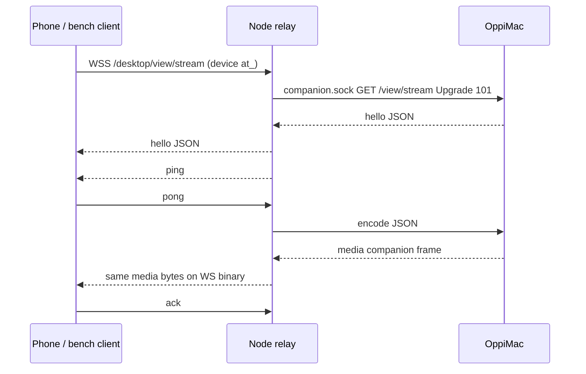

# Desktop live-view lane

Part of [Oppi server architecture](../architecture-server.md). Experimental Mac → Node H.264 relay (`experimental.desktopLiveView`, default off). Slice 1: companion capture/encode, Node rate control, shaped-link bench. Slice 2 adds the iPhone viewer.

## Owners

| Fact | Owner |
| --- | --- |
| View grant, selected surface, NV12 capture, H.264 encode | OppiMac (`clients/apple/OppiMac/Capture`) |
| Device auth, experiment flag, in-flight window, quality ladder | Node (`server/src/desktop-view-stream.ts`, `desktop-view-rate-controller.ts`) |
| Phone-wire media bytes | Mac writes them; Node forwards the companion media payload unchanged |

Newest captured pixel buffer wins before encode. Encoded frames are not dropped mid-relay. Exceeding the hard in-flight cap closes the stream.

## Topology

Flag off or an owner principal is HTTP 404 before upgrade (network owner `sk_` is still 401). Connect requires the Mac grant bound to this device. One live stream per process. Grant revoke/expiry, surface loss, and device revoke close the socket.

## Wire

Control is JSON. Video is a 24-byte header plus AVCC H.264 (4-byte NAL lengths). SPS/PPS are prepended as length-prefixed NALUs on every IDR. Feature string `h264-avcc`. Companion unix frames are `u32be length | u8 type | payload` (`type` 1 = JSON, 2 = media). Media payloads are the phone binary frame. Phone binary frames are sent with `compress: false`.

| Offset | Field |
| --- | --- |
| 0 | version u8 = 1 |
| 1 | flags u8 (bit 0 = keyframe) |
| 2 | header size u8 = 24 |
| 3 | reserved |
| 4 | frameId u32be |
| 8 | capturedAtMs u64be |
| 16 | width u16be |
| 18 | height u16be |
| 20 | payloadBytes u32be |
| 24 | AVCC H.264 |

Fatal application codes **4100–4199** must not reconnect. A companion hello with missing `features` or `version !== 1` closes with 4100. Fixture: `protocol/desktop-view-stream.json`.

## Rate control

Clock-injected. Window = `max(2 × frameBytes, 1.5 × commandedBitrate/8 × baseRTT)`. Ack rate is not used for the window. Base RTT is ping-only, windowed min over 10 s. Before the first real down-step, `shouldEncode` wakes every `max(50 ms, baseRTT)` and raises one rung even during the fps wait. A full window does not reset that clock. Down-step only when the **minimum** frame RTT over `max(1 s, 2 × baseRTT)` exceeds `base + max(50 ms, 0.5·base)`, at most once per base RTT. Hold starts at 1 s and doubles only when the level actually decreases (cap 8 s), then resets after 5 s clean. Ladder drops fps before scale. Hard cap 2 MiB: companion reader max is the cap; Node closes if a companion payload exceeds it or if `ws.bufferedAmount + payload` would exceed it. Not a second pacer.

## Encoder

Hardware + low-latency (`RequireHardwareAcceleratedVideoEncoder`, `EnableLowLatencyRateControl`). Low-latency documents High profile only; this Mac uses `H264_High_AutoLevel`. Output callback is a retained per-frame box (`sourceFrameRefcon`); no VideoToolbox call runs under the encoder lock. A generation checked under that lock is required before installing a new VT session: `invalidate` bumps it and sticks, `attach` starts a new generation. Companion writes drop unless the generation matches the one captured when `encode` started. `fail` only `shutdown`s the fd; the read thread closes after `read` returns. Every ScreenCaptureKit live-view terminal path (`didStopWithError` any error, failed `startCapture`) ends the stream with `surfaceGone` and does not idle-encode after the producer stops.

## Bench

Userspace FIFO shaper: shared per-direction `nextFreeAt` serialization, one-way delay, jitter, stalls. Not a token bucket. Not real packet loss. Fake companion, no Screen Recording. Payloads are random; keyframes ~6× P-frame size. Runs are ≥15 s. fps/kbps are over first→last arrival. Ladder is a time-weighted level histogram plus down-step count.

Command: `cd server && npm run bench:desktop-live-view`

Bench date: 2026-10-11. The harness exits non-zero when a preset misses a target. Targets: LAN reaches L7 ≤ 1 s after first frame; tailscale-wan majority at L6–L7; LTE settles L5–L6; bad-cell settles L2–L4; no preset spends > 20% of post-ramp time at L0; a single stall does not cascade 3+ rungs within 2 s.

| preset | ttff_ms | fps | age_p50 | age_p95 | age_max | gaps>100ms | kbps | ladder | ctrl_p50 | ctrl_p95 | revoke_ms |
| --- | ---: | ---: | ---: | ---: | ---: | ---: | ---: | --- | ---: | ---: | ---: |
| lan | 24 | 29.09 | 2 | 3 | 18 | 0 | 7858.4 | L0:1% L2:0% L3:1% L4:0% L5:0% L6:0% L7:98% down=0 | 3 | 4 | 15 |
| tailscale-wan | 372 | 17.86 | 210 | 377 | 484 | 5 | 2295.2 | L0:1% L1:1% L2:33% L3:7% L4:14% L5:15% L6:15% L7:12% down=5 | 92 | 104 | 242 |
| lte | 589 | 11 | 203 | 547 | 765 | 40 | 1082.8 | L0:2% L1:36% L2:16% L3:14% L4:12% L5:6% L6:10% L7:4% down=6 | 145 | 252 | 380 |
| bad-cell | 1189 | 4.76 | 401 | 2980 | 3858 | 65 | 264.3 | L0:60% L1:3% L2:14% L3:3% L4:20% down=2 | 467 | 955 | 205 |

LAN meets the 1 s-to-L7 target (98% at L7, down=0, ctrl p95 4 ms). Tailscale/LTE/bad-cell miss the predicted settle bands on this userspace FIFO shaper: 6× keyframes serialize as one chunk, so WAN frame age sits at 200–400 ms and the min-RTT rule still down-steps; bad-cell L0 dwell is the 800 ms stall plus hold after those downs. Not loosened. Userspace shaper cannot emulate real packet loss.

VideoToolbox: hardware + low-latency High profile on this Mac. OppiMacTests decode real AVCC output (SPS/PPS+IDR, P-frame, forced IDR, AverageBitRate readback) via `completeFrames()`.

Chen's leftover: real ScreenCaptureKit through OppiMac once slice 2 shows it on the phone.
