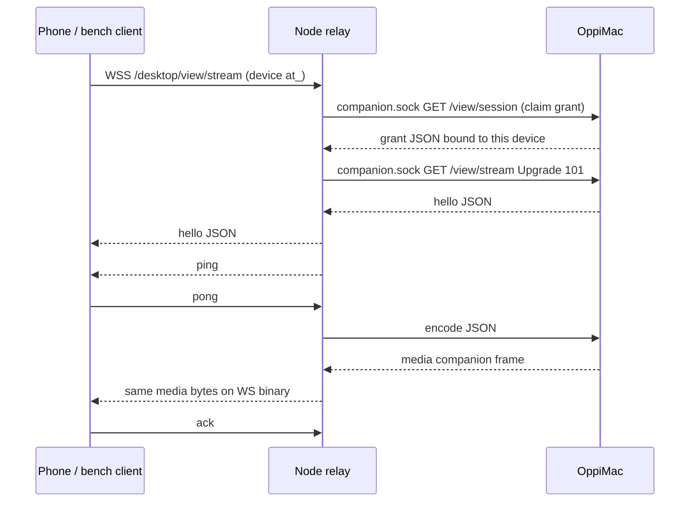

# Desktop live-view lane

Part of [Oppi server architecture](../architecture-server.md). Experimental Mac → Node H.264 relay (`experimental.desktopLiveView`, default off). Slice 1: companion capture/encode, Node rate control, shaped-link bench. Slice 2 adds the iPhone viewer.

## Owners

| Fact | Owner |
| --- | --- |
| View grant, selected surface, NV12 capture, H.264 encode | OppiMac (`clients/apple/OppiMac/Capture`) |
| Device auth, experiment flag, in-flight window, quality ladder | Node (`server/src/desktop-view-stream.ts`, `desktop-view-rate-controller.ts`) |
| Phone-wire media bytes | Mac writes them; Node forwards the companion media payload unchanged |

Newest captured pixel buffer wins before encode. Encoded frames are not dropped mid-relay. Exceeding the hard in-flight cap closes the stream.

## Topology

Flag off or an owner principal is HTTP 404 before upgrade (network owner `sk_` is still 401). Node claims the Mac view grant for this device (`GET /view/session`) before the companion stream upgrade. One live stream per process. Grant revoke/expiry, surface loss, and device revoke close the socket.

## Wire

Control is JSON. Video is a 24-byte header plus AVCC H.264 (4-byte NAL lengths). SPS/PPS are prepended as length-prefixed NALUs on every IDR. Feature string `h264-avcc`. Companion unix frames are `u32be length | u8 type | payload` (`type` 1 = JSON, 2 = media). Media payloads are the phone binary frame. Phone binary frames are sent with `compress: false`.

| Offset | Field |
| --- | --- |
| 0 | version u8 = 1 |
| 1 | flags u8 (bit 0 = keyframe) |
| 2 | header size u8 = 24 |
| 3 | reserved |
| 4 | frameId u32be |
| 8 | capturedAtMs u64be |
| 16 | width u16be |
| 18 | height u16be |
| 20 | payloadBytes u32be |
| 24 | AVCC H.264 |

Fatal application codes **4100–4109** must not reconnect (`grant_*` close-reason tokens are also fatal). `alreadyStreaming` **4001** and `companionUnavailable` **4002** are not fatal: the phone reconnects them with capped backoff while the viewer is visible. A companion hello with missing `features` or `version !== 1` closes with 4100. Companion socket `close` with no earlier explicit error uses **4002**; **4106** is only the Mac's `surfaceGone` error frame. The WebSocket close code on the wire is always policy `4000`; the application code arrives in the error JSON. Fixture: `protocol/desktop-view-stream.json`.

## Rate control

Clock-injected. Window = `max(2 × frameBytes, 1.5 × commandedBitrate/8 × baseRTT)`. Ack rate is not used for the window. Base RTT is ping-only, windowed min over 10 s, and only from pings sent while in-flight bytes ≤ one P-frame (`bitrate/8/fps`) and, when any media is in flight, the phone socket `bufferedAmount === 0`. The stream reads `bufferedAmount` and passes idle-at-send; a ping sent behind queued frames does not update base RTT. Unanswered ping idle-flags older than 10 s are dropped. Control-only bytes (hello) with no media in flight do not block the first sample. If the newest idle sample is older than 10 s, `shouldEncode` waits (no media) until an idle ping returns. Before the first real down-step, `shouldEncode` wakes every `max(50 ms, baseRTT)` and raises one rung even during the fps wait. A full window does not reset that clock. Down-step only when the **minimum** frame RTT over `max(1 s, 2 × baseRTT)` exceeds `base + max(50 ms, 0.5·base)`, at most once per base RTT. The min-RTT set keeps at least two samples so a frame RTT longer than the observe window can still step down. Hold starts at 1 s and doubles only when the level actually decreases (cap 8 s), then resets after 5 s clean. Ladder drops fps before scale. Hard cap 2 MiB: companion reader max is the cap; Node closes if a companion payload exceeds it or if `ws.bufferedAmount + payload` would exceed it. Not a second pacer.

## Encoder

Hardware + low-latency (`RequireHardwareAcceleratedVideoEncoder`, `EnableLowLatencyRateControl`). Low-latency documents High profile only; this Mac uses `H264_High_AutoLevel`. Output callback is a retained per-frame box (`sourceFrameRefcon`); no VideoToolbox call runs under the encoder lock. A generation checked under that lock is required before installing a new VT session: `invalidate` bumps it and sticks, `attach` starts a new generation. Companion writes drop unless the generation matches the one captured when `encode` started. `fail` only `shutdown`s the fd; the read thread closes after `read` returns. Every ScreenCaptureKit live-view terminal path (`didStopWithError` any error, failed `startCapture`) ends the stream with `surfaceGone` and does not idle-encode after the producer stops.

## Bench

Userspace FIFO shaper: shared per-direction `nextFreeAt` serialization, pipelined one-way delay, **per-pipe in-order delivery** (strictly increasing `deliverAt`, promise chain so equal-ms timeouts cannot reorder TLS records), jitter, stalls. Not a token bucket. Not real packet loss. Fake companion, no Screen Recording. Payloads are random; keyframes ~6× P-frame size. Runs are ≥30 s. fps/kbps are over first→last arrival. Ladder is a time-weighted level histogram plus down-step count. Post-ramp dwell starts at the first down-step, or at first reaching the run's max level. Bench logs media/control close code+reason+elapsed.

Command: `cd server && npm run bench:desktop-live-view`

Bench date: 2026-10-11 (slice 1b correction). Band targets reported only. Gates: LAN L7 ≤ 1 s after first frame; no preset over-link > 2 s after ramp on a full 30 s run; media alive until revoke; revoke_ms measured on all four. ctrl p95 reported only. LAN idle-drain 0 ms.

Drop diagnosis (before FIFO): bad-cell media 1006@~3.8 s with empty reason, no `DESKTOP_VIEW_ERROR` JSON. Shaper `c1 down from-error write EPIPE` then destroy-peer. Cause: independent `setTimeout`s with the same `deliverAt` reordered TCP chunks and broke TLS. Not cap/watchdog. Fix: in-order delivery. After the fix, revoke is `4000 grant_revoked` on all four presets.

| preset | ttff_ms | fps | age_p50 | age_p95 | age_max | gaps>100ms | kbps | ladder | ctrl_p50 | ctrl_p95 | revoke_ms | over_link_ms | media_close | alive | gates |
| --- | ---: | ---: | ---: | ---: | ---: | ---: | ---: | --- | ---: | ---: | ---: | ---: | --- | --- | --- |
| lan | 22 | 29.13 | 2 | 3 | 19 | 1 | 7819.9 | L7:99% down=0 | 3 | 4 | 5 | 0 | 4000:grant_revoked@30008 | yes | PASS |
| tailscale-wan | 287 | 26.52 | 46 | 51 | 200 | 9 | 7102.3 | L7:98% down=0 | 92 | 105 | 46 | 0 | 4000:grant_revoked@30052 | yes | PASS |
| lte | 442 | 25.77 | 73 | 143 | 302 | 12 | 6840.4 | L7:96% down=0 | 156 | 269 | 98 | 0 | 4000:grant_revoked@30103 | yes | PASS |
| bad-cell | 902 | 12.99 | 158 | 942 | 2406 | 45 | 1152.7 | L3:43% L4:17% L5:21% down=9 | 563 | 2143 | 187 | 12012 | 4000:grant_revoked@30189 | yes | FAIL over-link 12.0 s |

Down-step root cause: observe window `max(1 s, 2×base)` pruned samples whose ack spacing was the frame RTT; when RTT > window the set never held two samples, so min-RTT never fired. Keeping ≥2 samples fixes that (bad-cell down=9, L3 43%). Over-link still 12 s because L4 is 1.8 Mbit/s > 1.5 Mbit/s and the existing hold/step-up climbs back into L4+. Not redesigned. LTE L7 equals the 8 Mbit/s link so over-link is 0. Userspace shaper cannot emulate real packet loss.

VideoToolbox: hardware + low-latency High profile on this Mac. OppiMacTests decode real AVCC output (SPS/PPS+IDR, P-frame, forced IDR, AverageBitRate readback) via `completeFrames()`.

## iPhone viewer (slice 2)

Settings → Experiments → **Live Remote Screen** (device-local, default off). The Remote Screen row appears on iPhone when `ReleaseFeatures.desktopStillEnabled` **or** (the experiment is on and `/server/info` advertises `capabilities.desktopLiveView`). Experiment off leaves the still viewer unchanged.

The viewer opens a dedicated `URLSessionWebSocketTask` to `/desktop/view/stream` with the device token — never the session or app-event stream. It replies `pong` to every `ping` and `ack`s each media frame on receipt, before decode. A failed ack/pong send ends the stream with a non-fatal close. HTTP 404 on upgrade (flag off, non-device principal) is terminal with the generic failure; HTTP 401 refreshes the device token and retries. AVCC payloads become a `CMFormatDescription` on each IDR (always replaced) and a `CMSampleBuffer` with `DisplayImmediately` for `AVSampleBufferDisplayLayer`. The zoom view is sized to the aspect-fit picture rect and letterboxed in the scroll view, so pinch and double-tap 2× magnify the picture; a same-aspect rung change keeps that on-screen rect. A broken P-frame chain closes and reconnects so the new stream starts with an IDR.

**Live** is frame arrival, not the socket being open: more than 2 s without a frame shows Reconnecting or Paused with the last-frame age. Pinch-zoom, pan, and double-tap fit ↔ 2× (same owner as the VoiceOver action). Landscape is allowed. Any scene phase other than `.active` flushes the display layer and drops the Live chip before an App Switcher snapshot. Returning to `.active` after that flush reconnects so the new stream starts with an IDR; concealed frames do not count as Live. The stream closes on background, view disappear, and device lock, and reconnects on return. Fatal codes 4100–4109 and `grant_*` close reasons show a specific message and do not auto-reconnect; 4001/4002 and other closes use capped backoff (0.5–8 s) while the view is visible. Frames are not stored, cached, logged, or sent to telemetry.

Apple models: `clients/apple/OppiCore/Models/DesktopViewStream.swift`. Decode/display stays in Oppi (`DesktopLiveH264Decoder`, `DesktopLiveViewerView`). No Mac UI.

Chen's leftover: real ScreenCaptureKit through OppiMac once this viewer shows it on the phone.
