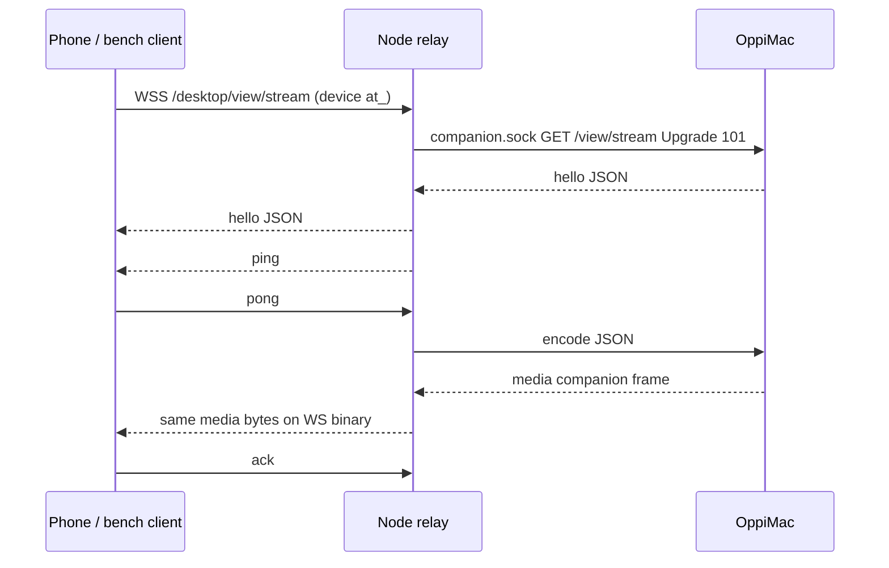

# Desktop live-view lane

Part of [Oppi server architecture](../architecture-server.md). Experimental Mac → Node H.264 relay (`experimental.desktopLiveView`, default off). Slice 1: companion capture/encode, Node rate control, shaped-link bench. Slice 2 adds the iPhone viewer.

## Owners

| Fact | Owner |
| --- | --- |
| View grant, selected surface, NV12 capture, H.264 encode | OppiMac (`clients/apple/OppiMac/Capture`) |
| Device auth, experiment flag, in-flight window, quality ladder | Node (`server/src/desktop-view-stream.ts`, `desktop-view-rate-controller.ts`) |
| Phone-wire media bytes | Mac writes them; Node forwards the companion media payload unchanged |

Newest captured pixel buffer wins before encode. Encoded frames are not dropped mid-relay. Exceeding the hard in-flight cap closes the stream.

## Topology

Flag off or an owner principal is HTTP 404 before upgrade (network owner `sk_` is still 401). Connect requires the Mac grant bound to this device. One live stream per process. Grant revoke/expiry, surface loss, and device revoke close the socket.

## Wire

Control is JSON. Video is a 24-byte header plus AVCC H.264 (4-byte NAL lengths). SPS/PPS are prepended as length-prefixed NALUs on every IDR. Feature string `h264-avcc`. Companion unix frames are `u32be length | u8 type | payload` (`type` 1 = JSON, 2 = media). Media payloads are the phone binary frame. Phone binary frames are sent with `compress: false`.

| Offset | Field |
| --- | --- |
| 0 | version u8 = 1 |
| 1 | flags u8 (bit 0 = keyframe) |
| 2 | header size u8 = 24 |
| 3 | reserved |
| 4 | frameId u32be |
| 8 | capturedAtMs u64be |
| 16 | width u16be |
| 18 | height u16be |
| 20 | payloadBytes u32be |
| 24 | AVCC H.264 |

Fatal application codes **4100–4199** must not reconnect. A companion hello with missing `features` or `version !== 1` closes with 4100. Fixture: `protocol/desktop-view-stream.json`.

## Rate control

Clock-injected. Window = `max(2 × frameBytes, 1.5 × commandedBitrate/8 × baseRTT)`. Ack rate is not used for the window. Base RTT is ping-only, windowed min over 10 s, and only from pings sent while in-flight bytes ≤ one P-frame (`bitrate/8/fps`) and, when any media is in flight, the phone socket `bufferedAmount === 0`. The stream reads `bufferedAmount` and passes idle-at-send; a ping sent behind queued frames does not update base RTT. Control-only bytes (hello) with no media in flight do not block the first sample. If the newest idle sample is older than 10 s, `shouldEncode` waits (no media) until an idle ping returns. Before the first real down-step, `shouldEncode` wakes every `max(50 ms, baseRTT)` and raises one rung even during the fps wait. A full window does not reset that clock. Down-step only when the **minimum** frame RTT over `max(1 s, 2 × baseRTT)` exceeds `base + max(50 ms, 0.5·base)`, at most once per base RTT. Hold starts at 1 s and doubles only when the level actually decreases (cap 8 s), then resets after 5 s clean. Ladder drops fps before scale. Hard cap 2 MiB: companion reader max is the cap; Node closes if a companion payload exceeds it or if `ws.bufferedAmount + payload` would exceed it. Not a second pacer.

## Encoder

Hardware + low-latency (`RequireHardwareAcceleratedVideoEncoder`, `EnableLowLatencyRateControl`). Low-latency documents High profile only; this Mac uses `H264_High_AutoLevel`. Output callback is a retained per-frame box (`sourceFrameRefcon`); no VideoToolbox call runs under the encoder lock. A generation checked under that lock is required before installing a new VT session: `invalidate` bumps it and sticks, `attach` starts a new generation. Companion writes drop unless the generation matches the one captured when `encode` started. `fail` only `shutdown`s the fd; the read thread closes after `read` returns. Every ScreenCaptureKit live-view terminal path (`didStopWithError` any error, failed `startCapture`) ends the stream with `surfaceGone` and does not idle-encode after the producer stops.

## Bench

Userspace FIFO shaper: shared per-direction `nextFreeAt` serialization, pipelined one-way delay (deliverAt from arrival, not serial await), jitter, stalls. Not a token bucket. Not real packet loss. Fake companion, no Screen Recording. Payloads are random; keyframes ~6× P-frame size. Runs are ≥30 s. fps/kbps are over first→last arrival. Ladder is a time-weighted level histogram plus down-step count. Post-ramp dwell starts at the first down-step, or at first reaching the run's max level.

Command: `cd server && npm run bench:desktop-live-view`

Bench date: 2026-10-11 (slice 1b, idle base-RTT sampling). Band targets are still reported; they do not fail the harness. Slice 1b gates (harness exits non-zero on miss): LAN L7 ≤ 1 s after first frame; no preset commands a rung above its link rate for > 2 s cumulative after ramp; bad-cell control-ping p95 materially below the slice-1 838 ms (800 ms stall is a floor). Post-ramp starts at the first down-step, or at first reaching the run's max level. LAN idle-drain cost on this run: 0 ms (ttff 22 ms, first ping idle, no 10 s pause).

| preset | ttff_ms | fps | age_p50 | age_p95 | age_max | gaps>100ms | kbps | ladder | ctrl_p50 | ctrl_p95 | revoke_ms | over_link_ms | gates | bands |
| --- | ---: | ---: | ---: | ---: | ---: | ---: | ---: | --- | ---: | ---: | ---: | ---: | --- | --- |
| lan | 22 | 29.12 | 2 | 3 | 19 | 1 | 7817.5 | L7:99% down=0 | 3 | 4 | 5 | 0 | PASS L7≤1s, over-link | PASS |
| tailscale-wan | 299 | 27.24 | 46 | 50 | 201 | 5 | 7342.9 | L7:93% down=0 | 93 | 101 | — | 0 | PASS over-link | PASS L6–L7 |
| lte | 437 | 21.36 | 73 | 143 | 301 | 6 | 5601.8 | L7:71% down=0 | — | — | — | 0 | PASS over-link | FAIL L5–L6 (post-ramp is L7) |
| bad-cell | 868 | 10.94 | 165 | 1254 | 1274 | 9 | 1352.1 | L6:41% down=0 | 310 | 1463 | — | 1484 | PASS over-link; FAIL ctrl p95 1463 (not below 838) | FAIL L2–L4 |

The earlier WAN miss was the shaper: each chunk awaited the previous chunk's full one-way delay, so fps could not exceed ~1000/(delay+jitter) and the byte-rate controller looked app-limited. After pipelining deliverAt from arrival, LAN and tailscale-wan pass. LTE stays at L7 (8 Mbit/s commanded on 8 Mbit/s) so L5–L6 post-ramp is 0% once post-ramp starts at first L7. Slice 1b idle sampling keeps base RTT from tracking the standing queue; over-link after ramp was ≤ 2 s on this run. bad-cell control-ping p95 is stall-dominated (shared `nextFreeAt`, 800 ms stall); unmodified slice-1 with no media already measured p95 954 ms, so 838 ms is not a stable ceiling. Targets not loosened. Userspace shaper cannot emulate real packet loss.

VideoToolbox: hardware + low-latency High profile on this Mac. OppiMacTests decode real AVCC output (SPS/PPS+IDR, P-frame, forced IDR, AverageBitRate readback) via `completeFrames()`.

Chen's leftover: real ScreenCaptureKit through OppiMac once slice 2 shows it on the phone.
