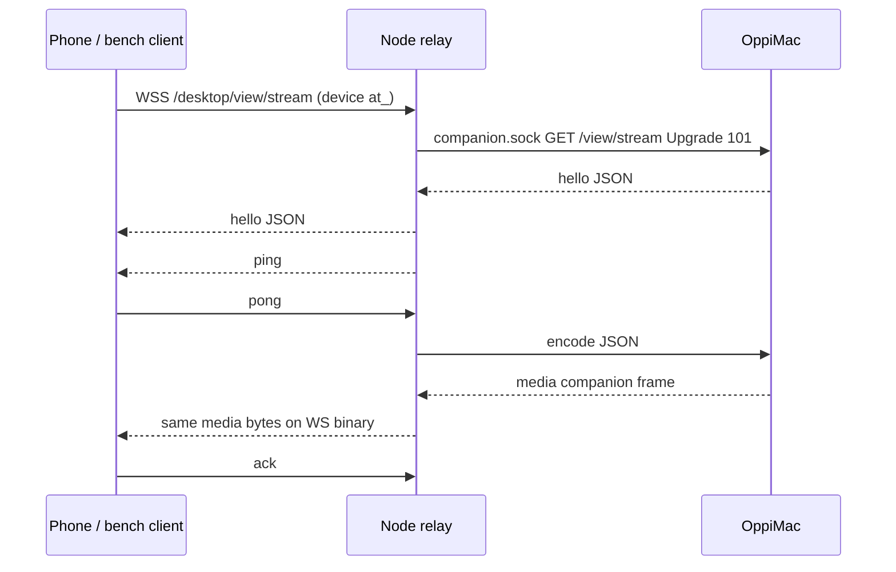

# Desktop live-view lane

Part of [Oppi server architecture](../architecture-server.md). Experimental Mac → Node H.264 relay (`experimental.desktopLiveView`, default off). Slice 1: companion capture/encode, Node rate control, shaped-link bench. Slice 2 adds the iPhone viewer.

## Owners

| Fact | Owner |
| --- | --- |
| View grant, selected surface, NV12 capture, H.264 encode | OppiMac (`clients/apple/OppiMac/Capture`) |
| Device auth, experiment flag, in-flight window, quality ladder | Node (`server/src/desktop-view-stream.ts`, `desktop-view-rate-controller.ts`) |
| Phone-wire media bytes | Mac writes them; Node forwards the companion media payload unchanged |

Newest captured pixel buffer wins before encode. Encoded frames are not dropped mid-relay. Exceeding the hard in-flight cap closes the stream.

## Topology

Flag off or an owner principal is HTTP 404 before upgrade (network owner `sk_` is still 401). Connect requires the Mac grant bound to this device. One live stream per process. Grant revoke/expiry, surface loss, and device revoke close the socket.

## Wire

Control is JSON. Video is a 24-byte header plus AVCC H.264 (4-byte NAL lengths). SPS/PPS are prepended as length-prefixed NALUs on every IDR. Feature string `h264-avcc`. Companion unix frames are `u32be length | u8 type | payload` (`type` 1 = JSON, 2 = media). Media payloads are the phone binary frame. Phone binary frames are sent with `compress: false`.

| Offset | Field |
| --- | --- |
| 0 | version u8 = 1 |
| 1 | flags u8 (bit 0 = keyframe) |
| 2 | header size u8 = 24 |
| 3 | reserved |
| 4 | frameId u32be |
| 8 | capturedAtMs u64be |
| 16 | width u16be |
| 18 | height u16be |
| 20 | payloadBytes u32be |
| 24 | AVCC H.264 |

Fatal application codes **4100–4199** must not reconnect. Fixture: `protocol/desktop-view-stream.json`.

## Rate control

Clock-injected. Window = `max(2 × lastFrameBytes, 1.5 × deliveredRate × baseRTT)`. Base RTT is ping-only, windowed min over 10 s. Frame-ack RTT above `base + max(50 ms, 0.5·base)` steps down at most once per RTT. Step-up hold starts at 1 s, doubles on congestion up to 8 s, resets after 5 s clean. Ladder drops fps before scale. Hard cap 2 MiB closes rather than buffering. No WS `bufferedAmount` layer.

## Encoder

Hardware + low-latency (`RequireHardwareAcceleratedVideoEncoder`, `EnableLowLatencyRateControl`). Low-latency documents High profile only; this Mac uses `H264_High_AutoLevel`. Output callback is a retained per-frame box (`sourceFrameRefcon`); no VideoToolbox call runs under the encoder lock.

## Bench

Userspace FIFO shaper: shared per-direction `nextFreeAt` serialization, one-way delay, jitter, stalls. Not a token bucket. Not real packet loss. Fake companion, no Screen Recording. Payloads are random; keyframes ~6× P-frame size. Runs are ≥15 s. fps/kbps are over first→last arrival. Ladder is a time-weighted level histogram plus down-step count.

Command: `cd server && npm run bench:desktop-live-view`

| preset | ttff_ms | fps | age_p50 | age_p95 | age_max | gaps>100ms | kbps | ladder | ctrl_p50 | ctrl_p95 | revoke_ms |
| --- | ---: | ---: | ---: | ---: | ---: | ---: | ---: | --- | ---: | ---: | ---: |
| lan | 18 | 24.7 | 2 | 2 | 17 | 14 | 5092.7 | L0:7% L1:7% L2:7% L3:7% L4:7% L5:7% L6:7% L7:53% down=0 | 3 | 4 | 5 |
| tailscale-wan | 429 | 7.54 | 47 | 76 | 181 | 72 | 398.4 | L0:51% L1:43% L2:6% down=3 | 92 | 101 | 61 |
| lte | 580 | 5.32 | 74 | 146 | 178 | 71 | 284.5 | L0:93% L1:7% down=1 | 144 | 220 | 66 |
| bad-cell | 1133 | 4.54 | 204 | 671 | 1009 | 62 | 245.7 | L0:89% L1:11% down=1 | 457 | 959 | 143 |

LAN spends most of the run at level 7 with 18 ms to first frame. Shared-bottleneck control ping under load is reported. Userspace shaper cannot emulate real packet loss.

VideoToolbox: hardware + low-latency High profile on this Mac. OppiMacTests decode real AVCC output (SPS/PPS+IDR, P-frame, forced IDR, AverageBitRate readback) via `completeFrames()`.

Chen's leftover: real ScreenCaptureKit through OppiMac once slice 2 shows it on the phone.
