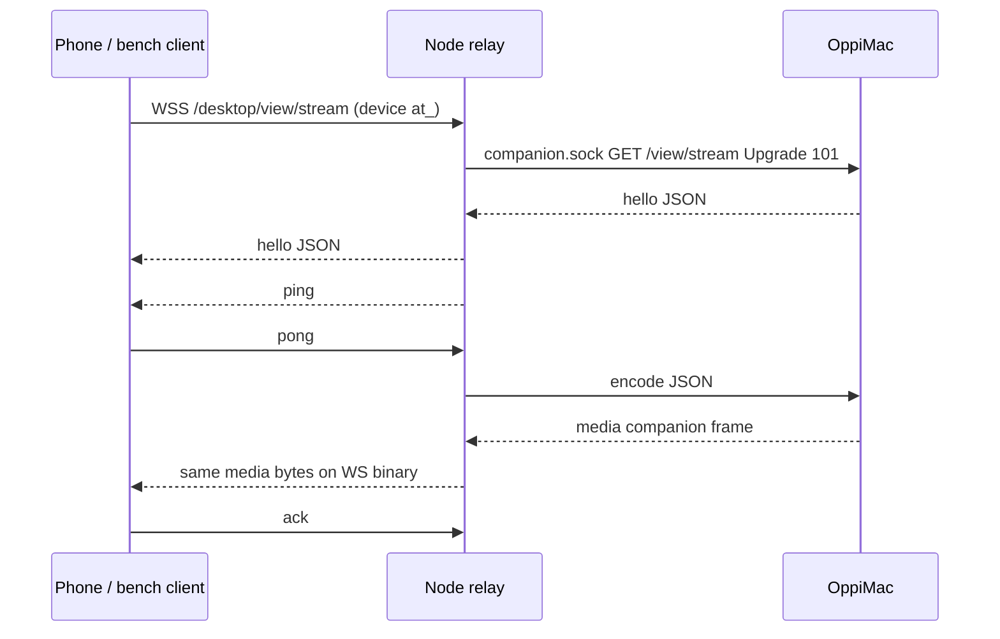

# Desktop live-view lane

Part of [Oppi server architecture](../architecture-server.md). Experimental Mac → Node H.264 relay (`experimental.desktopLiveView`, default off). Slice 1: companion capture/encode, Node rate control, shaped-link bench. Slice 2 adds the iPhone viewer.

## Owners

| Fact | Owner |
| --- | --- |
| View grant, selected surface, NV12 capture, H.264 encode | OppiMac (`clients/apple/OppiMac/Capture`) |
| Device auth, experiment flag, in-flight window, quality ladder | Node (`server/src/desktop-view-stream.ts`, `desktop-view-rate-controller.ts`) |
| Phone-wire media bytes | Mac writes them; Node forwards the companion media payload unchanged |

Newest captured pixel buffer wins before encode. Encoded frames are not dropped mid-relay. Exceeding the hard in-flight cap closes the stream.

## Topology

Flag off or an owner principal is HTTP 404 before upgrade (network owner `sk_` is still 401). Connect requires the Mac grant bound to this device. One live stream per process. Grant revoke/expiry, surface loss, and device revoke close the socket.

## Wire

Control is JSON. Video is a 24-byte header plus Annex-B H.264. SPS/PPS precede every IDR. Companion unix frames are `u32be length | u8 type | payload` (`type` 1 = JSON, 2 = media). Media payloads are the phone binary frame.

| Offset | Field |
| --- | --- |
| 0 | version u8 = 1 |
| 1 | flags u8 (bit 0 = keyframe) |
| 2 | header size u8 = 24 |
| 3 | reserved |
| 4 | frameId u32be |
| 8 | capturedAtMs u64be |
| 16 | width u16be |
| 18 | height u16be |
| 20 | payloadBytes u32be |
| 24 | Annex-B H.264 |

Fatal application codes **4100–4199** must not reconnect. Fixture: `protocol/desktop-view-stream.json`.

## Rate control

Clock-injected. Window = `max(2 × lastFrameBytes, 2.5 × deliveredRate × baseRTT)`. Ladder drops fps before scale. Step-up needs 100 ms of a half-empty window. Hard cap 2 MiB closes rather than buffering.

## Bench (2026-10-10)

Userspace shaper (token bucket, one-way delay, jitter, stalls). Not real packet loss. Fake companion, no Screen Recording.

Command: `cd server && npm run bench:desktop-live-view`

| preset | ttff_ms | fps | age_p50 | age_p95 | age_max | gaps>100ms | kbps | ladder | ctrl_p50 | ctrl_p95 | revoke_ms |
| --- | ---: | ---: | ---: | ---: | ---: | ---: | ---: | --- | ---: | ---: | ---: |
| lan | 19 | 26.75 | 2 | 3 | 4 | 1 | 6406.1 | 0→7→7 | 3 | 4 | 4 |
| tailscale-wan | 381 | 18.25 | 59 | 114 | 120 | 2 | 1090.2 | 0→5→2 | 91 | 100 | 108 |
| lte | 594 | 13.5 | 180 | 664 | 733 | 3 | 711.8 | 0→4→3 | 143 | 278 | 742 |
| bad-cell | 1163 | 4.5 | 461 | 1469 | 1469 | 17 | 231.7 | 0→3→0 | 292 | 1075 | 526 |

LAN reached the top rung (level 7) with 19 ms to first frame. Control-WebSocket ping under load is reported, not hidden. Userspace shaper cannot emulate real packet loss.

VideoToolbox: in-process XCTest waiting on `VTCompressionSessionCompleteFrames` / encoded-frame callbacks hung 240–360s without delivering a sample. Slice 1 therefore asserts session create and bitrate-without-rebuild in OppiMacTests; Annex-B IDR/SPS/PPS on the wire is still produced by the encoder path for the live companion, but that bitstream is not decoded in XCTest. Chen's leftover: real ScreenCaptureKit through OppiMac once slice 2 shows it on the phone.
