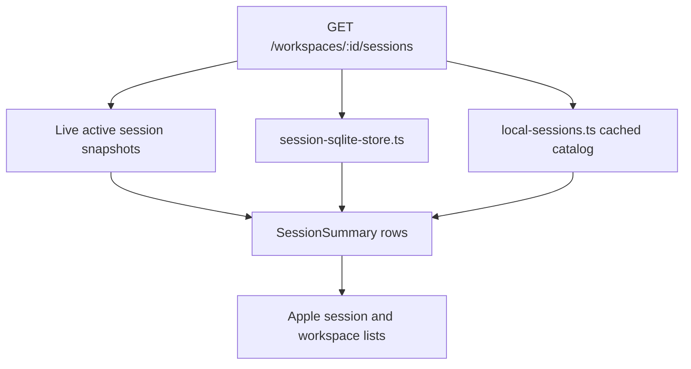

# Oppi server architecture: Read models and event stream

Part of [Oppi server architecture](../architecture-server.md). Session list and history read models, and the app event stream.

## Session list and history read models

Workspace navigation uses `SessionListService` over SQLite-backed snapshots and the local-session catalog instead of reading full JSONL traces on the hot path. The workspace catalog can opt into compact Git summaries (`changedCount`, `ahead`, and `behind`); this uses a lightweight status probe rather than the full review-oriented Git status payload.

The recent lane is time-bounded with `sinceMs` and `untilMs`. Older stopped sessions and importable local sessions are summarized into archive buckets and loaded lazily. `SessionListService` alone places both kinds of session in a bucket, in the server's local time zone: a calendar day for the last 30 days, else a calendar month, each ending at the next local midnight (so a daylight-saving day spans 23 or 25 hours). The iOS workspace list starts its recent lane at its local midnight and asks for buckets before that same instant (`beforeMs`). Every bucket ends at or before `beforeMs`, and the client also caps a bucket request there, so a session is never in both the recent lane and a bucket. When the server's time zone differs from the phone's, a calendar day can still be split between the recent lane and the newest bucket.

`SessionTraceService` owns trace paging, outline snapshots, recovery, tool output lookup, overall diffs, changed-file summaries, and raw changed-file previews.

### Session changes: touched list and worktree git view

A session has two change views, and they answer different questions:

- **Touched list** (`changeStats.changedFiles`, `GET …/sessions/{id}/changes`, per-file `GET …/diff?path=`): the paths the session's own `edit`/`write` calls named, recorded per tool call by `updateSessionChangeStats` with no git. It is approximate (bash and other tools are not seen) and is the only view a main-checkout session has. Harness URLs (`agent://`, `local://`, …) never count (`extractPath`). The per-file diff is rebuilt from the trace's mutations (`diff-core.ts`), so it shows what this session's edits did.
- **Worktree view** (`changeStats.worktree`, `GET …/sessions/{id}/worktree-changes`, per-file `GET …/worktree-diff?path=`): for a session in its own worktree (`worktreeId` set and not `main`), git's answer for the worktree vs its base, the merge-base of its HEAD and `main-worktree/HEAD` (the workspace's main checkout). Committed, uncommitted, and untracked changes count together, whoever made them, so it is the worktree's change set: every session in that worktree shares it, and `sessionTouched` marks the files this session's own calls named.

`session-git-changes.ts` owns the worktree view and its git budget. Git is read-only here (no commits, refs, index writes, or stash): only plumbing runs, because porcelain `git diff` and `git status` refresh and rewrite the worktree's index, which collides with an agent's own `git commit` on `index.lock`. Nothing runs per tool call: a tool end only bumps an in-memory generation for the worktree. `agent_settled` (not `agent_end`, which precedes an automatic retry) of a turn in which a tool ran runs one read and stores the bounded result on `changeStats.worktree` (counts, lines, base and HEAD, up to 100 paths). Session summaries carry its counts only, so list rows never run git; the paths stay on the session for the removed-worktree fallback. A read is `rev-parse HEAD main-worktree/HEAD`, `merge-base` only for a new (HEAD, target) pair, then `diff-index --raw --numstat --no-renames <base>` (a file whose stat changed but whose content did not is dropped) and `ls-files --others --exclude-standard` in parallel. Untracked lines are counted asynchronously for the first 200 untracked files; a listing past 4 MiB keeps what it read. One read runs per worktree at a time, shared by every caller that arrives while it runs. The worktree's path comes from `git worktree list` once per process, a worktree under removal counts as gone, and a gone one is not looked up again for 30 seconds. HEAD being the merge-base (main contains it) is a landing only with evidence of commits made in the worktree; a worktree that only synced with main (fast-forward, rebase, reset) or was reset to its base is measured from the plain merge-base. The first evidence is the landing's own record: a fast-forward landing leaves an entry in the main checkout's reflog whose new sha is the worktree's HEAD. The reflog of the branch the main checkout has checked out is read first (it has no `checkout` entries, and `git update-ref` from another worktree logs only there), then `<commonDir>/logs/HEAD` with its `checkout:` entries skipped (checking main out again records the previous checkout as old sha); its old sha is main's tip just before the landing, the right base for plain commits, rebases (fixups and autosquash too), and merges of main. Both are file reads of the last 64 KB, no git process, and their mtimes are in the cache signal. The entry counts when HEAD was made in the worktree, read from the worktree's own HEAD reflog (an entry reaching HEAD that created a commit: `commit…`, a `rebase` or `pull --rebase` pick, fixup, squash, reword, edit, or continue, `cherry-pick`, `revert`, or a `merge` or `pull` that made a merge commit), and one cached `merge-base --is-ancestor` shows the old sha is in HEAD. A HEAD that arrived from outside (a fast-forward sync, `reset`, `checkout`, or a rebase that only fast-forwarded) is never a landing, even when main's reflog reached that sha by main's own commit or another worktree's landing. This covers a commit and a landing in one turn, on the first turn too. Without reflog evidence, the commits stored at the last turn end count when they were the worktree's own (stored HEAD is not stored base): while HEAD is still the stored HEAD the read measures from the stored base, and once HEAD has moved but still contains them (a sync after landing) the live read is empty and both the turn end and `worktree-changes` answer with the stored value (`live: false`), so the row and the list agree. Only the stored evidence applies, so a commit and a landing in the same turn reads as zero, with reflogs off (`core.logAllRefUpdates=false`), when the landing entry is past the last 64 KB of the reflog, or for a `--no-ff` landing (main's new tip is a merge commit, so no reflog entry names HEAD). A cached or shared read is reused for a caller only when it fits that caller's stored commits. `worktree-changes` reuses the last snapshot while the worktree's generation, the mtimes of its `index`, `HEAD`, and HEAD reflog and of the main checkout's HEAD reflog, and a 10-second age all match, so a read right after a turn costs no git; `worktree-diff` reads the base blob with one `cat-file` and the current file from the worktree. When the worktree is gone (removed after landing), `worktree-changes` answers the list stored at the last turn end (`live: false`) and `worktree-diff` reads the stored base and HEAD blobs from the main checkout's object store, falling back to the trace diff. A later turn end that cannot read the worktree keeps the stored value.

Session detail uses bounded trace pages and lightweight outline data where possible. Full trace reads remain behind recovery and compatibility paths:

- `readSessionTrace(...)` for server-owned persisted traces,
- `readSessionTraceFromFile(...)` and `readSessionTraceFromFiles(...)` for Pi JSONL files,
- `readSessionTraceByUuid(...)` for UUID lookup fallback.

## App event stream

`AppEventStreamMux` converts session broadcast events into app-level messages. It sends only allowed `AppEventMessage` types:

- session created/imported/discovered/deleted/ended,
- session summaries,
- stop requested/confirmed/failed,
- session errors,
- extension UI request/settled, and notifications other than session surface and editor methods,
- workspace git changed,
- app-event stream connected.

It does not send focused timeline deltas, full session state, queue state, command results, dictation frames, or raw `GitStatus` payloads. Session surface and editor notifications (`setStatus`, `setWidget`, `setTitle`, the `setWorking*` family, `setHiddenThinkingLabel`, `setToolsExpanded`, `set_editor_text`) stay on that session's stream, which replays the persistent ones on subscribe; only that session's chat shows them, and a busy session can update its working text every second. On connect it sends `app_events_connected` with `snapshotRequired: true`; clients repair state through HTTP snapshots.
