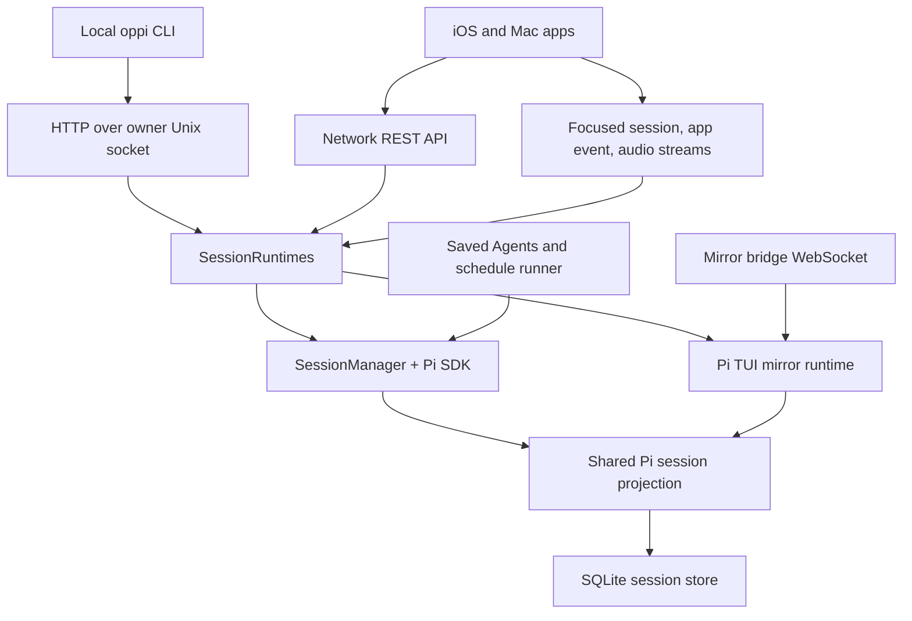

# Oppi architecture

> **What belongs here:** the cross-system map: owners, boundaries, invariants that span server and clients, and where to read next. Feature behaviour and history belong in code comments and tests. Standard and budgets: [`dev/README.md`](README.md#what-belongs-in-dev).

Oppi pairs Apple clients with an Oppi server to view, prompt, and steer Pi sessions. The server embeds the Pi SDK for managed sessions, mirrors terminal-owned Pi TUI sessions through the Oppi Mirror extension, and stores saved Agent and schedule state. The local CLI uses HTTP over an owner-only Unix socket; Apple clients use authenticated HTTPS/WSS, including over Tailscale.

Details: [Server architecture](architecture-server.md), [Client architecture](architecture-client.md), [Networking](networking.md).

## Runtime topology

The server is the authority for sessions, workspace access, runtime configuration, saved Agents and schedules, and the mobile session projection; the app is a remote control and renderer. Execution belongs to the server's Pi SDK runtime or to a terminal Pi TUI connected through the mirror bridge.

Both Apple clients share protocol DTOs, `ChatSessionManager`, and reducers in `OppiCore`. iOS adapts over paired HTTPS/WSS and paints with UIKit; Mac adapts over the owner Unix socket, paints with AppKit/SwiftUI, and attaches to, waits for, or spawns the local runtime.

## Runtime ownership and projection

Managed SDK sessions, mirrored terminal sessions, and local JSONL imports are adapters into one Pi-backed session model. Adapters differ only where ownership differs (start, stop, abort, commands, queue control, extension UI responses); shared projection owns event translation, session mutation, media, titles, summaries, and the SQLite read model. Live mirror and JSONL import coalesce by `Session.id` and canonical `piSessionFile`, so one terminal session is one row. `Session.runtime` is `"oppi"` (server-owned) or `"pi-tui"` (terminal-owned); `SessionRuntimes` dispatches on it.

## Transport map

| Lane | Transport | Carries |
| --- | --- | --- |
| Local CLI | HTTP over Unix socket | CLI routes, no host, port, TLS, DNS, or Tailscale |
| Sessions inbox, workspace catalog, workspace recent list, archive buckets | HTTP | summaries, counts, attention, compact Git summary, importable local rows |
| Files and media, host files | HTTP GET/HEAD | listings, bytes, uploads, attachments, byte ranges |
| Quick actions, review comments, Agents, schedules | HTTP | definitions, launches, runs |
| App event stream | server → client WebSocket | row updates, extension attention, workspace invalidation |
| Focused session stream | bidirectional WebSocket | timeline events, prompts, commands, queue sync |
| Focused session catch-up | HTTP GET | missed durable events after reconnect |
| Mirror bridge | bidirectional WebSocket | terminal session registration, takeover, commands, extension UI proxying |
| Dictation stream | JSON + binary WebSocket | control frames, PCM, transcripts |

Prompt to pixel: `ClientMessage` → `ws-message-handler.ts` → `SessionRuntimes` → SDK or mirror → shared projection → `session-broadcast.ts` (durable sequence) → focused stream → `ServerConnection.routeStreamMessage` → `ChatSessionManager` → `DeltaCoalescer` → `TimelineReducer` → timeline. Durable events carry per-session sequence numbers for catch-up; high-frequency deltas are hot traffic repaired from paged trace history, never a full trace load.

## Cross-system invariants

- The local CLI uses bearer-authenticated HTTP over the owner Unix socket and never discovers or falls back to a network listener.
- The Mac app uses the same socket for HTTP and live WebSocket upgrades and never sends `sk_` over HTTPS/WSS; unauthenticated `GET /health` may use localhost HTTPS.
- Remote access is HTTPS/WSS, independent of the CLI socket; remote failures fail closed without disabling local routes. Device credentials bind a per-device P-256 key and a short-lived token.
- Workspace navigation is HTTP-first. The app-event stream is store-level only: never timeline deltas, full state, queue state, command results, audio, or raw `GitStatus`; compact Git state comes from the catalog snapshot. App-event reconnect repairs from HTTP snapshots, not replay.
- The Workspaces root is a server-scoped active-session inbox. The hot recent list is time-bounded; older history is in archive buckets. Session-list endpoints return summaries, not full `Session` payloads.
- Hot workspace endpoints never reread `~/.pi/agent/sessions/*.jsonl`; importable TUI metadata comes from the cached local-session catalog and SQLite read models. Imported sessions stay resumable without mutating their JSONL.
- Mirror sessions are terminal-owned: the server never auto-starts an SDK runtime for a `runtime == "pi-tui"` session.
- Hot timeline traffic stays separate from cold projections. Files, attachments, and media stay on authenticated HTTP with byte ranges. Quick actions, review comments, Agents, and schedules stay on HTTP; only the created or focused session uses the session stream.
- Scheduled runs use the managed-session launch path, not a separate adapter.
- The client applies shared store updates exactly once per inbound live event. Reducers, coalescers, and focused-session policy stay UI-framework-free in `OppiCore`. A still-stopped session stays history-only: opening its focused stream can resume server-owned execution.

## Protocol boundary

The server source of truth is `server/src/types/protocol.ts` (re-exported by `server/src/types.ts`); Apple mirrors live in `clients/apple/OppiCore/Models/`. Change server types, Apple models, and protocol tests together: a mismatched pair fails at the transport boundary. Checklist: [Server architecture](architecture-server.md#protocol-boundary).
