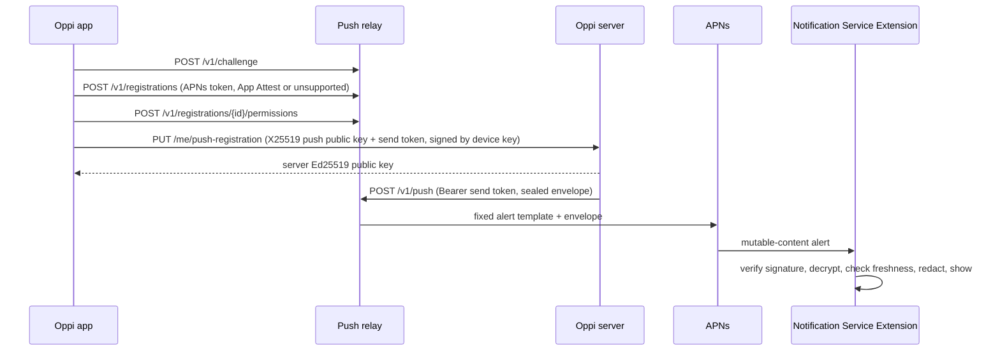

# Oppi Push: Envelope v1 and Relay API v1

Status: v1, unreleased. Implemented by `server/src/push/`, `relay/`, and
`clients/apple/OppiCore/Push/` with the `OppiNotificationService` extension.

Oppi pushes are end-to-end encrypted. A paired Oppi server encrypts each notification to a
key that only the phone holds and signs it with the server's identity key. The relay and
Apple Push Notification service (APNs) carry ciphertext they cannot read. There is no
plaintext push path: a device without a registered push key gets no push.

Push is opt-in on both ends. The server operator sets `push.mode` to `relay`
(`off` is the default), and the user turns on push for that server in the app.



## 1. Keys

| Key | Owner | Algorithm | Purpose |
| --- | --- | --- | --- |
| Server identity key | Oppi server (`identity_ed25519`) | Ed25519 | Signs every envelope. The app pins its fingerprint `sha256:<base64url(SHA-256(raw public key))>` at pairing. |
| Device key | App (Secure Enclave when available) | ECDSA P-256 | Existing pairing key. Signs the push registration so a TLS-terminating proxy cannot swap the push key or send token. |
| Push key | App, one per paired server | X25519 | HPKE recipient key. The 32-byte raw private key lives in the keychain shared with the extension, `kSecAttrAccessibleAfterFirstUnlockThisDeviceOnly`. Never leaves the phone. |
| App Attest key | App (Secure Enclave) | ECDSA P-256 | Proves a genuine Oppi build to the relay at registration; signs relay management requests. |

`keyId` (`kid`) is the first 16 bytes of `SHA-256(raw 32-byte push public key)`; text form is base64url
without padding (22 characters).

The app rotates a push key after 30 days at its next registration and keeps the previous
private key until the following rotation, so pushes sealed to it while the new
registration propagates still open. The server stores only the latest public key per
device.

## 2. Envelope v1

All lengths are bytes. Base64url is RFC 4648 §5 without padding.

| Offset | Length | Field |
| --- | --- | --- |
| 0 | 1 | `version` = `0x01` |
| 1 | 16 | `kid` |
| 17 | 32 | `enc`: HPKE encapsulated key (the sender's ephemeral X25519 public key) |
| 49 | 528 | `ct`: HPKE ciphertext of the 512-byte padded plaintext plus a 16-byte tag |
| 577 | 64 | `sig`: Ed25519 signature |

Total: **641 bytes**, **855** base64url characters. Every v1 envelope has exactly this
length, so size reveals nothing about content.

### 2.1 Encryption

HPKE (RFC 9180) base mode, single shot, with ciphersuite:

- KEM: DHKEM(X25519, HKDF-SHA256), `0x0020`.
- KDF: HKDF-SHA256, `0x0001`.
- AEAD: ChaCha20-Poly1305, `0x0003`.

CryptoKit names this suite `HPKE.Ciphersuite.Curve25519_SHA256_ChachaPoly`. The push public
key is the raw 32-byte X25519 key (`Curve25519.KeyAgreement.PublicKey.rawRepresentation`).
Both ends reject an all-zero X25519 shared secret (RFC 9180 §7.1.4).

- `info` = UTF-8 `oppi-push-envelope-v1`
- `aad` = envelope bytes `[0, 17)` (`version || kid`)

### 2.2 Signature

`sig` = Ed25519 over UTF-8 `oppi-push-envelope-v1-sig`, one `0x00` byte, then envelope
bytes `[0, 577)`. The signature covers the version, `kid`, `enc`, and `ct`.

### 2.3 Padded plaintext

512 bytes: `uint16 big-endian length || UTF-8 JSON (length bytes) || zero bytes`.
`length` is at most 510. A receiver rejects a longer length or any nonzero padding byte.

### 2.4 Plaintext JSON

```json
{
  "v": 1,
  "ts": 1760000000000,
  "event": "blocked",
  "kind": "permission",
  "sessionId": "s_123",
  "workspaceId": "w_456",
  "title": "Needs Approval",
  "subtitle": "Fix the flaky test",
  "body": "Waiting for your approval."
}
```

| Field | Rule |
| --- | --- |
| `v` | `1` |
| `ts` | Server time in Unix milliseconds when sealed. |
| `event` | `blocked`, `done`, `error`, `pairing_approval`, or `device_enrolled` |
| `kind` | `blocked` only: `permission`, `question`, or `auth` |
| `sessionId` | Session the push is about; omitted for `pairing_approval` and `device_enrolled` |
| `workspaceId` | Present when the session has a workspace |
| `approvalId` | `pairing_approval` only: the pending approval (`pa_...`) |
| `deviceId` | `device_enrolled` only: the newly paired device |
| `title`, `body` | Display text |
| `subtitle` | Session name; the server shortens it until the JSON fits 510 bytes, and drops it when nothing else fits |

Pairing pushes carry no session:

```json
{
  "v": 1,
  "ts": 1760000000000,
  "event": "pairing_approval",
  "approvalId": "pa_123",
  "title": "Approve New Device?",
  "body": "iPad wants to pair (invite, 100.64.0.7)."
}
```

`pairing_approval` goes to every active paired device with a push registration when a new
device waits for approval: title `Approve New Device?`, body
`<name> wants to pair (<method>, <source>).` `device_enrolled` goes to every other active
paired device with a push registration after any device enrolls: title `New Device Paired`,
body `<name> paired (<method>, <source>).`, and `ts` is the enrollment time. `method` is
`invite`, `tailscale`, or `custom`; `source` is the client IP, the Tailscale login, or the
custom approver's source, and the parenthesis holds only the method when there is none.
Apps that predate these events show the fixed fallback for them.

Receivers ignore unknown fields. There is no sequence number: the server keeps no per-push
state, and replay protection uses the envelope's `enc` (§2.5 step 7).

### 2.5 Receiver checks (Notification Service Extension)

In order. Any failure shows the fixed fallback (§4) and nothing from the push.

1. `e` in the APNs payload decodes to exactly 641 bytes with `version` `0x01`.
2. A push key with this `kid` exists on the phone. Its record names the paired server and
   holds that server's Ed25519 public key, checked against the pinned fingerprint when
   stored.
3. `sig` verifies with that server's public key.
4. HPKE open succeeds.
5. Padding and JSON are valid and `v` is `1`.
6. Freshness: `ts` is no more than 3,900 s old (relay TTL 3,600 s plus 300 s clock skew) and
   no more than 300 s in the future.
7. Replay: `enc` is the message ID. The sender draws a fresh ephemeral X25519 key for every
   push, and the signature covers it, so a repeated `enc` is a replay. Per `kid`, the
   extension keeps the `enc` of every push it accepted in the last 4,200 s (the 3,900 s
   maximum age plus the 300 s by which `ts` may be ahead, so an accepted push is remembered for
   as long as it can pass step 6) and rejects a repeat. Older entries are pruned. Because
   nothing depends on server state, re-registering the same key, a restored server config, or
   APNs reordering never rejects a real push.

   The ledger is an App Group file. If it cannot be read or decoded, the extension logs that,
   resets it, and continues: a replay of a push accepted within the last 4,200 s could then
   show once more, which is better than every later push showing the fallback. If the ledger
   cannot be saved, the push is rejected.

   Known limit: pruning uses the phone's wall clock. If the clock runs more than 300 s fast
   while a later push is accepted, that write can prune an earlier push's `enc`; after the
   clock is corrected, a replay of the earlier push is fresh again and shows once more. The
   replay can only repeat a genuine alert the phone already showed, so v1 accepts this rather
   than keeping a monotonic clock across reboots.

The extension logs each fallback's rejection reason (`size`, `version`, `unknownKey`,
`signature`, `decrypt`, `plaintext`, `stale`, `replay`, or a timeout) with `os.Logger`,
subsystem `dev.chenda.Oppi`, category `Push`. It never logs plaintext or key material.

### 2.6 Redaction

When App Lock is on, or a scoped lock (server, workspace, or session) covers the push's
session, the extension shows a redacted alert built only from `event` and `kind`: the
event title and the fixed event body below, no subtitle, and nothing else from the
plaintext.

| Event | Title | Body |
| --- | --- | --- |
| `blocked`/`permission` | Needs Approval | Waiting for your approval. |
| `blocked`/`question` | Question | Waiting for your answer. |
| `blocked`/`auth` | Sign-in Needed | Waiting for you to sign in. |
| `done` | Session Done | The run finished. |
| `error` | Session Error | Open Oppi to review the session error. |
| `pairing_approval` | Approve New Device? | A new device is waiting for your approval. |
| `device_enrolled` | New Device Paired | A new device was paired with your server. |

The pairing rows apply under App Lock or a server-scope lock; they have no workspace or
session, so narrower scoped locks do not cover them.

## 3. Relay API v1

JSON over HTTPS. Request bodies are at most 8 KiB (`413 body_too_large`). Unknown request
fields fail with `400 unknown_field`. Errors are `{"error": "<code>"}`. Secrets travel only
in the `Authorization` header, never in a URL.

### 3.1 App calls

**`POST /v1/challenge`** → `200 {"challenge": "<base64url 32 bytes>", "expiresAt": <ms>}`.
Single use, valid 300 s. Rate-limited per client address in memory (`429 rate_limited`);
the relay stores no addresses.

**`POST /v1/registrations`**

```json
{
  "challenge": "<from /v1/challenge>",
  "apnsToken": "<lowercase hex, 64-200 chars>",
  "environment": "sandbox",
  "attestation": { "keyId": "<base64>", "object": "<base64 CBOR attestation>" }
}
```

`attestation` is `null` on devices without App Attest (`DCAppAttestService.isSupported`
false). `clientDataHash` = `SHA-256(UTF-8 "oppi-relay-registration-v1\n" + challenge +
"\n" + apnsToken + "\n" + environment)`.

With an attestation the relay checks, per Apple's "Validating apps that connect to your
server": the `x5c` chain to the Apple App Attestation Root CA; the nonce extension
(OID `1.2.840.113635.100.8.2`) equals `SHA-256(authData || clientDataHash)`;
`SHA-256(credential public key)` equals `keyId`; `rpIdHash` equals `SHA-256(appId)`
(`<TeamID>.<bundle ID>`); the counter is 0; the AAGUID is `appattestdevelop` or
`appattest` + seven zero bytes; the credential ID equals `keyId`. A development AAGUID is
accepted only with `environment` `sandbox`.

`201`:

```json
{
  "registrationId": "r_<base64url 16 bytes>",
  "registrationSecret": "<base64url 32 bytes>",
  "attested": true,
  "limits": { "pushesPerDay": 200 }
}
```

Errors: `400 bad_request`, `400 unknown_field`, `400 challenge_invalid` (unknown, used, or
expired), `401 attestation_invalid`, `429 rate_limited`.

**Registration-authenticated calls** carry `Authorization: Bearer <registrationSecret>`.
Attested registrations also carry `X-Oppi-Assertion: <base64 CBOR assertion>` whose
`clientDataHash` = `SHA-256(UTF-8 "oppi-relay-request-v1\n" + METHOD + "\n" + path + "\n" +
base64url(SHA-256(body)))`. The relay verifies the ECDSA signature over
`SHA-256(authenticatorData || clientDataHash)` with the stored App Attest public key,
checks `rpIdHash`, and requires the counter to exceed the stored counter, then stores it.
Failures: `401 unauthorized`, `401 assertion_invalid`, `410 gone` for an unknown
registration.

- **`POST /v1/registrations/{id}/permissions`**, body `{}` → `201 {"permissionId":
  "p_<base64url 16 bytes>", "sendToken": "osp1.<registrationId>.<permissionId>.<base64url 32
  bytes>"}`. At most 16 permissions per registration (`409 too_many_permissions`). The app
  hands the token to one paired server, which treats it as opaque. The relay stores only
  `SHA-256` of its secret part; the ids route the request to the registration's storage.
- **`DELETE /v1/registrations/{id}/permissions/{permissionId}`** → `204`.
- **`DELETE /v1/registrations/{id}`** → `204`. Deletes its permissions.

### 3.2 Server calls

Carry `Authorization: Bearer <sendToken>`. A missing or malformed bearer is `401
unauthorized`. A well-formed token the relay does not hold is `410 gone`: the permission
was revoked, or its registration was deleted.

**`POST /v1/push`**

```json
{ "envelope": "<855 base64url chars>", "collapseId": "<22 base64url chars>", "ttl": 3600 }
```

- `envelope`: required; must decode to exactly 641 bytes starting with `0x01`
  (`413 envelope_size` otherwise, `400 bad_envelope` for a wrong version or alphabet). The
  relay does not and cannot open it.
- `collapseId`: optional; keyed hash chosen by the server (§5).
- `ttl`: optional seconds, 0-3600, default 3600.

Results: `200 {"ok": true}`; `410 gone` (also when APNs answers `410`, `400
BadDeviceToken`, or `400 DeviceTokenNotForTopic`: the relay deletes the registration
first); `429 quota_exceeded` with `Retry-After`; `502 apns_unavailable` for APNs `429`,
`5xx`, or network failure.

**`DELETE /v1/permission`** → `204`, idempotent. The server revokes its own permission.

**`GET /v1/version`** → `200 {"api": 1}`.

### 3.3 Quotas

Per registration and UTC day: 200 pushes when attested, 50 when not. Per registration:
at most 10 pushes per minute. These fit normal use within the Cloudflare Workers Free plan:
a push costs one Worker request, one Durable Object request, and one row written, of
100,000 each a day, so 200 phones at the daily cap use 40,000. A refused push writes
nothing. Unattested registrations: at most 5 per client address per
hour (in memory).

### 3.4 Relay storage

Per registration: id, `SHA-256(registrationSecret)`, APNs token, environment, attested
flag, App Attest public key and counter, creation time, permissions (id and
`SHA-256(secret)`), and quota counters. Challenges until used or expired. No envelopes,
no client addresses, no request logs.

### 3.5 APNs request (fixed template)

The relay accepts no APNs headers or payload fields from callers.

- `:path` `/3/device/<apnsToken>` on `api.push.apple.com` or `api.sandbox.push.apple.com`
  by the registration's environment.
- `apns-push-type: alert`, `apns-priority: 10`, `apns-topic: <bundle ID>`,
  `apns-expiration: now + ttl`, `apns-collapse-id` when given.
- Payload:

```json
{"aps":{"alert":{"title":"Oppi","body":"You have a new notification."},"mutable-content":1},"e":"<envelope>"}
```

There is no outer sound, thread ID, category, or interruption level. The extension sets
those after decrypting, so urgency and session grouping stay inside the ciphertext. It
stacks every `done` in one Notification Center thread; other session events stack per
session.

## 4. Fallback

When the extension cannot verify and decrypt a push, or runs out of time, the user sees the
outer alert: title `Oppi`, body `You have a new notification.` The extension never shows
any field from a push that failed a check. Without Apple's
`com.apple.developer.usernotifications.filtering` entitlement, it cannot drop the push.

## 5. Server behavior

- `push.mode`: `off` (default) or `relay`. `push.relays`: `[primary, standby]` HTTPS origins
  (`http` only for loopback, for local testing).
- The server advertises `capabilities.pushNotifications = {"version": 1, "relay":
  "<primary>"}` only in relay mode.
- **`PUT /me/push-registration`** (paired device credential only):

```json
{
  "keyId": "<22 chars>",
  "publicKey": "<base64url 32 bytes>",
  "sendToken": "osp1....",
  "relay": "<primary origin>",
  "issuedAt": 1760000000000,
  "signature": "<base64url 64-byte P-256 r||s>"
}
```

  The device key signs the UTF-8 lines, joined by `\n`:
  `oppi-push-registration-v1`, `deviceId`, server fingerprint, `keyId`,
  `base64url(SHA-256(publicKey))`, `base64url(SHA-256(UTF-8 sendToken))`, `relay`,
  `issuedAt` (decimal). The server checks that `keyId` matches the key, `issuedAt` is
  within 10 minutes of its clock, the signature verifies with the calling device's
  enrolled key, and `relay` equals its primary (`409 relay_mismatch`). It replaces the
  device's previous registration and answers `{"serverPublicKey": "<base64url 32 bytes>",
  "keyId": "<kid>"}`. The app checks the public key against the pinned fingerprint before
  storing it for the extension. In `off` mode the route answers `409 push_disabled`.
- **`DELETE /me/push-registration`** forgets the calling device's registration and asks
  the relay to delete its permission.
- Revoking a device or rotating the owner token removes its registration in the same
  write and asks the relay to delete the permission.
- Per-device budget, in memory: 200 pushes per UTC day and 10 per minute for each device,
  matching the relay's quota so the server stops before the relay refuses. Routine events
  (`done`, `error`, `device_enrolled`) stop at 180 a day and 8 a minute; the rest
  is kept for `blocked` and `pairing_approval`, which wait on the user. A relay `429` with
  `Retry-After` pauses that device's pushes until it passes.
- Events: `blocked` and `done` on program-status transitions, at most once a minute per
  session and kind, skipping devices that hold a live stream; `done` only for top-level
  sessions with no child session still starting or working; `error` on its lifecycle event.
  A session ending pushes nothing. `pairing_approval` when a pairing waits
  for approval and `device_enrolled` after each enrollment (never to the new device). See
  [onboarding](../../docs/onboarding.md) for when pairing needs approval.
- Sends go to the primary; network errors, timeouts, and `5xx` move to the standby. A `410`
  from the primary removes the device's registration; a `410` from the standby does not,
  because a standby may not share the primary's permissions.
- `collapseId` = base64url of the first 16 bytes of
  `HMAC-SHA256(key = SHA-256(sendToken), "oppi-push-collapse-v1\n" + key)`, where `key` is the
  `sessionId` for session events, `pairing:<approvalId>` for `pairing_approval`, and
  `device:<deviceId>` for `device_enrolled`: stable per device and subject, unlinkable across
  devices.
- Fail closed: the relay client accepts only a sealed-envelope type that only the sealing
  function constructs. No code path builds an APNs payload or a relay body from plaintext.

## 6. Threat model

| Party | Can | Cannot |
| --- | --- | --- |
| Relay operator, Cloudflare | See APNs tokens, environments, server IP addresses, push timing, collapse IDs, and whether a registration is attested. Drop, delay, or duplicate pushes. Send pushes that show the fixed fallback text. | Read content; forge content (Ed25519); replay accepted pushes (`enc` ledger and freshness; one exception after a phone clock correction, §2.5 step 7); learn content length (fixed size); learn urgency or session grouping (set inside the ciphertext). |
| Apple (APNs) | Same metadata as the relay, minus server addresses. | Same as the relay. |
| Network attacker between app and server, including a TLS-terminating proxy | See the push public key and send token. | Substitute either: the device key signs both. |
| Holder of a stolen send token | Push fallback-text alerts to one device until the token is revoked. | Read or forge content. |
| Another paired server | Push to the phone with its own token. | Decrypt or forge pushes for other servers: keys are per server. |
| The Oppi server | Everything; it is the source. | n/a (trusted) |

### 6.1 Practical threats, most severe first

End-to-end encryption protects what a push says. It does not decide which alerts reach the
Lock Screen. These are the threats that remain, ranked by how much harm they can do in
practice.

1. **Forged plaintext alerts (phishing).** Whoever holds the team's APNs key, or controls the
   relay deployment or its Cloudflare account, can send APNs any payload, including an alert
   without `mutable-content`. iOS shows that alert as sent; the extension never runs, so no
   signature check applies. The text can say anything, for example "Approve the deploy now".
   Encryption cannot prevent this. Mitigations:
   - key and account hygiene for the relay operator (`relay/README.md`, "Operator security");
   - **app invariant: a notification tap only opens Oppi to a session. It never approves,
     denies, answers, or replies.** Session notification categories register no actions, and
     the tap handler only navigates. A forged alert can mislead a person, but tapping it cannot
     act on anyone's behalf. Any future notification action breaks this invariant and needs its
     own authentication design.
2. **Fallback spam.** A leaked send token or a hostile relay can push the fixed fallback alert
   ("Oppi: You have a new notification.") to one device. It carries no attacker text. Relay
   quotas bound a leaked token (§3.3: daily and per-minute limits per registration); revoking
   the device or turning push off ends it. A hostile relay is not bound by its own quotas, but
   it can already do worse (threat 1). Apple's `com.apple.developer.usernotifications.filtering` entitlement, if
   granted, would let the extension drop such pushes instead of showing the fallback (§4).
3. **Lock Screen exposure.** Someone holding the phone can read a decrypted alert on the Lock
   Screen. App Lock and scoped locks remove the session name (§2.6); iOS **Settings →
   Notifications → Show Previews → When Unlocked** hides alert text until the phone is unlocked.
4. **Push key theft (out of scope).** The private push key is a keychain item with
   `kSecAttrAccessibleAfterFirstUnlockThisDeviceOnly`: it never moves to another device
   through a backup or iCloud Keychain, and only Oppi and its extension can read it. Taking it needs full device compromise, and
   an attacker with that can already open Oppi itself.

**Metadata that leaks by design:** device APNs token and environment; the sending server's
IP address (to the relay); the time of each push; one fixed size; the collapse ID's
per-device-and-session linkability; the attested flag; registration and permission counts.

**Post-quantum:** out of scope for v1. The KEM is classical X25519, so someone who records
envelopes today could read them with a future quantum computer. A post-quantum or hybrid KEM
can return later as a new envelope `version`. The Ed25519 signature is classical too;
forging it would need a quantum computer at the time of the attack, so there is nothing to
harvest.

**Out of scope for v1:** notification rules, a delivery log, Live Activities, a standby on
another cloud, and the independent cryptographic review.

## 7. Test vectors

`protocol/push/vectors/` holds vectors written only by explicit commands
(`cd server && npm run push:vectors:update`, which runs
`protocol/push/scripts/generate-vectors.sh`, and `npm run push:canary -- --write-capture`):

- `cryptokit-hpke.json`: HPKE ciphertexts sealed by CryptoKit to a test X25519 key; the server
  suite opens them.
- `server-envelopes.json`: envelopes sealed and signed by the server code; the Apple tests
  verify and open them and check that each negative case fails for its named reason. Also the
  registration-signature bytes both sides must build.
- `canary-capture.json`: APNs payloads the Node relay produced in the canary run; the Apple
  tests decrypt them back to the canaries and check that tampered, replayed, wrong-key, and
  oversized copies show the fallback. The last payload was sealed after the server forgot the
  registration and the phone registered the same push key again; it must open too.

Ordinary tests never rewrite them.

The server's HPKE code (`server/src/push/hpke.ts`, Node's built-in `crypto` only) is also
checked against RFC 9180 Appendix A.2.1, the official vector for this suite in base mode
(`server/tests/fixtures/hpke-rfc9180-a2.json`).

## 8. Canary proof

`cd server && npm run push:canary` (needs `npm ci` in `relay/`) runs real server sealing
through the real relay, both the Node adapter in capture mode and the Cloudflare adapter in
the local Workers runtime, to a mock APNs. Session name, session ID, and workspace ID are
canary strings. The run fails if any canary appears, raw or base64, base64url,
hex, UTF-16, or JSON-escaped, in the relay's input, logs, storage, or APNs output, or if any
captured envelope does not open back to them. It does not contact real APNs or Cloudflare.
