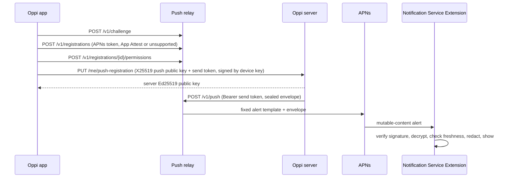

# Oppi Push: Envelope v1 and Relay API v1

Status: v1, unreleased. Implemented by `server/src/push/`, `relay/`, and
`clients/apple/OppiCore/Push/` with the `OppiNotificationService` extension. The
counts-only Live Activity (section 3.6) rides the same registrations and send tokens; it is
not encrypted and carries no text.

Oppi pushes are end-to-end encrypted. A paired Oppi server encrypts each notification to a
key that only the phone holds and signs it with the server's identity key. The relay and
Apple Push Notification service (APNs) carry ciphertext they cannot read. There is no
plaintext push path: a device without a registered push key gets no push.

Push is opt-in on both ends. The server operator sets `push.mode` to `relay`
(`off` is the default), and the user turns on push for that server in the app.



## 1. Keys

| Key | Owner | Algorithm | Purpose |
| --- | --- | --- | --- |
| Server identity key | Oppi server (`identity_ed25519`) | Ed25519 | Signs every envelope. The app pins its fingerprint `sha256:<base64url(SHA-256(raw public key))>` at pairing. |
| Device key | App (Secure Enclave when available) | ECDSA P-256 | Existing pairing key. Signs the push registration so a TLS-terminating proxy cannot swap the push key or send token. |
| Push key | App, one per paired server | X25519 | HPKE recipient key. The 32-byte raw private key lives in the keychain shared with the extension, `kSecAttrAccessibleAfterFirstUnlockThisDeviceOnly`. Never leaves the phone. |
| App Attest key | App (Secure Enclave) | ECDSA P-256 | Proves a genuine Oppi build to the relay at registration; signs relay management requests. |

`keyId` (`kid`) is the first 16 bytes of `SHA-256(raw 32-byte push public key)`; text form is base64url
without padding (22 characters).

The app rotates a push key after 30 days at its next registration and keeps the previous
private key until the following rotation, so pushes sealed to it while the new
registration propagates still open. The server stores only the latest public key per
device.

## 2. Envelope v1

All lengths are bytes. Base64url is RFC 4648 §5 without padding.

| Offset | Length | Field |
| --- | --- | --- |
| 0 | 1 | `version` = `0x01` |
| 1 | 16 | `kid` |
| 17 | 32 | `enc`: HPKE encapsulated key (the sender's ephemeral X25519 public key) |
| 49 | 528 | `ct`: HPKE ciphertext of the 512-byte padded plaintext plus a 16-byte tag |
| 577 | 64 | `sig`: Ed25519 signature |

Total: **641 bytes**, **855** base64url characters. Every v1 envelope has exactly this
length, so size reveals nothing about content.

### 2.1 Encryption

HPKE (RFC 9180) base mode, single shot, with ciphersuite:

- KEM: DHKEM(X25519, HKDF-SHA256), `0x0020`.
- KDF: HKDF-SHA256, `0x0001`.
- AEAD: ChaCha20-Poly1305, `0x0003`.

CryptoKit names this suite `HPKE.Ciphersuite.Curve25519_SHA256_ChachaPoly`. The push public
key is the raw 32-byte X25519 key (`Curve25519.KeyAgreement.PublicKey.rawRepresentation`).
Both ends reject an all-zero X25519 shared secret (RFC 9180 §7.1.4).

- `info` = UTF-8 `oppi-push-envelope-v1`
- `aad` = envelope bytes `[0, 17)` (`version || kid`)

### 2.2 Signature

`sig` = Ed25519 over UTF-8 `oppi-push-envelope-v1-sig`, one `0x00` byte, then envelope
bytes `[0, 577)`. The signature covers the version, `kid`, `enc`, and `ct`.

### 2.3 Padded plaintext

512 bytes: `uint16 big-endian length || UTF-8 JSON (length bytes) || zero bytes`.
`length` is at most 510. A receiver rejects a longer length or any nonzero padding byte.

### 2.4 Plaintext JSON

```json
{
  "v": 1,
  "ts": 1760000000000,
  "event": "blocked",
  "kind": "permission",
  "sessionId": "s_123",
  "workspaceId": "w_456",
  "title": "Needs Approval",
  "subtitle": "Fix the flaky test",
  "body": "Waiting for your approval."
}
```

| Field | Rule |
| --- | --- |
| `v` | `1` |
| `ts` | Server time in Unix milliseconds when sealed. |
| `event` | `blocked`, `error`, `notify`, `pairing_approval`, or `device_enrolled` |
| `kind` | `blocked` only: `permission`, `question`, or `auth` |
| `sessionId` | Session the push is about; omitted for `pairing_approval` and `device_enrolled` |
| `workspaceId` | Present when the session has a workspace |
| `approvalId` | `pairing_approval` only: the pending approval (`pa_...`) |
| `deviceId` | `device_enrolled` only: the newly paired device |
| `title`, `body` | Display text. For `blocked`, the title is fixed ("Needs Approval", "Question", "Sign-in Needed") and the body is what the session waits on: the first line of the dialog title (lines below it often carry a command, diff, or tool input and never leave the server) or an `ask`'s first question, else the fixed body in 2.6. For `notify`, the agent's own words (title at most 80 code points, body at most 200) |
| `subtitle` | Session name. Session events always keep it: the server caps the name at 40 code points and 96 JSON bytes and shortens the body, ending it in an ellipsis (U+2026), until the JSON fits 510 bytes. Pairing events have none |

Pairing pushes carry no session:

```json
{
  "v": 1,
  "ts": 1760000000000,
  "event": "pairing_approval",
  "approvalId": "pa_123",
  "title": "Approve New Device?",
  "body": "iPad wants to pair (invite, 100.64.0.7)."
}
```

`pairing_approval` goes to every active paired device with a push registration when a new
device waits for approval: title `Approve New Device?`, body
`<name> wants to pair (<method>, <source>).` `device_enrolled` goes to every other active
paired device with a push registration after any device enrolls: title `New Device Paired`,
body `<name> paired (<method>, <source>).`, and `ts` is the enrollment time. `method` is
`invite`, `tailscale`, or `custom`; `source` is the client IP, the Tailscale login, or the
custom approver's source, and the parenthesis holds only the method when there is none.
A phone receives only the events it listed when it registered (5), so it never gets a push
it would have to show as the fixed fallback.

Receivers ignore unknown fields. There is no sequence number: the server keeps no per-push
state, and replay protection uses the envelope's `enc` (§2.5 step 7).

### 2.5 Receiver checks (Notification Service Extension)

In order. Any failure shows the fixed fallback (§4) and nothing from the push.

1. `e` in the APNs payload decodes to exactly 641 bytes with `version` `0x01`.
2. A push key with this `kid` exists on the phone. Its record names the paired server and
   holds that server's Ed25519 public key, checked against the pinned fingerprint when
   stored.
3. `sig` verifies with that server's public key.
4. HPKE open succeeds.
5. Padding and JSON are valid and `v` is `1`.
6. Freshness: `ts` is no more than 3,900 s old (relay TTL 3,600 s plus 300 s clock skew) and
   no more than 300 s in the future.
7. Replay: `enc` is the message ID. The sender draws a fresh ephemeral X25519 key for every
   push, and the signature covers it, so a repeated `enc` is a replay. Per `kid`, the
   extension keeps the `enc` of every push it accepted in the last 4,200 s (the 3,900 s
   maximum age plus the 300 s by which `ts` may be ahead, so an accepted push is remembered for
   as long as it can pass step 6) and rejects a repeat. Older entries are pruned. Because
   nothing depends on server state, re-registering the same key, a restored server config, or
   APNs reordering never rejects a real push.

   The ledger is an App Group file. If it cannot be read or decoded, the extension logs that,
   resets it, and continues: a replay of a push accepted within the last 4,200 s could then
   show once more, which is better than every later push showing the fallback. If the ledger
   cannot be saved, the push is rejected.

   Known limit: pruning uses the phone's wall clock. If the clock runs more than 300 s fast
   while a later push is accepted, that write can prune an earlier push's `enc`; after the
   clock is corrected, a replay of the earlier push is fresh again and shows once more. The
   replay can only repeat a genuine alert the phone already showed, so v1 accepts this rather
   than keeping a monotonic clock across reboots.

The extension logs each fallback's rejection reason (`size`, `version`, `unknownKey`,
`signature`, `decrypt`, `plaintext`, `stale`, `replay`, or a timeout) with `os.Logger`,
subsystem `dev.chenda.Oppi`, category `Push`. It never logs plaintext or key material.

### 2.6 Redaction

When App Lock is on, or a scoped lock (server, workspace, or session) covers the push's
session, the extension shows a redacted alert built only from `event` and `kind`: the
event title and the fixed event body below, no subtitle, and nothing else from the
plaintext.

| Event | Title | Body |
| --- | --- | --- |
| `blocked`/`permission` | Needs Approval | Waiting for your approval. |
| `blocked`/`question` | Question | Waiting for your answer. |
| `blocked`/`auth` | Sign-in Needed | Waiting for you to sign in. |
| `error` | Session Failed | Stopped with an error. |
| `notify` | Agent Message | Open Oppi to read it. |
| `pairing_approval` | Approve New Device? | A new device is waiting for your approval. |
| `device_enrolled` | New Device Paired | A new device was paired with your server. |

The pairing rows apply under App Lock or a server-scope lock; they have no workspace or
session, so narrower scoped locks do not cover them.

## 3. Relay API v1

JSON over HTTPS. Request bodies are at most 8 KiB (`413 body_too_large`). Unknown request
fields fail with `400 unknown_field`. Errors are `{"error": "<code>"}`. Secrets travel only
in the `Authorization` header, never in a URL.

Any call may answer `503 {"error": "relay_capacity"}` with `Retry-After` set to the seconds
until the next 00:00 UTC. The relay sends it only when its host refuses work for the rest of
the UTC day (on Cloudflare's Workers Free plan, a used-up daily Durable Object allowance:
requests, rows read, rows written, or duration), so a caller may hold off until then. Any
other internal failure is `500 internal` without `Retry-After`. A Worker that is itself out of
requests for the day never runs, and Cloudflare answers with its own error page.

### 3.1 App calls

**`POST /v1/challenge`** → `200 {"challenge": "<base64url 32 bytes>", "expiresAt": <ms>}`.
Single use, valid 300 s. Rate-limited per client address in memory (`429 rate_limited`);
the relay stores no addresses.

**`POST /v1/registrations`**

```json
{
  "challenge": "<from /v1/challenge>",
  "apnsToken": "<lowercase hex, 64-200 chars>",
  "environment": "sandbox",
  "attestation": { "keyId": "<base64>", "object": "<base64 CBOR attestation>" }
}
```

`attestation` is `null` on devices without App Attest (`DCAppAttestService.isSupported`
false), which the relay accepts only with `environment` `sandbox`: development builds,
Simulator, and health probes. Production registrations must attest. `clientDataHash` = `SHA-256(UTF-8 "oppi-relay-registration-v1\n" + challenge +
"\n" + apnsToken + "\n" + environment)`.

With an attestation the relay checks, per Apple's "Validating apps that connect to your
server": the `x5c` chain to the Apple App Attestation Root CA; the nonce extension
(OID `1.2.840.113635.100.8.2`) equals `SHA-256(authData || clientDataHash)`;
`SHA-256(credential public key)` equals `keyId`; `rpIdHash` equals `SHA-256(appId)`
(`<TeamID>.<bundle ID>`); the counter is 0; the AAGUID is `appattestdevelop` or
`appattest` + seven zero bytes; the credential ID equals `keyId`. A development AAGUID is
accepted only with `environment` `sandbox`.

`201`:

```json
{
  "registrationId": "r_<base64url 16 bytes>",
  "registrationSecret": "<base64url 32 bytes>",
  "attested": true,
  "limits": { "pushesPerDay": 100 }
}
```

One registration per APNs token: registering a token again deletes the earlier
registration, its permissions, and their send tokens, and the new registration keeps the
earlier one's quota counts. An unattested registration never replaces an attested one.

Errors: `400 bad_request`, `400 unknown_field`, `400 challenge_invalid` (unknown, used, or
expired), `401 attestation_required` (production without an attestation; the challenge
stays unused), `401 attestation_invalid`, `409 registration_conflict` (unattested, and the
token belongs to an attested registration), `429 rate_limited`.

**Registration-authenticated calls** carry `Authorization: Bearer <registrationSecret>`.
Attested registrations also carry `X-Oppi-Assertion: <base64 CBOR assertion>` whose
`clientDataHash` = `SHA-256(UTF-8 "oppi-relay-request-v1\n" + METHOD + "\n" + path + "\n" +
base64url(SHA-256(body)))`. The relay verifies the ECDSA signature over
`SHA-256(authenticatorData || clientDataHash)` with the stored App Attest public key,
checks `rpIdHash`, and requires the counter to exceed the stored counter, then stores it.
Failures: `401 unauthorized`, `401 assertion_invalid`, `410 gone` for an unknown
registration.

- **`POST /v1/registrations/{id}/permissions`**, body `{}` → `201 {"permissionId":
  "p_<base64url 16 bytes>", "sendToken": "osp1.<registrationId>.<permissionId>.<base64url 32
  bytes>"}`. At most 16 permissions per registration (`409 too_many_permissions`). The app
  hands the token to one paired server, which treats it as opaque. The app keeps the token
  and gives the same one to that server on later connections; it mints another only for a
  new registration or a new pairing. The relay stores only `SHA-256` of its secret part; the
  ids route the request to the registration's storage.
- **`DELETE /v1/registrations/{id}/permissions/{permissionId}`** → `204`, idempotent.
- **`DELETE /v1/registrations/{id}`** → `204`. Deletes its permissions.
- **`PUT /v1/registrations/{id}/live-activity`**: the phone's Live Activity state, which
  names the permission that may drive each server's card (section 3.6), `204`.

### 3.2 Server calls

Carry `Authorization: Bearer <sendToken>`. A missing or malformed bearer is `401
unauthorized`. A well-formed token the relay does not hold is `410 gone`: the permission
was revoked, or its registration was deleted.

**`POST /v1/push`**

```json
{ "envelope": "<855 base64url chars>", "collapseId": "<22 base64url chars>", "ttl": 3600 }
```

- `envelope`: required; must decode to exactly 641 bytes starting with `0x01`
  (`413 envelope_size` otherwise, `400 bad_envelope` for a wrong version or alphabet). The
  relay does not and cannot open it.
- `collapseId`: optional; keyed hash chosen by the server (§5).
- `ttl`: optional seconds, 0-3600, default 3600.

Results: `200 {"ok": true}`; `410 gone` (also when APNs answers `410`, `400
BadDeviceToken`, or `400 DeviceTokenNotForTopic`: the relay deletes the registration
first); `429 quota_exceeded` with `Retry-After`; `429 rate_limited` with `Retry-After: 60`
when the client address passed its per-minute limit; `502 apns_unavailable` for APNs `429`,
`5xx`, or network failure.

**`DELETE /v1/permission`** → `204`, idempotent. The server revokes its own permission.
Shares the per-address push limit (`429 rate_limited` with `Retry-After: 60`).

**`GET /v1/version`** → `200 {"api": 1}`.

### 3.3 Quotas

Per registration and UTC day: 100 pushes when attested, 20 when not (sandbox only). Per
registration: at most 10 pushes per minute. A phone holds one registration per APNs token,
so registering again never resets these counts. The counts are the phone's, shared by every
server it is paired with. They fit normal use within the Cloudflare Workers Free plan
(100,000 Worker requests, Durable Object requests, and rows written a day each). An alert or
Live Activity update costs one Worker request, one Durable Object request, and one row; a
delivered Live Activity `end`, or a `start` that replaces a card's token, two Durable Object
requests and two rows; each Live Activity upload from the phone two requests and one row
(`relay/README.md`, "What each request costs"). A
phone at every cap uses about 170 Durable Object requests a day, so about 600 such phones
fill the plan; normal use is about 100. A refused push writes nothing. Unattested
registrations: at most 5 per client address per hour (in memory). Pushes, Live Activity
pushes, and permission releases: at most 60 per client address per minute together (in
memory), checked before the send token is looked up. An IPv6 client address counts as its /64.

Live Activity pushes (3.6) have their own counters: 40 per registration and UTC day when
attested, 20 when not, and 3 a minute. They never spend the alert quota and alerts never
spend theirs; registering again keeps both. A Live Activity push refused before APNs
(`409 no_activity`) is not counted. An `end` is counted but never refused for the day's
limit (so a full quota cannot leave a card showing finished work) and has an overdraft of 8
more: 48 a day when attested, 28 when not. The per-minute limit still applies. A delivered `end` clears the card's update
token, but one APNs failed (`502`) keeps it and may be sent again, which the overdraft bounds.

### 3.4 Relay storage

Per registration: id, `SHA-256(registrationSecret)`, APNs token, environment, attested
flag, App Attest public key and counter, creation time, permissions (id and
`SHA-256(secret)`), and quota counters. With Live Activities (3.6): the ActivityKit
push-to-start token; for each server whose card is on, the permission id that may drive it,
its slot, the live card's update token and the time the relay first saw it, and whether the
person dismissed it (and whether a server has ended it since); the last Live Activity
`aps.timestamp` it sent; and the Live Activity quota counters. Per
APNs token, the id of its current registration (the Cloudflare adapter keys this by the
token and stores only the id). Challenges until used or expired. No envelopes, no Live
Activity counts, no client addresses, no request logs.

A registration that carries no push, alert or Live Activity, for 90 days is deleted with its
permissions and its APNs-token entry. The relay counts from its creation or the last counted
push, whichever is later, using the quota counters above, so this keeps no extra data. The
Cloudflare adapter sets one alarm per registration, which moves itself to the last push + 90
days; the Node adapter sweeps on its next call. A phone whose registration went this way gets
`410` on its next relay call and registers again.

### 3.5 APNs request (fixed template)

The relay accepts no APNs headers or payload fields from callers.

- `:path` `/3/device/<apnsToken>` on `api.push.apple.com` or `api.sandbox.push.apple.com`
  by the registration's environment.
- `apns-push-type: alert`, `apns-priority: 10`, `apns-topic: <bundle ID>`,
  `apns-expiration: now + ttl`, `apns-collapse-id` when given.
- Payload:

```json
{"aps":{"alert":{"title":"Oppi","body":"You have a new notification."},"mutable-content":1},"e":"<envelope>"}
```

There is no outer sound, thread ID, category, or interruption level. The extension sets
those after decrypting, so urgency and session grouping stay inside the ciphertext. Session
events stack per session.

### 3.6 Live Activity

One counts-only card per paired server on the phone's Lock Screen and Dynamic Island: how
many top-level sessions run and how many wait on the person. Apple and the relay can read
ActivityKit payloads, so this path carries two integers and a random slot, never text. It is not encrypted; there is nothing in it to encrypt beyond the counts.

**Slot.** The phone makes a random 16-byte value per server (22 base64url characters,
kept on the phone). It names the card (`attributes.slot`) and keys its update token, and
survives a new registration or permission for the same server. Servers never see it.

**Which servers may drive a card.** The phone alone decides, through the state below: each
entry names the permission (by id) whose send token may start, update, and end that server's
card. A send token whose permission no entry names gets `409 no_activity` for every event: a
server whose card the person turned off, or a server with push off. The phone keeps each
server's send token (keychain, `kSecAttrAccessibleAfterFirstUnlockThisDeviceOnly`) to name
its permission, and gives the same token to the server on every registration (3.1), with
the current `liveActivity` value (section 5). Turning a server's card off or on changes
only this state and that value; it mints and deletes no permission.

**`PUT /v1/registrations/{id}/live-activity`** (registration-authenticated, App Attest
assertion when attested):

```json
{ "startToken": "<hex>", "activities": [{ "permissionId": "p_...", "slot": "<22 chars>", "token": "<hex>", "dismissed": false }] }
```

Both keys are required; `startToken` may be `null`. Each entry needs all four keys:
`permissionId` in the relay's `p_` format; `slot`; `token`, the live card's update token or
`null` while there is none; and `dismissed`, a boolean, true when the person dismissed the
card and it has had no card since (then `token` must be `null`). Tokens are lowercase hex,
64-200 characters; at most 16 entries, with distinct permission ids and distinct slots. The
relay does not check that a listed permission exists; one that does not exist drives
nothing. The body replaces what the relay held. The relay keeps, per slot, when it first saw
that token (`tokenAt`); sending the same token again keeps it. On an attested registration
the relay checks the assertion counter against the stored one and writes the state in the
same atomic step, so an upload whose counter is not above every earlier one is refused
(`401 assertion_invalid`) and never replaces a newer state, even when the two arrive out of
order. `204`; `400 bad_request`, `400 unknown_field`, `401`, `410 gone`. On `410` the
phone forgets that registration, so its next registration with a server starts a new one.

Each registration gets only the entries of servers whose send token it minted, and
`startToken: null` when it gets none. The phone sends its state whenever ActivityKit gives it
a push-to-start or update token, a card ends or is dismissed, a server's card or push setting
changes, or it registers with a server; again after 5 s, 15 s, 1 min, 5 min, and 5 min while a
relay fails to accept it; and at launch and on each return to the foreground while a relay
has not accepted the current state. The state and what each registration last accepted
survive the app being killed; a registration that already accepted the current state is not
sent it again.

**Dismissal.** An entry listed with `dismissed: true` gets no `start` (`409 no_activity`)
until a server sends `end` for it, which says that server's counts reached zero; the relay
records that even when there is no token to end. The record lasts while the phone keeps
listing the card as dismissed, so a phone that has not yet learned of the `end` cannot
dismiss the next card by listing it again; once the phone lists it as not dismissed (or not
at all), listing it as dismissed again is a new dismissal.

**`POST /v1/live-activity`** (Bearer send token):

```json
{ "event": "update", "running": 3, "needsYou": 1 }
```

| Field | Rule |
| --- | --- |
| `event` | `start`, `update`, or `end` |
| `running`, `needsYou` | integers 0-99; `start` and `update` need a sum of at least 1; `end` needs both 0 |

No other field is accepted (`400 unknown_field`), `timestamp` included: the relay stamps
each event itself. Results: `200 {"ok": true}`; `409
no_activity` when the phone lists no card for the permission, `start` finds no start token or
a dismissed card, `update` or `end` finds no update token for the card, or `update` finds one at least
8 hours old (Apple has ended that card; `end` still goes, to take it off the Lock Screen);
`410 gone` as for `/v1/push`; `429 quota_exceeded` with `Retry-After`; `502
apns_unavailable`. Once APNs accepts a `start`, the relay forgets the slot's previous update
token, only if it is still the one held when the start was authorized (the phone may already
have reported the new card's); until then the card on the phone can still be updated and
ended. A delivered `end` forgets the token.
When APNs retires a Live Activity token (`410`, `400 BadDeviceToken`, `400
DeviceTokenNotForTopic`), the relay forgets that token only and answers `409 no_activity`;
the registration and its alerts stay.

APNs request, built by the relay alone: `:path` `/3/device/<token>` by the registration's
environment, `apns-push-type: liveactivity`, `apns-topic: <bundle ID>.push-type.liveactivity`,
`apns-priority: 5` for `update` (outside the phone's ActivityKit budget) and `10` for
`start` and `end`, `apns-expiration: now + 3600`, no collapse ID. `T` is the relay's
current Unix second, or one more than the registration's last Live Activity `T` when that is
later, recorded in the same atomic step that charges the quota: each event is newer than the
one before, so a `start` right after an `end` is never ignored as stale. Payloads:

```json
{"aps":{"timestamp":T,"event":"start","content-state":{"running":R,"needsYou":N},"attributes-type":"OppiActivityAttributes","attributes":{"slot":"<slot>"},"input-push-token":1,"alert":{"title":"Oppi","body":"Agents are working."}}}
{"aps":{"timestamp":T,"event":"update","content-state":{"running":R,"needsYou":N}}}
{"aps":{"timestamp":T,"event":"end","content-state":{"running":0,"needsYou":0},"dismissal-date":T+30}}
```

Apple requires an alert to start a card by push; it is fixed text. `input-push-token`
asks iOS for the new card's update token, which the app reports with the PUT above.

**Phone.** `OppiActivityAttributes` (`slot`) with `ContentState { running, needsYou }`, the
relay template's keys. The app drives each card itself while it runs, requesting it with
`pushType: .token`, and ends it 30 s after the counts reach zero. It adopts a card the relay
started (same slot); a newer card for a slot replaces the older one. A card the person
dismissed stays away until that server's counts reach zero: the app starts none, and lists
the card as dismissed until it sees the counts reach zero or adopts a card a relay started
while every relay holds the dismissal (which means a server ended it at zero). Every relay
holds it when no upload is in flight and the dismissed cards each registration last accepted
are the ones the phone lists now; a card a relay starts at any other time is ended at once.
Dismissals survive the app being killed and are restored before the app requests any card.
When the app comes back, a card ActivityKit still lists as dismissed counts as a dismissal if
it showed nonzero counts (the app and the relay end cards at zero), no live card for the
slot came after it, and the app has not counted that card before; the app keeps the ids of the
dismissed cards it counted while ActivityKit still lists them. On the same pass it forgets
update tokens of cards ActivityKit no longer lists.

**Server.** See section 5.

## 4. Fallback

When the extension cannot verify and decrypt a push, or runs out of time, the user sees the
outer alert: title `Oppi`, body `You have a new notification.` The extension never shows
any field from a push that failed a check. Without Apple's
`com.apple.developer.usernotifications.filtering` entitlement, it cannot drop the push.
Fallback alerts share one thread (`oppi.push.fallback`) so they stack together, and the app
removes them from Notification Center when it becomes active: they open nothing.

## 5. Server behavior

- `push.mode`: `off` (default) or `relay`. `push.relays`: `[primary, standby]` HTTPS origins
  (`http` only for loopback, for local testing).
- The server advertises `capabilities.pushNotifications = {"version": 1, "relay":
  "<primary>"}` only in relay mode.
- **`PUT /me/push-registration`** (paired device credential only):

```json
{
  "keyId": "<22 chars>",
  "publicKey": "<base64url 32 bytes>",
  "sendToken": "osp1....",
  "relay": "<primary origin>",
  "issuedAt": 1760000000000,
  "signature": "<base64url 64-byte P-256 r||s>",
  "liveActivity": true,
  "events": ["blocked", "error", "notify", "pairing_approval", "device_enrolled"]
}
```

  The device key signs the UTF-8 lines, joined by `\n`:
  `oppi-push-registration-v1`, `deviceId`, server fingerprint, `keyId`,
  `base64url(SHA-256(publicKey))`, `base64url(SHA-256(UTF-8 sendToken))`, `relay`,
  `issuedAt` (decimal). The server checks that `keyId` matches the key, `issuedAt` is
  within 10 minutes of its clock, the signature verifies with the calling device's
  enrolled key, and `relay` equals its primary (`409 relay_mismatch`). It replaces the
  device's previous registration and answers `{"serverPublicKey": "<base64url 32 bytes>",
  "keyId": "<kid>"}`. The app checks the public key against the pinned fingerprint before
  storing it for the extension. In `off` mode the route answers `409 push_disabled`.
  After the signature check, a send token the primary relay answered `410` for (the server
  pruned that registration) is refused with `410 {"error":"send_token_gone"}`: the relay
  retired that permission, so the app drops the token and registers a new one. The server
  remembers the last few hundred such tokens, as hashes, in memory only; after a restart the
  next send's `410` teaches it again.
  `liveActivity` (optional boolean, `400` otherwise) says the phone shows this server's
  Live Activity; it is outside the signature on purpose: a proxy that sets it only gets
  `409 no_activity` from the relay, which follows the phone's own list (3.6), and one that
  clears it only withholds the card, as dropping the request would. The phone sends the same
  request again, with the send token the server already holds, when the setting changes.
  `events` (required array of strings, `400` otherwise) lists the plaintext `event` values
  the app can open. The server seals and sends no other event to that device, so the relay
  never carries a push the phone could show only as the fallback. It ignores names it does
  not know, and a stored registration without `events` is dropped until the phone registers
  again. Like `liveActivity`, it is outside the signature: removing an event only withholds
  pushes, as dropping them would.
- **`DELETE /me/push-registration`** forgets the calling device's registration and asks
  the relay to delete its permission.
- Revoking a device or rotating the owner token removes its registration in the same
  write and asks the relay to delete the permission.
- Per-device budget, in memory: 100 pushes per UTC day and 10 per minute for each device,
  the same numbers as the relay's quota. The relay's quota is per phone and shared by every
  server that phone is paired with, so a server within its own budget can still get a relay
  `429` once other servers have used the phone's quota; the relay's answer decides. Routine events
  (`error`, `notify`, `device_enrolled`) stop at 80 a day and 8 a minute; the rest
  is kept for `blocked` and `pairing_approval`, which wait on the user. A relay `429` with
  `Retry-After` pauses that device's pushes until it passes; so does a relay `503
  relay_capacity` with `Retry-After` (section 3), the same way (per device for alerts, per
  event kind for Live Activity). A `503` without `Retry-After` is a relay failure.
- Session events, at most once a minute per session and event. `blocked` (Needs you): any
  session enters `blocked`, skipping devices that hold a live stream; the body names what it
  waits on (2.4). `error` (Failed): a
  top-level session goes from `working` or `blocked` to `error`, with fixed text. A failed
  model call that an automatic retry recovers never leaves `working`, so it pushes nothing;
  a run that finishes or is stopped, and a session ending, push nothing. `notify` (Agent
  message): a top-level session's agent calls the `notify` tool, which the server offers only
  while some device holds a push registration. `error` and `notify` go to every registered
  device, present or not; the app hides one while that session's chat is on screen.
  `pairing_approval` when a pairing waits
  for approval and `device_enrolled` after each enrollment (never to the new device). See
  [onboarding](../../docs/onboarding.md) for when pairing needs approval.
- Sends go to the primary; network errors, timeouts, and `5xx` move to the standby. A `410`
  from the primary removes the device's registration; a `410` from the standby does not,
  because a standby may not share the primary's permissions.
- `collapseId` = base64url of the first 16 bytes of
  `HMAC-SHA256(key = SHA-256(sendToken), "oppi-push-collapse-v1\n" + key)`, where `key` is the
  `sessionId` for `blocked` and `error`, `notify:<sessionId>` for `notify` (so a later
  question never replaces a message the user has not read), `pairing:<approvalId>` for
  `pairing_approval`, and
  `device:<deviceId>` for `device_enrolled`: stable per device and subject, unlinkable across
  devices.
- Fail closed: the relay client accepts only a sealed-envelope type that only the sealing
  function constructs. No code path builds an APNs payload or a relay body from plaintext.
- Live Activity (3.6), for devices whose registration has `liveActivity: true` and that
  hold no live stream (a present app drives its own card; the server never drives it at the
  same time). Counts are the server's live sessions without a parent: `running` = program
  status `working`, `needsYou` = `blocked`. The server sends only when the card's counts
  would change, at most once a minute per device, the latest counts winning. Per device it
  tracks whether a card exists: none (start when work begins), unknown (the app drove it, or
  the server restarted), live (started by this server), or lost (out of reach). Zero counts
  end the card, from any state. A `start` goes out only when there is no card: from none, or
  right after a delivered `end`; never after an `end` answered `409`, which could leave a
  second card next to one the person sees or bring back one they dismissed. An `update`
  answered `409 no_activity` is tried again once a minute up to 5 times (the phone may still
  be reporting a new card's token), then the card is lost: nothing more goes out until the
  counts reach zero. A `start` answered `409 no_activity` (dismissed card, or no
  start token) also makes the card lost: no more starts until the counts reach zero, when an
  `end` goes out (it ends a dismissal at the relay) and the next work starts a card. Every card is ended and started again
  by 8 hours from the earliest it can have started, while work goes on: when this server
  started it; for an unknown card, the latest of the time the counts last rose from zero,
  this server's last start, and 8 hours before the server lost track (so a card left from
  before a restart is restarted at the reconcile). When a device leaves, the server assumes its card shows the current counts, unless they changed in
  the 2 minutes before (a suspended app may have missed that), and then sends. A minute after
  startup it reconciles each device once. Network failures retry after 5 minutes; a `429`
  waits out `Retry-After`, apart for an `end` and for a `start` or `update`: a day's quota
  that stops updates does not hold back the `end`. Budget: 40 per device and UTC day, apart from alerts; `update`
  stops at 32, and a `start` needs two free slots (its own and its `end`'s). An `end` is
  never refused for the day's 40 but has an overdraft of 8 (so 48), and waits out only its
  own `429`. Only sends the relay counted use it: delivered,
  `502 apns_unavailable` (APNs failed after the relay charged it), and `429`; a network
  failure, a timeout, another `5xx`, or a `409 no_activity` does not count.

## 6. Threat model

| Party | Can | Cannot |
| --- | --- | --- |
| Relay operator, Cloudflare | See APNs tokens, environments, server IP addresses, push timing, collapse IDs, and whether a registration is attested. Drop, delay, or duplicate pushes. Send pushes that show the fixed fallback text. | Read content; forge content (Ed25519); replay accepted pushes (`enc` ledger and freshness; one exception after a phone clock correction, §2.5 step 7); learn content length (fixed size); learn urgency or session grouping (set inside the ciphertext). |
| Apple (APNs) | Same metadata as the relay, minus server addresses. | Same as the relay. |
| Network attacker between app and server, including a TLS-terminating proxy | See the push public key and send token. | Substitute either: the device key signs both. |
| Holder of a stolen send token | Push fallback-text alerts to one device until the token is revoked. | Read or forge content. |
| Another paired server | Push to the phone with its own token. | Decrypt or forge pushes for other servers: keys are per server. |
| The Oppi server | Everything; it is the source. | n/a (trusted) |

### 6.1 Practical threats, most severe first

End-to-end encryption protects what a push says. It does not decide which alerts reach the
Lock Screen. These are the threats that remain, ranked by how much harm they can do in
practice.

1. **Forged plaintext alerts (phishing).** Whoever holds the team's APNs key, or controls the
   relay deployment or its Cloudflare account, can send APNs any payload, including an alert
   without `mutable-content`. iOS shows that alert as sent; the extension never runs, so no
   signature check applies. The text can say anything, for example "Approve the deploy now".
   Encryption cannot prevent this. Mitigations:
   - key and account hygiene for the relay operator (`relay/README.md`, "Operator security");
   - **app invariant: a notification tap only opens Oppi to a session. It never approves,
     denies, answers, or replies.** Session notification categories register no actions, and
     the tap handler only navigates. A forged alert can mislead a person, but tapping it cannot
     act on anyone's behalf. Any future notification action breaks this invariant and needs its
     own authentication design.
2. **Fallback spam.** A leaked send token or a hostile relay can push the fixed fallback alert
   ("Oppi: You have a new notification.") to one device. It carries no attacker text. Relay
   quotas bound a leaked token (§3.3: daily and per-minute limits per registration); revoking
   the device or turning push off ends it. A hostile relay is not bound by its own quotas, but
   it can already do worse (threat 1). Apple's `com.apple.developer.usernotifications.filtering` entitlement, if
   granted, would let the extension drop such pushes instead of showing the fallback (§4).
3. **Agent-written text.** A `notify` alert carries words the session's model chose, and so
   can a `blocked` alert's body (an `ask` question, or a dialog title an extension built from
   the model's input); the model may have read hostile content. The alert is genuinely from the server (signed) but
   its text is not vetted: it can ask the user to do anything. It always names its session
   (subtitle; the server shortens the body rather than drop the name), the tap invariant above still holds (it only opens that session), and the
   per-session throttle and device budget bound how many there can be.
4. **Lock Screen exposure.** Someone holding the phone can read a decrypted alert on the Lock
   Screen. App Lock and scoped locks remove the session name and an agent's words (§2.6); iOS **Settings →
   Notifications → Show Previews → When Unlocked** hides alert text until the phone is unlocked.
5. **Push key theft (out of scope).** The private push key is a keychain item with
   `kSecAttrAccessibleAfterFirstUnlockThisDeviceOnly`: it never moves to another device
   through a backup or iCloud Keychain, and only Oppi and its extension can read it. Taking it needs full device compromise, and
   an attacker with that can already open Oppi itself.

**Metadata that leaks by design:** device APNs token and environment; the sending server's
IP address (to the relay); the time of each push; one fixed size; the collapse ID's
per-device-and-session linkability; the attested flag; registration and permission counts.

**Post-quantum:** out of scope for v1. The KEM is classical X25519, so someone who records
envelopes today could read them with a future quantum computer. A post-quantum or hybrid KEM
can return later as a new envelope `version`. The Ed25519 signature is classical too;
forging it would need a quantum computer at the time of the attack, so there is nothing to
harvest.

**Live Activity metadata, by design:** the relay sees each Live Activity push's counts
and timing (not stored), the phone's push-to-start and update tokens, the per-server slots
and which permission may drive each, and when each update token arrived; Apple sees the
counts, timing, slot, and the fixed start alert. Nobody else's text is in it. A stolen send
token can set a phone's card to false counts, within the Live Activity quota, for the server
it was minted for, while the phone lists its permission for that card.

**Out of scope for v1:** notification rules, a delivery log, a standby on
another cloud, and the independent cryptographic review.

## 7. Test vectors

`protocol/push/vectors/` holds vectors written only by explicit commands
(`cd server && npm run push:vectors:update`, which runs
`protocol/push/scripts/generate-vectors.sh`, and `npm run push:canary -- --write-capture`):

- `cryptokit-hpke.json`: HPKE ciphertexts sealed by CryptoKit to a test X25519 key; the server
  suite opens them.
- `server-envelopes.json`: envelopes sealed and signed by the server code; the Apple tests
  verify and open them and check that each negative case fails for its named reason. Also the
  registration-signature bytes both sides must build.
- `canary-capture.json`: APNs payloads the Node relay produced in the canary run; the Apple
  tests decrypt them back to the canaries and check that tampered, replayed, wrong-key, and
  oversized copies show the fallback. The last payload was sealed after the server forgot the
  registration and the phone registered the same push key again; it must open too.

Ordinary tests never rewrite them.

The server's HPKE code (`server/src/push/hpke.ts`, Node's built-in `crypto` only) is also
checked against RFC 9180 Appendix A.2.1, the official vector for this suite in base mode
(`server/tests/fixtures/hpke-rfc9180-a2.json`).

## 8. Canary proof

`cd server && npm run push:canary` (needs `npm ci` in `relay/`) runs real server sealing
through the real relay, both the Node adapter in capture mode and the Cloudflare adapter in
the local Workers runtime, to a mock APNs. Session name, session ID, and workspace ID are
canary strings. The run fails if any canary appears, raw or base64, base64url,
hex, UTF-16, or JSON-escaped, in the relay's input, logs, storage, or APNs output, or if any
captured envelope does not open back to them. It does not contact real APNs or Cloudflare.
